# Coach APM
## A 50-Day Practice Book

*Built from your four reference PDFs: Common Verbs List, Subject-Verb Agreement, Tenses Quick Summary, and Tenses Summary Doc.*

---

## Read This First

### Who is this book for?
For anyone who wants to **speak** English correctly, one small step at a time. Every rule is explained in simple words, with many examples. If a 10-year-old can read it, you can too.

### What you will learn in 50 days
1. **All 12 tenses**, in simple language.
2. **Subject-Verb Agreement**: making "who" and "does what" match.
3. **100 common verbs**, with their past forms (V1, V2, V3), two new verbs every day.
4. **Real speaking**: introducing yourself, telling stories, giving work updates, speeches.

### How much time every day?
**30 to 40 minutes.** Same time every day, like brushing your teeth. A fixed time (for example, after tea) helps your brain build the habit.

### The 7 steps of EVERY day
Each day has the same shape, so you never get lost.

| Step | What | Time |
|---|---|---|
| **1. Remember** | Spaced-review: say old sentences from earlier days | 5 min |
| **2. Learn** | Read today's lesson. Say every example **aloud** | 10 min |
| **3. Verbs** | Learn the 2 verbs of the day (V1, V2, V3) | 3 min |
| **4. Fill** | Fill in the blanks | 5 min |
| **5. Fix** | Fix wrong sentences | 3 min |
| **6. Speak** | Do the speaking tasks (aloud!) | 10 min |
| **7. Check** | Check answers. Say the corrected sentences 3 times. Tick your tracker | 3 min |


**🗺️ Flow Chart: Your Daily Journey (follow the arrows!)**

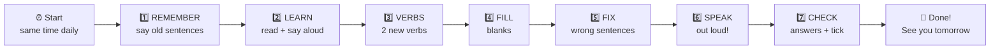

### Golden rules
1. **Speak OUT LOUD.** Reading silently is not enough. The mouth must practice, too.
2. **Mistakes are good.** Every mistake is your brain learning.
3. **Cover the answers first.** Try before you look.
4. **Do not skip the Remember step.** That is the secret to never forgetting.
5. **Record yourself** on your phone on speaking days. Your voice is the best teacher.
6. **If you miss a day,** do NOT start again. Just continue with the next day, and do the missed day later.

---

## The Secret of Remembering: Spaced Repetition

### Why do we forget?
Our brain forgets new things very fast, like a sandcastle near the waves. But when we **meet the same thing again just before we forget it**, the brain says, "Oh! This is important!" and keeps it much longer.

### The plan we use
Every lesson comes back to you again after **1 day, 3 days, 7 days, 14 days and 30 days**. This is called **spaced repetition**.

| You learn on | You see it again on |
|---|---|
| Day 1 | Day 2, Day 4, Day 8, Day 15, Day 31 |
| Day 10 | Day 11, Day 13, Day 17, Day 24, Day 40 |
| Day 20 | Day 21, Day 23, Day 27, Day 34, Day 50 |

You do not need to count. **Every day, step 1 ("Remember") tells you exactly what to review.** Cover the sentences, say them from memory, then check.

### How to do the "Remember" step (active recall)
1. Read only the **title** of the old day.
2. Try to say the old sentences **from memory**.
3. Uncover the sentences and check. Did you get them right?
4. If you forgot, say the sentence **3 times** and put a small star next to that day. Star days come back in your weekly review.


**🗺️ Flow Chart: Spaced Repetition: Meet it again before you forget**

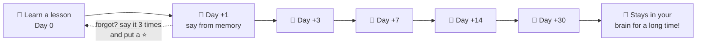

### Also: "Weekly check-up" days
Days **7, 14, 21, 28, 35, 42, 49** are check-up days. You test yourself on the whole week.

---

## Quick Words Used in This Book

| Word | Easy meaning | Example |
|---|---|---|
| **Subject** | WHO or WHAT the sentence is about | **Ravi** eats. |
| **Verb** | The DOING or BEING word | Ravi **eats**. |
| **V1** | The plain verb (today form) | eat |
| **V2** | The past form (yesterday form) | ate |
| **V3** | The "have" form (past participle) | eaten |
| **V-ing** | The verb with ing | eating |
| **Singular** | ONE | one boy |
| **Plural** | MANY | many boys |
| **Tense** | The TIME of the action (past, now, future) | ate / eat / will eat |
| **Helper verb** | A small verb that helps the main verb | do, does, did, will, have, has, had, am, is, are, was, were |

### The one-page Tense Map (keep this in front of you all 50 days)

| | **Past** | **Present** | **Future** |
|---|---|---|---|
| **Simple** | V2 / did + V1 | V1 (+s/es) / do, does + V1 | will + V1 |
| **Continuous** | was/were + V-ing | am/is/are + V-ing | will be + V-ing |
| **Perfect** | had + V3 | have/has + V3 | will have + V3 |
| **Perfect Continuous** | had been + V-ing | have/has been + V-ing + for/since | will have been + V-ing + for/since |

**Subject helper:** he/she/it = ONE. I/we/you/they = other group.

*(From your PDF: I have been working for IBM for 5 years / since 2019.)*


**🗺️ Picture: The Timeline of All Tenses**

```
 PAST  ◄──────────────────────── NOW ────────────────────────►  FUTURE
   │                               │                               │
   │ had + V3                      │ have/has + V3                 │ will have + V3
   │ (earlier past)                │ (done, matters now)           │ (done by then)
   │                               │                               │
   │ V2 / did                      │ V1 (+s/es)                    │ will + V1
   │ (finished)                    │ (habit, fact)                 │ (later)
   │                               │                               │
   │ was/were + ing                │ am/is/are + ing               │ will be + ing
   │ (in progress then)            │ (happening now)               │ (in progress then)
   │                               │                               │
   │ had been + ing                │ have/has been + ing           │ will have been + ing
   │ (long, before then)           │ (long, till now)              │ (long, by then)
```

**🗺️ Flow Chart: The Great Tense Chooser**

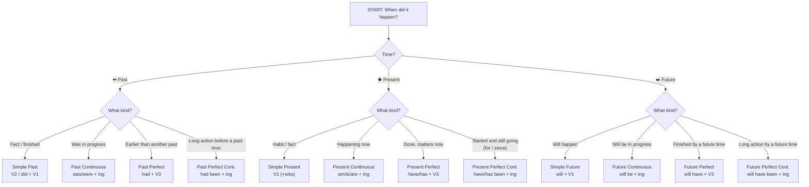

### Which tenses do I use most?
In real life you will use these **6 tenses 90% of the time**:
1. Simple Present, 2. Present Continuous, 3. Present Perfect, 4. Simple Past, 5. Past Continuous, 6. Simple Future.
The other six are good bonuses. Learn them all anyway. They make you sound smart.

---

## Your 50-Day Road Map

| Phase | Days | Focus |
|---|---|---|
| Week 1 — Build the Base | 1–7 | Sentences, am/is/are, Simple Present, matching subject and verb |
| Week 2 — Now and Before | 8–14 | Present Continuous, Simple Past, Past Continuous |
| Week 3 — Future and Perfect | 15–21 | Future, Present Perfect, Past Perfect, V3 |
| Week 4 — Long Actions and Groups | 22–28 | Perfect Continuous tenses, Future Perfect, everyone/team words |
| Week 5 — Tricky Agreement and First Speaking | 29–35 | Phrases in the middle, There is/are, money/time, were |
| Week 6 — Real-Life Speaking | 36–42 | Plans, work updates, meetings, negatives, questions, stories |
| Week 7 — Polish and Shine | 43–50 | For/since, opinions, tense detective, speeches, mistakes, final test |

| Day | Topic |
|---|---|
| 1 | The Two Boss Words: Who and Does-What |
| 2 | Am, Is, Are: The Being Words |
| 3 | Simple Present: Things I Do Again and Again |
| 4 | Simple Present: No and Question (Do / Does) |
| 5 | One or Many? Subject and Verb Must Match |
| 6 | AND, OR, NOR: Joining Two Subjects |
| 7 | Week 1 Check-Up Day (Review Day) |
| 8 | Present Continuous: Happening Right Now |
| 9 | Simple Present vs Present Continuous |
| 10 | Simple Past: Finished Things (Regular Verbs) |
| 11 | Simple Past: Irregular Verbs (The Rule Breakers) |
| 12 | Simple Past: No and Question (Did) |
| 13 | Past Continuous: What Was Going On |
| 14 | Week 2 Check-Up Day (Review Day) |
| 15 | Simple Future: What I Will Do |
| 16 | Future Continuous: Will Be Doing |
| 17 | Present Perfect: Done, and It Matters Now |
| 18 | Present Perfect vs Simple Past |
| 19 | V3 Workout: Past Participle Power |
| 20 | Past Perfect: The Earlier Past |
| 21 | Week 3 Check-Up Day (Review Day) |
| 22 | Present Perfect Continuous: For and Since |
| 23 | Past Perfect Continuous: How Long Before |
| 24 | Future Perfect: Finished by Then |
| 25 | Future Perfect Continuous: Will Have Been Doing |
| 26 | Everyone, Someone, Each: Singular Words in Disguise |
| 27 | Group Words: Team, Family, Class, Committee |
| 28 | Week 4 Check-Up Day (Review Day) |
| 29 | Ignore the Middle Part: Phrases Between Subject and Verb |
| 30 | Tricky Cases 1: There Is / There Are, Here Is / Here Are |
| 31 | Tricky Cases 2: Money, Distance, Time, Percent and 'A Lot Of' |
| 32 | Tricky Cases 3: Wishes, 'Were', 'Every', Requests |
| 33 | Speaking Day: Talk About Yourself (Simple Present + Is/Am/Are) |
| 34 | Speaking Day: Tell About Your Day (Simple Past + Past Continuous) |
| 35 | Week 5 Check-Up Day (Review Day) |
| 36 | Speaking Day: My Plans (Future, Going To, Will Be Doing) |
| 37 | Speaking Day: Work Updates (Present Perfect + Present Continuous) |
| 38 | Speaking Day: Meetings (Mix All Tenses) |
| 39 | Saying NO in Every Tense |
| 40 | Asking Questions in Every Tense |
| 41 | Speaking Day: Telling a Story (Past + Past Perfect) |
| 42 | Week 6 Check-Up Day (Review Day) |
| 43 | Talking About Progress: For, Since, Ago, Already, Yet, Just |
| 44 | Giving Opinions, Advice and Polite Requests |
| 45 | Which Tense Should I Use? (Mixed Decision Game) |
| 46 | Mini Speech 1: 'My Best Day' (1 Minute) |
| 47 | Mini Speech 2: 'My Work / My Dream' (1 Minute) |
| 48 | Mistake Hunter Day |
| 49 | Final Grand Test (Review Day) |
| 50 | Celebration Day: Your Final Speech and What Next |

---


# Week 1 — Build the Base
*Sentences, am/is/are, Simple Present, matching subject and verb*


## Day 1: The Two Boss Words: Who and Does-What

**Time: 30–40 minutes**

### Step 1: Remember (Spaced Review, 5 minutes)

Nothing to review today. This is Day 1! From tomorrow, this step will bring back old lessons.

### Step 2: Learn

Every sentence has two boss words.

1. **Subject** = WHO (or WHAT) the sentence is about. (a person, animal, or thing)
2. **Verb** = the DOING word (or "being" word). It tells what the subject does.

Think of a sentence like a train. The **subject** is the engine. The **verb** is the first coach. Without both, the train cannot move.

| Subject (WHO) | Verb (DOES WHAT) | Rest of sentence |
|---|---|---|
| I | eat | an apple. |
| The dog | runs | in the park. |
| My mother | cooks | rice. |
| The kids | play | cricket. |
| Rahul | reads | a book. |
| The sun | shines | in the morning. |

**The 7 small subject words (pronouns).** You will use them every day:

| Word | Means | Group |
|---|---|---|
| I | me | alone |
| you | the person I talk to | alone or many |
| he | one boy / man | one |
| she | one girl / woman | one |
| it | one thing / animal | one |
| we | me and others | many |
| they | other people / things | many |

**Big secret for later:** *he, she, it* are a special group. Verbs change a little for them. We will learn this tomorrow and the day after. Today, just find the subject and the verb.

**Many examples. Read each one aloud:**

1. I **drink** water.
2. You **speak** well.
3. He **plays** football.
4. She **sings** a song.
5. It **barks** loudly.
6. We **walk** to school.
7. They **watch** TV.
8. My father **drives** a car.
9. The teacher **writes** on the board.
10. The birds **fly** in the sky.
11. Priya **draws** pictures.
12. The baby **sleeps** at night.

**🗺️ Flow Chart: Building a Sentence (like a train)**

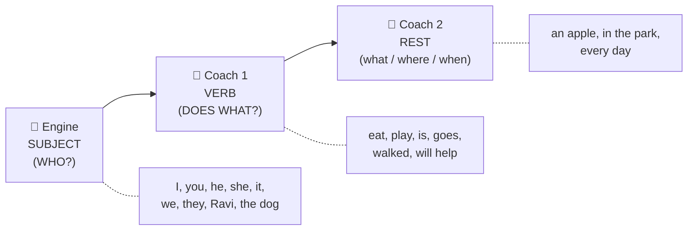

**Say it aloud, 3 times each (this is your daily drill):**

1. I drink water.
2. She sings a song.
3. We walk to school.
4. The birds fly in the sky.
5. My father drives a car.

### Step 3: Verbs of the Day

| V1 (today) | V1 + s (he/she/it) | V2 (yesterday) | V3 (have/has/had) |
|---|---|---|---|
| **add** | adds | added | added |
| **allow** | allows | allowed | allowed |

Say these sentences aloud:

- **add:**
  - I add sugar to the tea. (She adds sugar to the tea.)
  - Yesterday, I added sugar to the tea.
  - I have added sugar to the tea.
- **allow:**
  - I allow the kids to play outside. (She allows the kids to play outside.)
  - Yesterday, I allowed the kids to play outside.
  - I have allowed the kids to play outside.

### Step 4: Fill in the Blanks

1. In 'The dog runs fast', the subject is ______.
2. In 'The dog runs fast', the verb is ______.
3. In 'We eat lunch', the subject is ______.
4. In 'Mona reads a book', the verb is ______.
5. In 'They play cricket', the subject is ______ and the verb is ______.

### Step 5: Fix the Mistake

1. ❌ Runs fast the dog.   ➜   ✅ ______________________
2. ❌ Reads a book Mona.   ➜   ✅ ______________________

### Step 6: Speak Out Loud

1. Say 5 things YOU do every day. Start each with 'I'. (Example: I brush my teeth.)
2. Look around you. Say 3 sentences about people near you. Start with 'He' or 'She'.
3. Say 3 sentences about your family. (Example: My mother cooks food.)

### Step 7: Check Answers

<details>
<summary>Click or scroll to see the answers (try first!)</summary>

**Fill in the blanks:**

1. **The dog**
2. **runs**
3. **We**
4. **reads**
5. **They / play**

**Fix the mistake:**

1. ✅ **The dog runs fast.**
2. ✅ **Mona reads a book.**

</details>

**Tracker:** ☐ Remember  ☐ Learn  ☐ Verbs  ☐ Fill  ☐ Fix  ☐ Speak  ☐ Check   |  Score: ___ / 7


---


## Day 2: Am, Is, Are: The Being Words

**Time: 30–40 minutes**

### Step 1: Remember (Spaced Review, 5 minutes)

Cover the sentences. Say them from memory. Then check.

**Day 1 — The Two Boss Words: Who and Does-What** *(learned yesterday)*

- I drink water.
- She sings a song.
- We walk to school.
- The birds fly in the sky.
- My father drives a car.

### Step 2: Learn

Some verbs do not show an action. They show **what someone IS** (or where, or how).
The three being words for now are **am, is, are**.

**Which one do I use? Match it with the subject:**

| Subject | Use | Example |
|---|---|---|
| I | **am** | I **am** happy. |
| he / she / it | **is** | She **is** tall. |
| you / we / they | **are** | They **are** my friends. |
| one person or thing | **is** | The book **is** red. |
| many people or things | **are** | The books **are** red. |

**Short forms (we use these when we speak):**
I am = **I'm**, he is = **he's**, she is = **she's**, it is = **it's**, we are = **we're**, you are = **you're**, they are = **they're**.

**Many examples:**

1. I **am** a student.
2. I **am** hungry.
3. You **are** kind.
4. He **is** my brother.
5. She **is** at home.
6. It **is** a big city.
7. We **are** ready.
8. They **are** in the garden.
9. The sky **is** blue.
10. The mangoes **are** sweet.
11. My shoes **are** new.
12. Delhi **is** a big city.
13. Asha and Ravi **are** twins.
14. I'm tired. She's happy. They're late.

**Making it a "no":** put **not** after it. I am **not**, he is **not** (isn't), they are **not** (aren't).
- I am **not** sad.
- He **isn't** angry.
- We **aren't** late.

**Making it a question:** flip the order.
- You are ready. ➜ **Are you** ready?
- She is here. ➜ **Is she** here?

**🗺️ Flow Chart: Which one: am, is or are?**

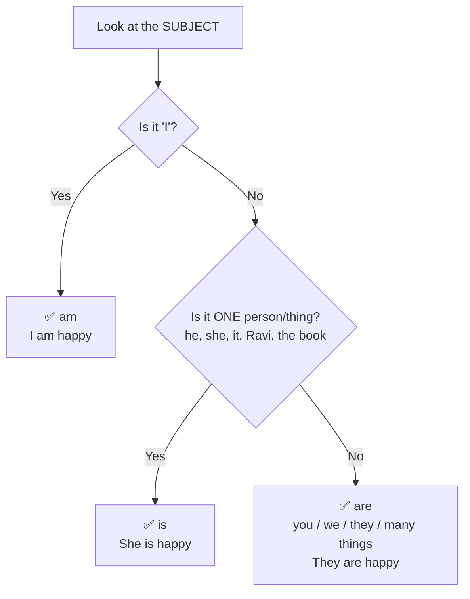

**Say it aloud, 3 times each (this is your daily drill):**

1. I am happy.
2. She is at home.
3. They are my friends.
4. The mangoes are sweet.
5. Is he ready?

### Step 3: Verbs of the Day

| V1 (today) | V1 + s (he/she/it) | V2 (yesterday) | V3 (have/has/had) |
|---|---|---|---|
| **appear** | appears | appeared | appeared |
| **ask** | asks | asked | asked |

Say these sentences aloud:

- **appear:**
  - A star appears in the sky.
  - Yesterday, a star appeared in the sky.
  - A star has appeared in the sky.
- **ask:**
  - I ask a question. (She asks a question.)
  - Yesterday, I asked a question.
  - I have asked a question.

### Step 4: Fill in the Blanks

1. I ____ a student.
2. She ____ very kind.
3. They ____ in the park.
4. The flowers ____ beautiful.
5. ____ you ready? (question)

### Step 5: Fix the Mistake

1. ❌ He are my friend.   ➜   ✅ ______________________
2. ❌ We is happy.   ➜   ✅ ______________________

### Step 6: Speak Out Loud

1. Say 5 sentences about yourself with 'I am'. (I am tall. I am from ... )
2. Describe 3 things on your table with 'It is' or 'They are'.
3. Say 3 'no' sentences. (I am not sleepy.)

### Step 7: Check Answers

<details>
<summary>Click or scroll to see the answers (try first!)</summary>

**Fill in the blanks:**

1. **am**
2. **is**
3. **are**
4. **are**
5. **Are**

**Fix the mistake:**

1. ✅ **He is my friend.**
2. ✅ **We are happy.**

</details>

**Tracker:** ☐ Remember  ☐ Learn  ☐ Verbs  ☐ Fill  ☐ Fix  ☐ Speak  ☐ Check   |  Score: ___ / 7


---


## Day 3: Simple Present: Things I Do Again and Again

**Time: 30–40 minutes**

### Step 1: Remember (Spaced Review, 5 minutes)

Cover the sentences. Say them from memory. Then check.

**Day 2 — Am, Is, Are: The Being Words** *(learned yesterday)*

- I am happy.
- She is at home.
- They are my friends.
- The mangoes are sweet.
- Is he ready?

### Step 2: Learn

**Simple Present** is for things that happen **again and again** (habits), and for **facts that are always true**.

**Magic words:** every day, always, usually, often, sometimes, never, on Mondays.

**The Rule (very important!)**

- For **I, you, we, they** ➜ use the plain verb. (V1)
  - I **play**. You **play**. We **play**. They **play**.
- For **he, she, it** (ONE person/thing) ➜ add **-s** or **-es**.
  - He **plays**. She **plays**. It **plays**.

**How to add -s / -es:**

| Verb ends in | What to do | Example |
|---|---|---|
| most words | add **s** | work ➜ works, read ➜ reads |
| s, sh, ch, x, o | add **es** | watch ➜ watches, go ➜ goes, wash ➜ washes |
| consonant + y | change y to **ies** | study ➜ studies, try ➜ tries |
| vowel + y | just add **s** | play ➜ plays |
| have | becomes **has** | She has a pen. |

**Easy trick:** *One person gets the "s". Many people get no "s".*
(Careful: nouns work the other way. One book, two book**s**. Verb gets "s" when the subject is ONE.)

**Many examples:**

1. I **wake** up at 6 o'clock.
2. You **brush** your teeth.
3. He **eats** breakfast at 8.
4. She **goes** to school by bus.
5. It **rains** a lot in July.
6. We **play** in the evening.
7. They **live** in Mumbai.
8. My sister **studies** at night.
9. The teacher **teaches** English.
10. Water **boils** at 100 degrees. (a fact)
11. The sun **rises** in the east. (a fact)
12. Ravi always **watches** cartoons.
13. My dog usually **sleeps** under the table.
14. Our team often **wins**.

**🗺️ Flow Chart: Simple Present: Do I add -s?**

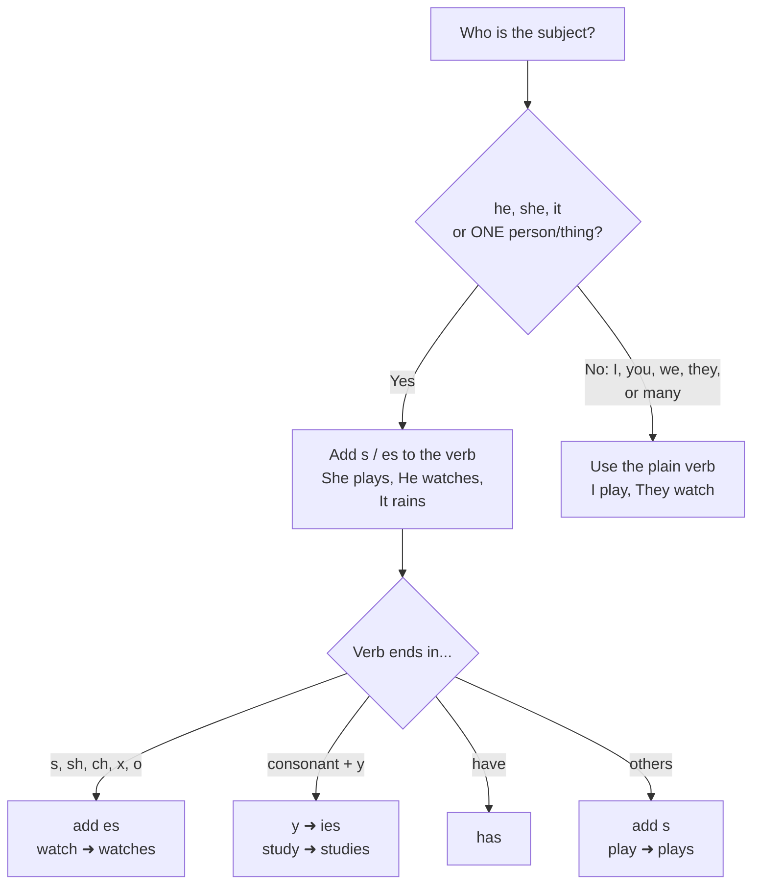

**Say it aloud, 3 times each (this is your daily drill):**

1. I wake up at six.
2. She goes to school by bus.
3. The sun rises in the east.
4. My sister studies at night.
5. They live in Mumbai.

### Step 3: Verbs of the Day

| V1 (today) | V1 + s (he/she/it) | V2 (yesterday) | V3 (have/has/had) |
|---|---|---|---|
| **be** | is | was/were | been |
| **become** | becomes | became | become |

Say these sentences aloud:

- **be:**
  - I am happy. / She is happy. / They are happy.
  - Yesterday I was happy. Yesterday they were happy.
  - I have been happy all week.
- **become:**
  - I become tired. (She becomes tired.)
  - Yesterday, I became tired.
  - I have become tired.

### Step 4: Fill in the Blanks

1. She ____ (play) cricket every day.
2. They ____ (go) to the park on Sundays.
3. He ____ (watch) TV at night.
4. My mother ____ (cook) delicious food.
5. The baby ____ (cry) a lot. (careful: y!)

### Step 5: Fix the Mistake

1. ❌ She go to school.   ➜   ✅ ______________________
2. ❌ My brother play football.   ➜   ✅ ______________________

### Step 6: Speak Out Loud

1. Tell me your morning in 6 sentences. Use 'I' and words like first, then, after that.
2. Tell about one family member's daily routine using 'he' or 'she'. (My father wakes up at 5...)
3. Say 3 facts you know. (The moon goes around the earth.)

### Step 7: Check Answers

<details>
<summary>Click or scroll to see the answers (try first!)</summary>

**Fill in the blanks:**

1. **plays**
2. **go**
3. **watches**
4. **cooks**
5. **cries**

**Fix the mistake:**

1. ✅ **She goes to school.**
2. ✅ **My brother plays football.**

</details>

**Tracker:** ☐ Remember  ☐ Learn  ☐ Verbs  ☐ Fill  ☐ Fix  ☐ Speak  ☐ Check   |  Score: ___ / 7


---


## Day 4: Simple Present: No and Question (Do / Does)

**Time: 30–40 minutes**

### Step 1: Remember (Spaced Review, 5 minutes)

Cover the sentences. Say them from memory. Then check.

**Day 3 — Simple Present: Things I Do Again and Again** *(learned yesterday)*

- I wake up at six.
- She goes to school by bus.
- The sun rises in the east.
- My sister studies at night.
- They live in Mumbai.

**Day 1 — The Two Boss Words: Who and Does-What** *(learned 3 days ago)*

- I drink water.
- She sings a song.
- We walk to school.
- The birds fly in the sky.
- My father drives a car.

### Step 2: Learn

To say **NO** or to **ASK** in Simple Present, we need a helper: **do** or **does**.

**The big secret:** when **does** comes, the "s" jumps to **does** and leaves the verb. The verb goes back to plain.

| | Helper | Verb |
|---|---|---|
| I / you / we / they | **do not (don't)** | plain verb |
| he / she / it | **does not (doesn't)** | plain verb |

- She plays. ➜ She **doesn't play**. (NOT "doesn't plays")
- They play. ➜ They **don't play**.

**Questions:** put **Do / Does** first.
- **Do** you like tea? ➜ Yes, I **do**. / No, I **don't**.
- **Does** she like tea? ➜ Yes, she **does**. / No, she **doesn't**.

**Question words go in front:** What, Where, When, Why, How.
- **Where do** you live?
- **What does** he eat?
- **Why do** they run?

**Many examples:**

1. I **don't** like spicy food.
2. You **don't** speak loudly.
3. We **don't** have school on Sunday.
4. They **don't** watch horror films.
5. He **doesn't** eat meat.
6. She **doesn't** wake up late.
7. It **doesn't** work.
8. My dad **doesn't** drink coffee.
9. **Do** you play chess?
10. **Do** they know the answer?
11. **Does** he live near here?
12. **Does** your mother cook rice every day?
13. What **do** you want?
14. Where **does** she study?

**🗺️ Flow Chart: No or Question? Pick the helper, then use the PLAIN verb**

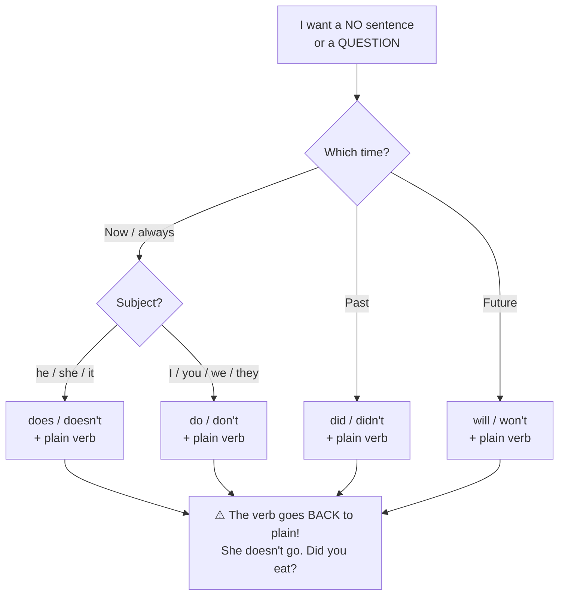

**Say it aloud, 3 times each (this is your daily drill):**

1. I don't like spicy food.
2. She doesn't wake up late.
3. Do you play chess?
4. Does he live near here?
5. Where does she study?

### Step 3: Verbs of the Day

| V1 (today) | V1 + s (he/she/it) | V2 (yesterday) | V3 (have/has/had) |
|---|---|---|---|
| **begin** | begins | began | begun |
| **believe** | believes | believed | believed |

Say these sentences aloud:

- **begin:**
  - I begin the class. (She begins the class.)
  - Yesterday, I began the class.
  - I have begun the class.
- **believe:**
  - I believe in myself. (She believes in herself.)
  - Yesterday, I believed in myself.
  - I have believed in myself.

### Step 4: Fill in the Blanks

1. She ____ like onions. (no)
2. They ____ play on weekdays. (no)
3. ____ you like pizza?
4. ____ he speak English?
5. Where ____ your father work?

### Step 5: Fix the Mistake

1. ❌ He doesn't likes milk.   ➜   ✅ ______________________
2. ❌ Does she plays tennis?   ➜   ✅ ______________________

### Step 6: Speak Out Loud

1. Say 4 things you DON'T do on Sunday morning.
2. Ask a friend (or the mirror) 5 questions starting with Do or Does.
3. Say 3 things your best friend doesn't like.

### Step 7: Check Answers

<details>
<summary>Click or scroll to see the answers (try first!)</summary>

**Fill in the blanks:**

1. **doesn't**
2. **don't**
3. **Do**
4. **Does**
5. **does**

**Fix the mistake:**

1. ✅ **He doesn't like milk.**
2. ✅ **Does she play tennis?**

</details>

**Tracker:** ☐ Remember  ☐ Learn  ☐ Verbs  ☐ Fill  ☐ Fix  ☐ Speak  ☐ Check   |  Score: ___ / 7


---


## Day 5: One or Many? Subject and Verb Must Match

**Time: 30–40 minutes**

### Step 1: Remember (Spaced Review, 5 minutes)

Cover the sentences. Say them from memory. Then check.

**Day 4 — Simple Present: No and Question (Do / Does)** *(learned yesterday)*

- I don't like spicy food.
- She doesn't wake up late.
- Do you play chess?
- Does he live near here?
- Where does she study?

**Day 2 — Am, Is, Are: The Being Words** *(learned 3 days ago)*

- I am happy.
- She is at home.
- They are my friends.
- The mangoes are sweet.
- Is he ready?

### Step 2: Learn

This is the most important rule in spoken English:

> **ONE subject ➜ ONE verb form.   MANY subjects ➜ MANY verb form.**

This is called **Subject-Verb Agreement**. It means the subject and the verb are **friends who agree**.

| Subject | Verb (be) | Verb (do something) |
|---|---|---|
| One: The manager | **is** | **completes** |
| Many: The managers | **are** | **complete** |

**Examples (copy these from real office talk):**

1. Vishnu always **completes** his reports on time. (one person)
2. The manager **is** in a meeting. (one person)
3. Sarah and Nancy **lead** the marketing team. (two people)
4. The children **are** playing. (many)
5. The child **is** playing. (one)
6. My friend **likes** music. (one)
7. My friends **like** music. (many)
8. The dog **barks**. The dogs **bark**.
9. A bird **sings**. Birds **sing**.
10. This book **is** old. These books **are** old.

**How to check quickly (3 steps):**

1. Find the **verb**.
2. Ask: **WHO or WHAT** does it? That is the subject.
3. Is it **one** or **many**? Pick the matching verb.

**🗺️ Flow Chart: Subject-Verb Agreement: The Master Flow**

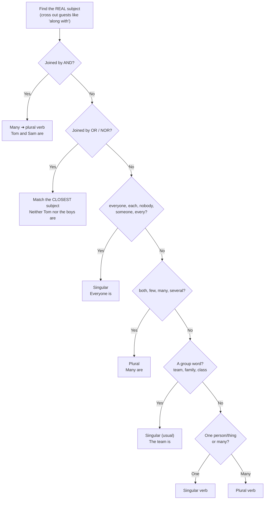

**Say it aloud, 3 times each (this is your daily drill):**

1. The manager is in a meeting.
2. Sarah and Nancy lead the team.
3. The dog barks. The dogs bark.
4. My friend likes music.
5. My friends like music.

### Step 3: Verbs of the Day

| V1 (today) | V1 + s (he/she/it) | V2 (yesterday) | V3 (have/has/had) |
|---|---|---|---|
| **bring** | brings | brought | brought |
| **build** | builds | built | built |

Say these sentences aloud:

- **bring:**
  - I bring my bag. (She brings her bag.)
  - Yesterday, I brought my bag.
  - I have brought my bag.
- **build:**
  - I build a sandcastle. (She builds a sandcastle.)
  - Yesterday, I built a sandcastle.
  - I have built a sandcastle.

### Step 4: Fill in the Blanks

1. The boy ____ (run) fast.
2. The boys ____ (run) fast.
3. My teacher ____ (be) kind.
4. My teachers ____ (be) kind.
5. A bird ____ (sing) sweetly.

### Step 5: Fix the Mistake

1. ❌ The girls plays outside.   ➜   ✅ ______________________
2. ❌ The manager are busy.   ➜   ✅ ______________________

### Step 6: Speak Out Loud

1. Say 4 pairs: one thing, then many things. (The cat sleeps. The cats sleep.)
2. Describe your classmates / colleagues: 'My colleague ... My colleagues ...' (3 pairs)
3. Say 3 sentences about people at your office with 'is' and 'are'.

### Step 7: Check Answers

<details>
<summary>Click or scroll to see the answers (try first!)</summary>

**Fill in the blanks:**

1. **runs**
2. **run**
3. **is**
4. **are**
5. **sings**

**Fix the mistake:**

1. ✅ **The girls play outside.**
2. ✅ **The manager is busy.**

</details>

**Tracker:** ☐ Remember  ☐ Learn  ☐ Verbs  ☐ Fill  ☐ Fix  ☐ Speak  ☐ Check   |  Score: ___ / 7


---


## Day 6: AND, OR, NOR: Joining Two Subjects

**Time: 30–40 minutes**

### Step 1: Remember (Spaced Review, 5 minutes)

Cover the sentences. Say them from memory. Then check.

**Day 5 — One or Many? Subject and Verb Must Match** *(learned yesterday)*

- The manager is in a meeting.
- Sarah and Nancy lead the team.
- The dog barks. The dogs bark.
- My friend likes music.
- My friends like music.

**Day 3 — Simple Present: Things I Do Again and Again** *(learned 3 days ago)*

- I wake up at six.
- She goes to school by bus.
- The sun rises in the east.
- My sister studies at night.
- They live in Mumbai.

### Step 2: Learn

**Rule 1: AND = adds up = MANY = plural verb.**

- Vishnu **and** Irfan **attend** the weekly meetings.
- Jenny **and** Mark **are** attending the conference.
- Tea **and** coffee **are** hot.

**Rule 2: OR / NOR = choice. The verb agrees with the subject that is CLOSER to it.**

Think: *the verb is shy; it stands near the nearest friend.*

- Neither the manager **nor the team** **is** available. (closest = team = one group, so "is")
- Either the client **or the marketing department** **is** responsible. (closest = department, one, so "is")
- Either the teacher **or the students** **are** coming. (closest = students = many, so "are")
- Either the students **or the teacher** **is** coming. (closest = teacher = one, so "is")

**More examples:**

1. Mom **and** Dad **are** at home.
2. My brother **and** my sister **go** to the same school.
3. Rice **or** noodles **are** fine. (closest = noodles = many, so "are")
4. Neither he **nor** I **am** ready. (closest = I = "am")
5. Neither Ria **nor** her friends **are** late.
6. Either Tom **or** Sam **has** the key.
7. A pen **and** a pencil **are** on the table.
8. The cat **and** the dog **play** together.
9. Either you **or** I **am** wrong.
10. Neither the boys **nor** the girl **is** here.

**🗺️ Flow Chart: AND vs OR / NOR**

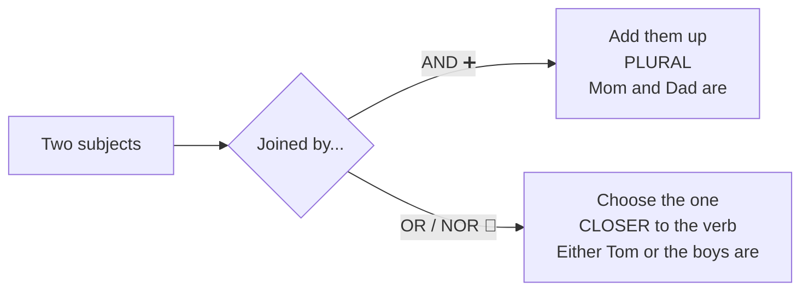

**Say it aloud, 3 times each (this is your daily drill):**

1. Vishnu and Irfan attend the meetings.
2. Neither the manager nor the team is available.
3. Either the teacher or the students are coming.
4. Mom and Dad are at home.
5. Neither he nor I am ready.

### Step 3: Verbs of the Day

| V1 (today) | V1 + s (he/she/it) | V2 (yesterday) | V3 (have/has/had) |
|---|---|---|---|
| **buy** | buys | bought | bought |
| **call** | calls | called | called |

Say these sentences aloud:

- **buy:**
  - I buy fresh fruit. (She buys fresh fruit.)
  - Yesterday, I bought fresh fruit.
  - I have bought fresh fruit.
- **call:**
  - I call my friend. (She calls her friend.)
  - Yesterday, I called my friend.
  - I have called my friend.

### Step 4: Fill in the Blanks

1. Raj and Meena ____ (be) friends.
2. Neither Raj nor Meena ____ (be) late.
3. Either the boys or the girl ____ (have) the ball. (closest = girl)
4. Tea and biscuits ____ (be) ready.
5. Neither the cooks nor the waiter ____ (know) the answer.

### Step 5: Fix the Mistake

1. ❌ Tom and Sam is brothers.   ➜   ✅ ______________________
2. ❌ Neither the teacher nor the students is here.   ➜   ✅ ______________________

### Step 6: Speak Out Loud

1. Say 4 sentences with 'and': (Papa and I go to the market.)
2. Say 3 sentences with 'either ... or'.
3. Say 3 sentences with 'neither ... nor'.

### Step 7: Check Answers

<details>
<summary>Click or scroll to see the answers (try first!)</summary>

**Fill in the blanks:**

1. **are**
2. **is**
3. **has**
4. **are**
5. **knows**

**Fix the mistake:**

1. ✅ **Tom and Sam are brothers.**
2. ✅ **Neither the teacher nor the students are here.**

</details>

**Tracker:** ☐ Remember  ☐ Learn  ☐ Verbs  ☐ Fill  ☐ Fix  ☐ Speak  ☐ Check   |  Score: ___ / 7


---


## Day 7: Week 1 Check-Up Day (Review Day)

**Time: 30–40 minutes**

### Step 1: Remember (Spaced Review, 5 minutes)

Cover the sentences. Say them from memory. Then check.

**Day 6 — AND, OR, NOR: Joining Two Subjects** *(learned yesterday)*

- Vishnu and Irfan attend the meetings.
- Neither the manager nor the team is available.
- Either the teacher or the students are coming.
- Mom and Dad are at home.
- Neither he nor I am ready.

**Day 4 — Simple Present: No and Question (Do / Does)** *(learned 3 days ago)*

- I don't like spicy food.
- She doesn't wake up late.
- Do you play chess?
- Does he live near here?
- Where does she study?

### Step 2: Learn

Today we do not learn anything new. Today we make the brain **stronger**.

**Your jobs today:**

1. Read the **Week 1 Cheat Sheet** below one time.
2. Do the **Mixed Test** (no peeking).
3. Check answers. Circle your mistakes.
4. Say each corrected sentence **3 times**.

**Week 1 Cheat Sheet**

| Topic | Remember |
|---|---|
| Subject / verb | Subject = WHO. Verb = DOES WHAT. |
| am / is / are | I **am**; he/she/it **is**; you/we/they **are** |
| Simple Present | he/she/it + **s/es**; others plain |
| No / question | **don't / doesn't / do / does** + plain verb |
| Agreement | One = one form; many = many form |
| and | plural |
| or / nor | agree with closest |

**🗺️ Flow Chart: Spaced Repetition: Meet it again before you forget**


**Say it aloud, 3 times each (this is your daily drill):**

1. I am happy.
2. He goes to school.
3. She doesn't like onions.
4. Do you play chess?
5. Neither he nor I am ready.

### Step 3: Verbs of the Day

| V1 (today) | V1 + s (he/she/it) | V2 (yesterday) | V3 (have/has/had) |
|---|---|---|---|
| **change** | changes | changed | changed |
| **come** | comes | came | come |

Say these sentences aloud:

- **change:**
  - I change my shirt. (She changes her shirt.)
  - Yesterday, I changed my shirt.
  - I have changed my shirt.
- **come:**
  - I come home early. (She comes home early.)
  - Yesterday, I came home early.
  - I have come home early.

### Step 4: Fill in the Blanks

1. He ____ (like) mangoes.
2. They ____ (not, like) mangoes.
3. ____ she ____ (live) here? (Does/live)
4. Neither Ria nor her brothers ____ (be) here.
5. My friend and I ____ (play) every day.
6. I ____ (be) 10 minutes late.
7. The cat ____ (sleep) on the sofa.
8. The cats ____ (sleep) on the sofa.

### Step 5: Fix the Mistake

1. ❌ She don't likes tea.   ➜   ✅ ______________________
2. ❌ Raj and Meena is going.   ➜   ✅ ______________________
3. ❌ Does he plays football?   ➜   ✅ ______________________

### Step 6: Speak Out Loud

1. Speak for 1 minute: 'My day.' Use at least 6 Simple Present sentences.
2. Speak for 30 seconds: 'My family.' Use is / are correctly.
3. Ask 5 questions with Do/Does, then answer them out loud.

### Step 7: Check Answers

<details>
<summary>Click or scroll to see the answers (try first!)</summary>

**Fill in the blanks:**

1. **likes**
2. **don't like**
3. **Does ... live**
4. **are**
5. **play**
6. **am**
7. **sleeps**
8. **sleep**

**Fix the mistake:**

1. ✅ **She doesn't like tea.**
2. ✅ **Raj and Meena are going.**
3. ✅ **Does he play football?**

</details>

**Tracker:** ☐ Remember  ☐ Learn  ☐ Verbs  ☐ Fill  ☐ Fix  ☐ Speak  ☐ Check   |  Score: ___ / 11


---


# Week 2 — Now and Before
*Present Continuous, Simple Past, Past Continuous*


## Day 8: Present Continuous: Happening Right Now

**Time: 30–40 minutes**

### Step 1: Remember (Spaced Review, 5 minutes)

Cover the sentences. Say them from memory. Then check.

**Day 7 — Week 1 Check-Up Day (Review Day)** *(learned yesterday)*

- I am happy.
- He goes to school.
- She doesn't like onions.
- Do you play chess?
- Neither he nor I am ready.

**Day 5 — One or Many? Subject and Verb Must Match** *(learned 3 days ago)*

- The manager is in a meeting.
- Sarah and Nancy lead the team.
- The dog barks. The dogs bark.
- My friend likes music.
- My friends like music.

**Day 1 — The Two Boss Words: Who and Does-What** *(learned 1 week ago)*

- I drink water.
- She sings a song.
- We walk to school.
- The birds fly in the sky.
- My father drives a car.

### Step 2: Learn

**Present Continuous** = something is happening **right now**, or **around these days** (temporary).

**Formula:** **am / is / are** + verb + **ing**

| Subject | Helper | Example |
|---|---|---|
| I | **am** | I **am eating**. |
| he / she / it | **is** | She **is dancing**. |
| you / we / they | **are** | They **are playing**. |

**Magic words:** now, right now, at the moment, today, these days, currently, look!, listen!

**How to add -ing:**

- Most verbs: just add ing. (play ➜ play**ing**, eat ➜ eat**ing**)
- Ends with silent **e**: drop e. (make ➜ mak**ing**, write ➜ writ**ing**)
- Short verb with one vowel + one consonant: double the last letter. (run ➜ run**ning**, sit ➜ sit**ting**, stop ➜ stop**ping**)

**Many examples:**

1. I **am reading** a story.
2. I **am sitting** in my chair.
3. You **are speaking** very well.
4. He **is running** in the park.
5. She **is making** tea.
6. It **is raining** now.
7. We **are waiting** for the bus.
8. They **are watching** a movie.
9. The teacher **is writing** on the board.
10. My mother **is cooking** dinner.
11. I **am working** on a new project this week. (temporary)
12. Prakash **is leading** the team these days.

**No:** I am **not** playing. She **isn't** sleeping. They **aren't** listening.
**Question:** **Are** you listening? **Is** he coming? What **are** you doing?

**🗺️ Flow Chart: Adding -ing: Which spelling?**

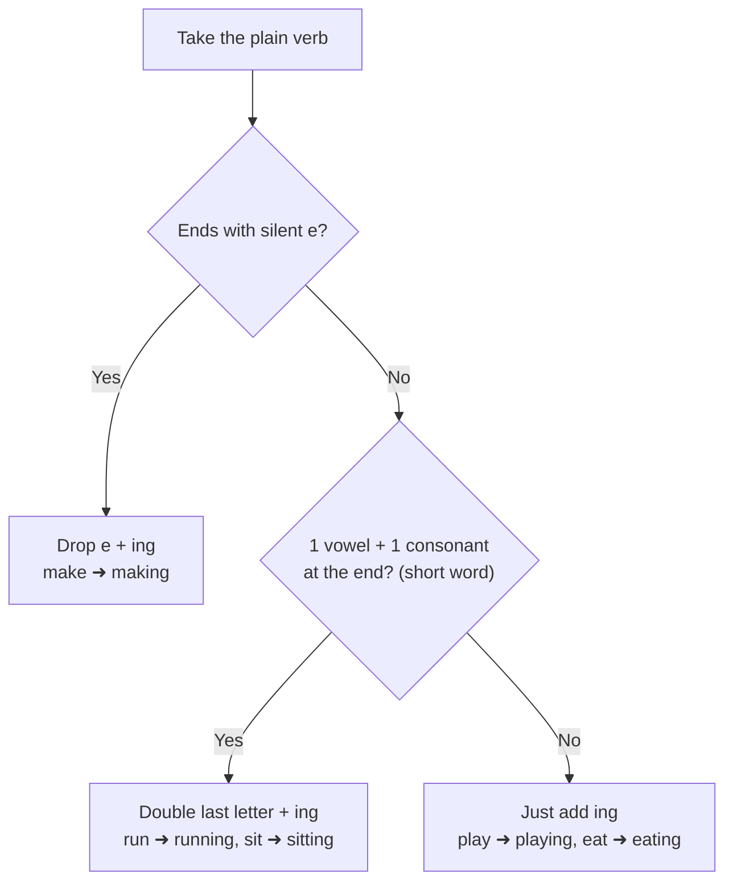

**Say it aloud, 3 times each (this is your daily drill):**

1. I am reading a story.
2. She is making tea.
3. They are watching a movie.
4. It is raining now.
5. What are you doing?

### Step 3: Verbs of the Day

| V1 (today) | V1 + s (he/she/it) | V2 (yesterday) | V3 (have/has/had) |
|---|---|---|---|
| **consider** | considers | considered | considered |
| **continue** | continues | continued | continued |

Say these sentences aloud:

- **consider:**
  - I consider the idea. (She considers the idea.)
  - Yesterday, I considered the idea.
  - I have considered the idea.
- **continue:**
  - I continue the work. (She continues the work.)
  - Yesterday, I continued the work.
  - I have continued the work.

### Step 4: Fill in the Blanks

1. I ____ (write) a letter now.
2. She ____ (run) in the park.
3. They ____ (not, sleep).
4. ____ you ____ (listen)?
5. What ____ he ____ (do)?

### Step 5: Fix the Mistake

1. ❌ She is play now.   ➜   ✅ ______________________
2. ❌ I am writting a note.   ➜   ✅ ______________________

### Step 6: Speak Out Loud

1. Look around. Say 6 things that are happening right now (near you or outside).
2. Pretend to be a TV reporter: 'The kids are running. The man is selling...'
3. Say 3 things you are doing these days (not always). (I am learning English.)

### Step 7: Check Answers

<details>
<summary>Click or scroll to see the answers (try first!)</summary>

**Fill in the blanks:**

1. **am writing**
2. **is running**
3. **aren't sleeping**
4. **Are ... listening**
5. **is ... doing**

**Fix the mistake:**

1. ✅ **She is playing now.**
2. ✅ **I am writing a note.**

</details>

**Tracker:** ☐ Remember  ☐ Learn  ☐ Verbs  ☐ Fill  ☐ Fix  ☐ Speak  ☐ Check   |  Score: ___ / 7


---


## Day 9: Simple Present vs Present Continuous

**Time: 30–40 minutes**

### Step 1: Remember (Spaced Review, 5 minutes)

Cover the sentences. Say them from memory. Then check.

**Day 8 — Present Continuous: Happening Right Now** *(learned yesterday)*

- I am reading a story.
- She is making tea.
- They are watching a movie.
- It is raining now.
- What are you doing?

**Day 6 — AND, OR, NOR: Joining Two Subjects** *(learned 3 days ago)*

- Vishnu and Irfan attend the meetings.
- Neither the manager nor the team is available.
- Either the teacher or the students are coming.
- Mom and Dad are at home.
- Neither he nor I am ready.

**Day 2 — Am, Is, Are: The Being Words** *(learned 1 week ago)*

- I am happy.
- She is at home.
- They are my friends.
- The mangoes are sweet.
- Is he ready?

### Step 2: Learn

Two tenses, two jobs.

| Simple Present | Present Continuous |
|---|---|
| Habit / always / fact | Right now / temporary |
| She **drinks** tea every morning. | She **is drinking** tea now. |
| I **work** at Paytm. | I **am working** from home this week. |
| Birds **fly**. | Look! The bird **is flying**. |

**Picture it:**
- Simple Present = a **photo album of your life** (what usually happens).
- Present Continuous = a **live video** (what is happening now).

**Some verbs do not like -ing** (they show feelings or thinking, not actions): **know, like, love, want, need, understand, believe, remember, hear, see (sometimes)**.
- ✅ I **know** the answer. ❌ I am knowing the answer.
- ✅ She **wants** water. ❌ She is wanting water.

**Many examples:**

1. He **plays** football on Sundays. Today he **is playing** chess.
2. I **speak** Hindi. Right now I **am speaking** English.
3. We **eat** lunch at one. We **are eating** lunch now.
4. It **rains** in July. It **is raining** today.
5. They **don't watch** TV. They **are reading**.
6. She **doesn't cook** every day. Today she **is cooking** biryani.
7. I **understand** this lesson. (not "am understanding")
8. Do you **like** this song? Yes, I **love** it.

**🗺️ Flow Chart: Now or Always? Simple Present vs Present Continuous**

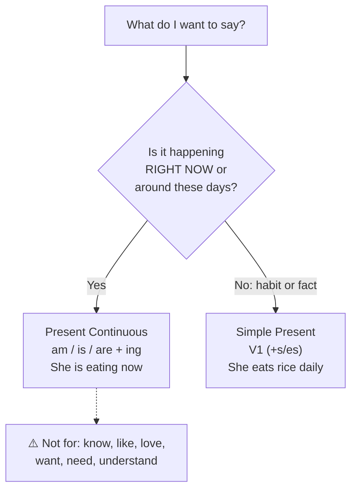

**Say it aloud, 3 times each (this is your daily drill):**

1. He plays football on Sundays.
2. Today he is playing chess.
3. I speak Hindi. Now I am speaking English.
4. She wants some water.
5. I understand this lesson.

### Step 3: Verbs of the Day

| V1 (today) | V1 + s (he/she/it) | V2 (yesterday) | V3 (have/has/had) |
|---|---|---|---|
| **create** | creates | created | created |
| **cut** | cuts | cut | cut |

Say these sentences aloud:

- **create:**
  - I create a drawing. (She creates a drawing.)
  - Yesterday, I created a drawing.
  - I have created a drawing.
- **cut:**
  - I cut the paper. (She cuts the paper.)
  - Yesterday, I cut the paper.
  - I have cut the paper.

### Step 4: Fill in the Blanks

1. She usually ____ (drink) tea, but today she ____ (drink) milk.
2. I ____ (know) the answer.
3. Look! The baby ____ (smile).
4. My father ____ (work) in a bank. (his job)
5. They ____ (build) a house these days.

### Step 5: Fix the Mistake

1. ❌ I am knowing him.   ➜   ✅ ______________________
2. ❌ She is wanting a pen.   ➜   ✅ ______________________

### Step 6: Speak Out Loud

1. Say 3 pairs: 'Usually I ... but today I am ...'
2. Compare 'my life' and 'what I am doing right now' in 5 sentences.
3. Speak for 1 minute: describe what people in your house usually do and what they are doing now.

### Step 7: Check Answers

<details>
<summary>Click or scroll to see the answers (try first!)</summary>

**Fill in the blanks:**

1. **drinks / is drinking**
2. **know**
3. **is smiling**
4. **works**
5. **are building**

**Fix the mistake:**

1. ✅ **I know him.**
2. ✅ **She wants a pen.**

</details>

**Tracker:** ☐ Remember  ☐ Learn  ☐ Verbs  ☐ Fill  ☐ Fix  ☐ Speak  ☐ Check   |  Score: ___ / 7


---


## Day 10: Simple Past: Finished Things (Regular Verbs)

**Time: 30–40 minutes**

### Step 1: Remember (Spaced Review, 5 minutes)

Cover the sentences. Say them from memory. Then check.

**Day 9 — Simple Present vs Present Continuous** *(learned yesterday)*

- He plays football on Sundays.
- Today he is playing chess.
- I speak Hindi. Now I am speaking English.
- She wants some water.
- I understand this lesson.

**Day 7 — Week 1 Check-Up Day (Review Day)** *(learned 3 days ago)*

- I am happy.
- He goes to school.
- She doesn't like onions.
- Do you play chess?
- Neither he nor I am ready.

**Day 3 — Simple Present: Things I Do Again and Again** *(learned 1 week ago)*

- I wake up at six.
- She goes to school by bus.
- The sun rises in the east.
- My sister studies at night.
- They live in Mumbai.

### Step 2: Learn

**Simple Past** = something **started and finished** in the past. We know (or say) WHEN.

**Magic words:** yesterday, last night, last week, last year, two days ago, in 2020, when I was a child.

**The best news:** the verb is the **same for every subject**! No s/es drama.
- I **played**. You **played**. He **played**. They **played**. All same!

**Regular verbs: add -ed.**

| Verb ends in | Do this | Example |
|---|---|---|
| most words | add **ed** | walk ➜ walk**ed**, ask ➜ ask**ed** |
| ends in **e** | add **d** | like ➜ like**d**, live ➜ live**d** |
| consonant + y | y ➜ **ied** | study ➜ stud**ied**, try ➜ tr**ied** |
| short vowel + consonant | double it | stop ➜ stop**ped** |

**Many examples:**

1. I **walked** to school yesterday.
2. You **asked** a good question.
3. He **helped** his mother.
4. She **called** me last night.
5. It **appeared** in the sky.
6. We **played** cricket on Sunday.
7. They **watched** a movie last week.
8. The teacher **talked** for an hour.
9. I **opened** the window.
10. My father **worked** in Delhi in 2010.
11. We **decided** to go home.
12. He **tried** again.
13. She **stopped** the car.
14. Ravi **changed** his shirt.

**🗺️ Flow Chart: Simple Past: Regular or Naughty (irregular) verb?**

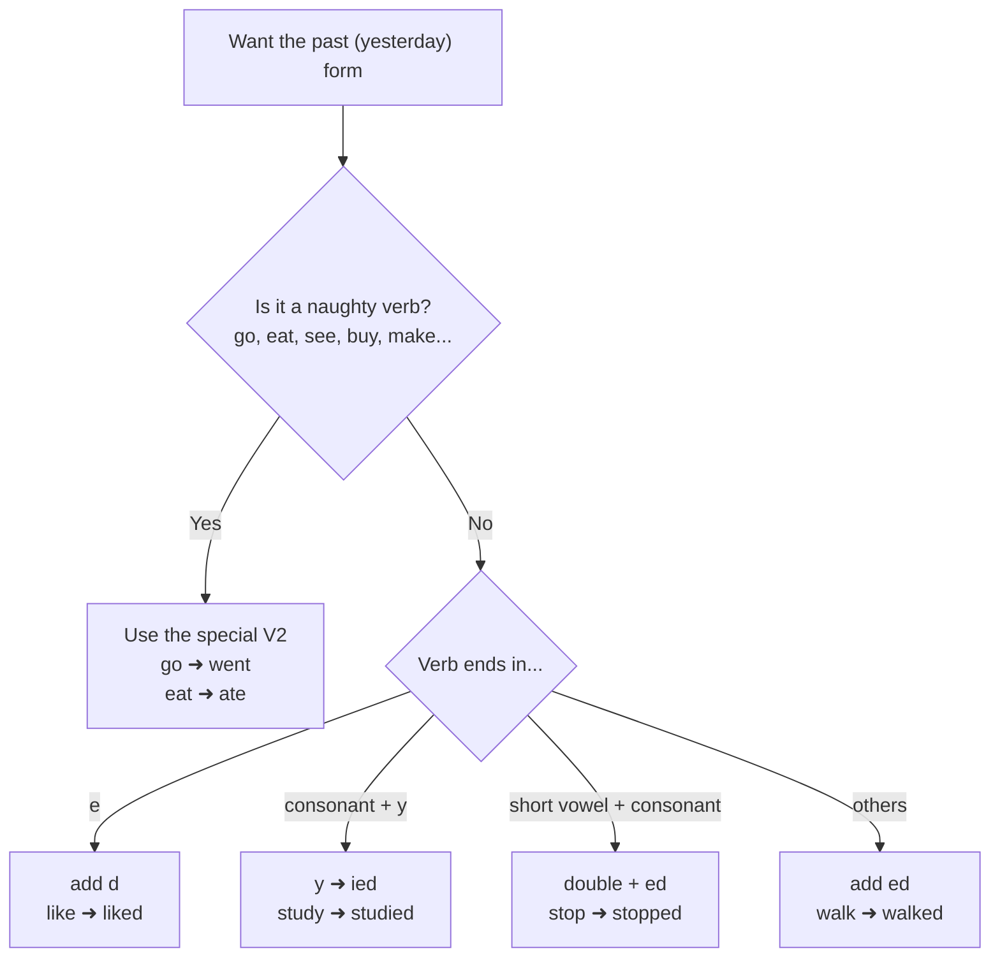

**Say it aloud, 3 times each (this is your daily drill):**

1. I walked to school yesterday.
2. She called me last night.
3. We played cricket on Sunday.
4. He tried again.
5. She stopped the car.

### Step 3: Verbs of the Day

| V1 (today) | V1 + s (he/she/it) | V2 (yesterday) | V3 (have/has/had) |
|---|---|---|---|
| **decide** | decides | decided | decided |
| **die** | dies | died | died |

Say these sentences aloud:

- **decide:**
  - I decide quickly. (She decides quickly.)
  - Yesterday, I decided quickly.
  - I have decided quickly.
- **die:**
  - The flower dies in the sun.
  - Yesterday, the flower died in the sun.
  - The flower has died in the sun.

### Step 4: Fill in the Blanks

1. Yesterday I ____ (watch) a film.
2. She ____ (call) me an hour ago.
3. We ____ (live) in Pune in 2015.
4. He ____ (study) all night.
5. The car ____ (stop) suddenly.

### Step 5: Fix the Mistake

1. ❌ Yesterday I play cricket.   ➜   ✅ ______________________
2. ❌ She call me last night.   ➜   ✅ ______________________

### Step 6: Speak Out Loud

1. Tell 6 things you did yesterday (use regular verbs).
2. Tell what you did last Sunday in 5 sentences.
3. Tell about a trip you took. (We visited... We walked... We enjoyed...)

### Step 7: Check Answers

<details>
<summary>Click or scroll to see the answers (try first!)</summary>

**Fill in the blanks:**

1. **watched**
2. **called**
3. **lived**
4. **studied**
5. **stopped**

**Fix the mistake:**

1. ✅ **Yesterday I played cricket.**
2. ✅ **She called me last night.**

</details>

**Tracker:** ☐ Remember  ☐ Learn  ☐ Verbs  ☐ Fill  ☐ Fix  ☐ Speak  ☐ Check   |  Score: ___ / 7


---


## Day 11: Simple Past: Irregular Verbs (The Rule Breakers)

**Time: 30–40 minutes**

### Step 1: Remember (Spaced Review, 5 minutes)

Cover the sentences. Say them from memory. Then check.

**Day 10 — Simple Past: Finished Things (Regular Verbs)** *(learned yesterday)*

- I walked to school yesterday.
- She called me last night.
- We played cricket on Sunday.
- He tried again.
- She stopped the car.

**Day 8 — Present Continuous: Happening Right Now** *(learned 3 days ago)*

- I am reading a story.
- She is making tea.
- They are watching a movie.
- It is raining now.
- What are you doing?

**Day 4 — Simple Present: No and Question (Do / Does)** *(learned 1 week ago)*

- I don't like spicy food.
- She doesn't wake up late.
- Do you play chess?
- Does he live near here?
- Where does she study?

### Step 2: Learn

Some verbs are naughty. They do **not** take -ed. They change shape. You must **remember** them. We learn them slowly with 2 verbs every day.

**Top naughty verbs (V1 ➜ V2):**

| Today | Yesterday | | Today | Yesterday |
|---|---|---|---|---|
| go | **went** | | eat | **ate** |
| come | **came** | | drink | **drank** |
| see | **saw** | | buy | **bought** |
| take | **took** | | bring | **brought** |
| give | **gave** | | make | **made** |
| have | **had** | | get | **got** |
| say | **said** | | tell | **told** |
| know | **knew** | | think | **thought** |
| find | **found** | | speak | **spoke** |
| write | **wrote** | | run | **ran** |
| sit | **sat** | | stand | **stood** |
| begin | **began** | | leave | **left** |
| meet | **met** | | pay | **paid** |
| sell | **sold** | | send | **sent** |
| win | **won** | | lose | **lost** |
| cut, put, let, set, read | **same!** | | do | **did** |

**Many examples:**

1. I **went** to the market.
2. She **came** home late.
3. We **saw** a tiger at the zoo.
4. He **took** my pen.
5. They **gave** me a gift.
6. I **had** a big breakfast.
7. She **said** hello.
8. He **knew** the answer.
9. I **found** my keys.
10. I **wrote** a letter to my friend.
11. We **ate** pizza and **drank** juice.
12. She **bought** a red dress.
13. He **brought** his lunch.
14. They **won** the match.
15. I **read** a story. (said "red")
16. I **cut** the cake. I **put** it on a plate.

**🗺️ Flow Chart: Simple Past: Regular or Naughty (irregular) verb?**


**Say it aloud, 3 times each (this is your daily drill):**

1. I went to the market.
2. We saw a tiger.
3. She bought a red dress.
4. They won the match.
5. I found my keys.

### Step 3: Verbs of the Day

| V1 (today) | V1 + s (he/she/it) | V2 (yesterday) | V3 (have/has/had) |
|---|---|---|---|
| **do** | does | did | done |
| **expect** | expects | expected | expected |

Say these sentences aloud:

- **do:**
  - I do my homework. (She does her homework.)
  - Yesterday, I did my homework.
  - I have done my homework.
- **expect:**
  - I expect good news. (She expects good news.)
  - Yesterday, I expected good news.
  - I have expected good news.

### Step 4: Fill in the Blanks

1. Yesterday I ____ (go) to the park.
2. She ____ (buy) some fruit.
3. We ____ (see) a rainbow.
4. He ____ (eat) two apples.
5. They ____ (win) the game.

### Step 5: Fix the Mistake

1. ❌ I goed to school.   ➜   ✅ ______________________
2. ❌ She buyed a bag.   ➜   ✅ ______________________

### Step 6: Speak Out Loud

1. Tell your last weekend using 6 irregular verbs (went, ate, saw, bought, came, had).
2. Tell a mini story: 'Yesterday I went ... I saw ... I bought ...'
3. Say all verbs in the table aloud: go-went, come-came, see-saw... (two rounds)

### Step 7: Check Answers

<details>
<summary>Click or scroll to see the answers (try first!)</summary>

**Fill in the blanks:**

1. **went**
2. **bought**
3. **saw**
4. **ate**
5. **won**

**Fix the mistake:**

1. ✅ **I went to school.**
2. ✅ **She bought a bag.**

</details>

**Tracker:** ☐ Remember  ☐ Learn  ☐ Verbs  ☐ Fill  ☐ Fix  ☐ Speak  ☐ Check   |  Score: ___ / 7


---


## Day 12: Simple Past: No and Question (Did)

**Time: 30–40 minutes**

### Step 1: Remember (Spaced Review, 5 minutes)

Cover the sentences. Say them from memory. Then check.

**Day 11 — Simple Past: Irregular Verbs (The Rule Breakers)** *(learned yesterday)*

- I went to the market.
- We saw a tiger.
- She bought a red dress.
- They won the match.
- I found my keys.

**Day 9 — Simple Present vs Present Continuous** *(learned 3 days ago)*

- He plays football on Sundays.
- Today he is playing chess.
- I speak Hindi. Now I am speaking English.
- She wants some water.
- I understand this lesson.

**Day 5 — One or Many? Subject and Verb Must Match** *(learned 1 week ago)*

- The manager is in a meeting.
- Sarah and Nancy lead the team.
- The dog barks. The dogs bark.
- My friend likes music.
- My friends like music.

### Step 2: Learn

For **NO** and **QUESTIONS** in the past we use **did**. It works for **everyone**.

**The big secret:** **did** already shows the past. So the main verb goes **back to plain (V1)**.

- She went. ➜ She **didn't go**. (NOT "didn't went")
- They played. ➜ They **didn't play**.

**Questions:** **Did** + subject + plain verb?
- **Did** you eat? ➜ Yes, I **did**. / No, I **didn't**.
- **Did** he call? ➜ Yes, he **did**. / No, he **didn't**.
- **Where did** you go? **What did** she say? **Why did** they leave?

**The past of "be" is special (no did needed!):**

| Subject | Past of be | No | Question |
|---|---|---|---|
| I, he, she, it | **was** | wasn't | **Was** she hungry? |
| you, we, they | **were** | weren't | **Were** you hungry? |

- I **was** hungry. They **were** in a restaurant.
- She **wasn't** at home. We **weren't** late.
- **Were** you hungry? Yes, I **was**. / No, I **wasn't**.
- Why **was** he sad? Where **were** they?

**Many examples:**

1. I **didn't** go to school yesterday.
2. You **didn't** call me.
3. He **didn't** see the movie.
4. She **didn't** eat lunch.
5. It **didn't** rain.
6. We **didn't** win the match.
7. They **didn't** understand the lesson.
8. **Did** you sleep well?
9. **Did** she come to the party?
10. **Did** they buy a car?
11. What **did** you eat for dinner?
12. When **did** he reach home?
13. Why **did** you laugh?
14. Where **did** they go?

**🗺️ Flow Chart: No or Question? Pick the helper, then use the PLAIN verb**


**Say it aloud, 3 times each (this is your daily drill):**

1. I didn't go to school yesterday.
2. She didn't eat lunch.
3. Did you sleep well?
4. What did you eat for dinner?
5. Were you hungry?

### Step 3: Verbs of the Day

| V1 (today) | V1 + s (he/she/it) | V2 (yesterday) | V3 (have/has/had) |
|---|---|---|---|
| **fall** | falls | fell | fallen |
| **feel** | feels | felt | felt |

Say these sentences aloud:

- **fall:**
  - I fall from the chair. (She falls from the chair.)
  - Yesterday, I fell from the chair.
  - I have fallen from the chair.
- **feel:**
  - I feel happy. (She feels happy.)
  - Yesterday, I felt happy.
  - I have felt happy.

### Step 4: Fill in the Blanks

1. I ____ (not, see) him yesterday.
2. She ____ (not, call) me.
3. ____ you ____ (finish) the work?
4. What ____ they ____ (say)?
5. ____ he ____ (come) yesterday?

### Step 5: Fix the Mistake

1. ❌ She didn't went to school.   ➜   ✅ ______________________
2. ❌ Did you ate lunch?   ➜   ✅ ______________________

### Step 6: Speak Out Loud

1. Say 4 things you did NOT do yesterday.
2. Ask 5 'Did you...?' questions about yesterday and answer them.
3. Ask a family member 'What did you do today?' Listen and repeat what they said using past tense.

### Step 7: Check Answers

<details>
<summary>Click or scroll to see the answers (try first!)</summary>

**Fill in the blanks:**

1. **didn't see**
2. **didn't call**
3. **Did ... finish**
4. **did ... say**
5. **Did ... come**

**Fix the mistake:**

1. ✅ **She didn't go to school.**
2. ✅ **Did you eat lunch?**

</details>

**Tracker:** ☐ Remember  ☐ Learn  ☐ Verbs  ☐ Fill  ☐ Fix  ☐ Speak  ☐ Check   |  Score: ___ / 7


---


## Day 13: Past Continuous: What Was Going On

**Time: 30–40 minutes**

### Step 1: Remember (Spaced Review, 5 minutes)

Cover the sentences. Say them from memory. Then check.

**Day 12 — Simple Past: No and Question (Did)** *(learned yesterday)*

- I didn't go to school yesterday.
- She didn't eat lunch.
- Did you sleep well?
- What did you eat for dinner?
- Were you hungry?

**Day 10 — Simple Past: Finished Things (Regular Verbs)** *(learned 3 days ago)*

- I walked to school yesterday.
- She called me last night.
- We played cricket on Sunday.
- He tried again.
- She stopped the car.

**Day 6 — AND, OR, NOR: Joining Two Subjects** *(learned 1 week ago)*

- Vishnu and Irfan attend the meetings.
- Neither the manager nor the team is available.
- Either the teacher or the students are coming.
- Mom and Dad are at home.
- Neither he nor I am ready.

### Step 2: Learn

**Past Continuous** = an action that was **in progress** at a time in the past. It was happening (like a movie paused in the middle).

**Formula:** **was / were** + verb + **ing**

| Subject | Helper | Example |
|---|---|---|
| I, he, she, it | **was** | I **was reading**. |
| you, we, they | **were** | They **were playing**. |

**Magic words:** at 5 o'clock yesterday, while, when, all day, at that time.

**Two uses:**

1. **A long action at a moment:** At 8 last night, I **was watching** TV.
2. **A long action + a short action that interrupted it:**
   - I **was cooking** when the phone **rang**. (cooking = long, rang = short)
   - While she **was walking**, it **started** to rain.

**Many examples:**

1. I **was sleeping** at 10 o'clock.
2. You **were talking** loudly.
3. He **was playing** football at five.
4. She **was cooking** dinner.
5. It **was raining** all day.
6. We **were waiting** for the bus.
7. They **were watching** a movie.
8. Ajay **was managing** the team while the manager was on leave.
9. I **was walking** when I **saw** an old friend.
10. The kids **were playing** when it **started** to rain.
11. I **wasn't listening**.
12. **Were** you **sleeping**? What **was** he **doing**?

**🗺️ Flow Chart: Past Continuous: A long action and a short interruption**

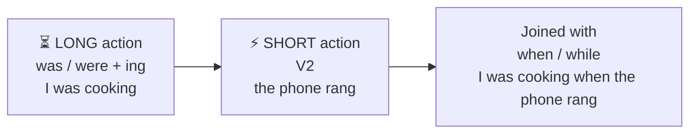

**Say it aloud, 3 times each (this is your daily drill):**

1. I was sleeping at ten.
2. They were watching a movie.
3. I was walking when I saw an old friend.
4. It was raining all day.
5. What was he doing?

### Step 3: Verbs of the Day

| V1 (today) | V1 + s (he/she/it) | V2 (yesterday) | V3 (have/has/had) |
|---|---|---|---|
| **find** | finds | found | found |
| **follow** | follows | followed | followed |

Say these sentences aloud:

- **find:**
  - I find my keys. (She finds her keys.)
  - Yesterday, I found my keys.
  - I have found my keys.
- **follow:**
  - I follow the rules. (She follows the rules.)
  - Yesterday, I followed the rules.
  - I have followed the rules.

### Step 4: Fill in the Blanks

1. At 7 pm yesterday, I ____ (eat) dinner.
2. They ____ (play) when it started to rain.
3. She ____ (not, listen).
4. What ____ you ____ (do) at 9 o'clock?
5. While I ____ (cook), the phone rang.

### Step 5: Fix the Mistake

1. ❌ I were sleeping.   ➜   ✅ ______________________
2. ❌ They was playing.   ➜   ✅ ______________________

### Step 6: Speak Out Loud

1. Say what you were doing at 6 pm yesterday, 8 pm, 10 pm. (3 sentences)
2. Tell an interrupted story: 'I was ... when ...' (3 times)
3. Describe a picture/scene from memory using 'was/were + ing' (a market, a park).

### Step 7: Check Answers

<details>
<summary>Click or scroll to see the answers (try first!)</summary>

**Fill in the blanks:**

1. **was eating**
2. **were playing**
3. **wasn't listening**
4. **were ... doing**
5. **was cooking**

**Fix the mistake:**

1. ✅ **I was sleeping.**
2. ✅ **They were playing.**

</details>

**Tracker:** ☐ Remember  ☐ Learn  ☐ Verbs  ☐ Fill  ☐ Fix  ☐ Speak  ☐ Check   |  Score: ___ / 7


---


## Day 14: Week 2 Check-Up Day (Review Day)

**Time: 30–40 minutes**

### Step 1: Remember (Spaced Review, 5 minutes)

Cover the sentences. Say them from memory. Then check.

**Day 13 — Past Continuous: What Was Going On** *(learned yesterday)*

- I was sleeping at ten.
- They were watching a movie.
- I was walking when I saw an old friend.
- It was raining all day.
- What was he doing?

**Day 11 — Simple Past: Irregular Verbs (The Rule Breakers)** *(learned 3 days ago)*

- I went to the market.
- We saw a tiger.
- She bought a red dress.
- They won the match.
- I found my keys.

**Day 7 — Week 1 Check-Up Day (Review Day)** *(learned 1 week ago)*

- I am happy.
- He goes to school.
- She doesn't like onions.
- Do you play chess?
- Neither he nor I am ready.

### Step 2: Learn

Time to make Week 2 stick.

**Week 2 Cheat Sheet**

| Tense | Formula | Example |
|---|---|---|
| Present Continuous | am/is/are + V-ing | I am eating. |
| Simple Past (regular) | V + ed | I walked. |
| Simple Past (irregular) | V2 (learn them) | I went. |
| Past no/question | did / didn't + V1 | Did you go? I didn't go. |
| Past Continuous | was/were + V-ing | I was eating. |

**Remember:**
- Present Simple = habit. Present Continuous = now.
- Past Simple = finished. Past Continuous = in progress.

**Your jobs:** read the sheet, do the test, fix your mistakes, say all sentences 3 times.

**🗺️ Picture: The Timeline of All Tenses**

```
 PAST  ◄──────────────────────── NOW ────────────────────────►  FUTURE
   │                               │                               │
   │ had + V3                      │ have/has + V3                 │ will have + V3
   │ (earlier past)                │ (done, matters now)           │ (done by then)
   │                               │                               │
   │ V2 / did                      │ V1 (+s/es)                    │ will + V1
   │ (finished)                    │ (habit, fact)                 │ (later)
   │                               │                               │
   │ was/were + ing                │ am/is/are + ing               │ will be + ing
   │ (in progress then)            │ (happening now)               │ (in progress then)
   │                               │                               │
   │ had been + ing                │ have/has been + ing           │ will have been + ing
   │ (long, before then)           │ (long, till now)              │ (long, by then)
```

**Say it aloud, 3 times each (this is your daily drill):**

1. I am eating now.
2. I went to the market yesterday.
3. Did you go to school?
4. I was cooking when you called.
5. She didn't see the film.

### Step 3: Verbs of the Day

| V1 (today) | V1 + s (he/she/it) | V2 (yesterday) | V3 (have/has/had) |
|---|---|---|---|
| **get** | gets | got | got/gotten |
| **give** | gives | gave | given |

Say these sentences aloud:

- **get:**
  - I get a gift. (She gets a gift.)
  - Yesterday, I got a gift.
  - I have got a gift.
- **give:**
  - I give a present. (She gives a present.)
  - Yesterday, I gave a present.
  - I have given a present.

### Step 4: Fill in the Blanks

1. Right now I ____ (read).
2. Yesterday we ____ (go) to the zoo.
3. She ____ (not, call) me yesterday.
4. ____ you ____ (see) the match?
5. At 6 pm he ____ (play) cricket.
6. It usually ____ (rain) in July.
7. They ____ (watch) TV when I arrived.
8. I ____ (eat) rice last night.

### Step 5: Fix the Mistake

1. ❌ Yesterday I was go to market.   ➜   ✅ ______________________
2. ❌ She isn't knowing the answer.   ➜   ✅ ______________________
3. ❌ Did he went there?   ➜   ✅ ______________________

### Step 6: Speak Out Loud

1. Speak 1 minute: 'Yesterday' (use at least 6 Past Simple verbs).
2. Speak 1 minute: 'What is happening in my house now.' (Present Continuous)
3. Tell a story with was/were + ing and a short action. (30 seconds)

### Step 7: Check Answers

<details>
<summary>Click or scroll to see the answers (try first!)</summary>

**Fill in the blanks:**

1. **am reading**
2. **went**
3. **didn't call**
4. **Did ... see**
5. **was playing**
6. **rains**
7. **were watching**
8. **ate**

**Fix the mistake:**

1. ✅ **Yesterday I went to the market.**
2. ✅ **She doesn't know the answer.**
3. ✅ **Did he go there?**

</details>

**Tracker:** ☐ Remember  ☐ Learn  ☐ Verbs  ☐ Fill  ☐ Fix  ☐ Speak  ☐ Check   |  Score: ___ / 11


---


# Week 3 — Future and Perfect
*Future, Present Perfect, Past Perfect, V3*


## Day 15: Simple Future: What I Will Do

**Time: 30–40 minutes**

### Step 1: Remember (Spaced Review, 5 minutes)

Cover the sentences. Say them from memory. Then check.

**Day 14 — Week 2 Check-Up Day (Review Day)** *(learned yesterday)*

- I am eating now.
- I went to the market yesterday.
- Did you go to school?
- I was cooking when you called.
- She didn't see the film.

**Day 12 — Simple Past: No and Question (Did)** *(learned 3 days ago)*

- I didn't go to school yesterday.
- She didn't eat lunch.
- Did you sleep well?
- What did you eat for dinner?
- Were you hungry?

**Day 8 — Present Continuous: Happening Right Now** *(learned 1 week ago)*

- I am reading a story.
- She is making tea.
- They are watching a movie.
- It is raining now.
- What are you doing?

**Day 1 — The Two Boss Words: Who and Does-What** *(learned 2 weeks ago)*

- I drink water.
- She sings a song.
- We walk to school.
- The birds fly in the sky.
- My father drives a car.

### Step 2: Learn

**Simple Future** = things that **will happen later** (tomorrow, next week, next year).

**Formula:** **will** + plain verb (V1). Same for **everyone**. No s, no ing, no ed.

**Magic words:** tomorrow, next week, next month, soon, later, tonight, in 2 days.

**"Shall" (a polite old cousin of will):** In formal English, **shall** can be used with **I** and **we**: "I **shall** call you." "**Shall** we start?" (an offer). In daily speaking, **will** is fine. Use **Shall I...? / Shall we...?** to offer or suggest.

**Short form:** I will = **I'll**, she will = **she'll**, they will = **they'll**, will not = **won't**.

**Many examples:**

1. I **will call** you tomorrow.
2. You **will enjoy** the movie.
3. He **will come** at 5.
4. She **will finish** the work soon.
5. It **will rain** tonight.
6. We **will visit** my grandma next week.
7. They **will attend** a workshop next month.
8. Ajay **will present** the report in the board meeting.
9. We **will lead** the team in the new project.
10. I'**ll** help you. (a quick decision)
11. I **won't forget**. (promise)
12. **Will** you come? Yes, I **will**. No, I **won't**.
13. What **will** you do tomorrow?
14. When **will** she arrive?

**Other ways to talk about the future (bonus):**
- **I am going to** + V1 = a plan: I **am going to** buy a bike.
- **I am meeting** him at 5 = a fixed plan.

**🗺️ Flow Chart: Which Future? Pick by the situation**

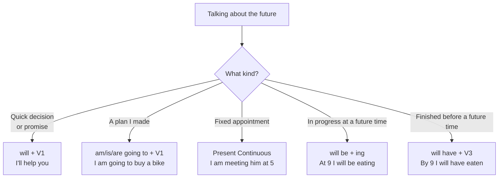

**Say it aloud, 3 times each (this is your daily drill):**

1. I will call you tomorrow.
2. She will finish the work soon.
3. We will visit my grandma next week.
4. I won't forget.
5. What will you do tomorrow?

### Step 3: Verbs of the Day

| V1 (today) | V1 + s (he/she/it) | V2 (yesterday) | V3 (have/has/had) |
|---|---|---|---|
| **go** | goes | went | gone |
| **grow** | grows | grew | grown |

Say these sentences aloud:

- **go:**
  - I go to school. (She goes to school.)
  - Yesterday, I went to school.
  - I have gone to school.
- **grow:**
  - I grow tall. (She grows tall.)
  - Yesterday, I grew tall.
  - I have grown tall.

### Step 4: Fill in the Blanks

1. Tomorrow I ____ (visit) my uncle.
2. She ____ (not, come) today.
3. They ____ (start) the project next week.
4. ____ you ____ (help) me?
5. What time ____ he ____ (arrive)?

### Step 5: Fix the Mistake

1. ❌ I will goes tomorrow.   ➜   ✅ ______________________
2. ❌ She will calling me.   ➜   ✅ ______________________

### Step 6: Speak Out Loud

1. Tell 5 things you will do tomorrow.
2. Make 3 promises. (I will always help you. I won't be late.)
3. Tell your plans for next weekend in 5 sentences.

### Step 7: Check Answers

<details>
<summary>Click or scroll to see the answers (try first!)</summary>

**Fill in the blanks:**

1. **will visit**
2. **won't come**
3. **will start**
4. **Will ... help**
5. **will ... arrive**

**Fix the mistake:**

1. ✅ **I will go tomorrow.**
2. ✅ **She will call me.**

</details>

**Tracker:** ☐ Remember  ☐ Learn  ☐ Verbs  ☐ Fill  ☐ Fix  ☐ Speak  ☐ Check   |  Score: ___ / 7


---


## Day 16: Future Continuous: Will Be Doing

**Time: 30–40 minutes**

### Step 1: Remember (Spaced Review, 5 minutes)

Cover the sentences. Say them from memory. Then check.

**Day 15 — Simple Future: What I Will Do** *(learned yesterday)*

- I will call you tomorrow.
- She will finish the work soon.
- We will visit my grandma next week.
- I won't forget.
- What will you do tomorrow?

**Day 13 — Past Continuous: What Was Going On** *(learned 3 days ago)*

- I was sleeping at ten.
- They were watching a movie.
- I was walking when I saw an old friend.
- It was raining all day.
- What was he doing?

**Day 9 — Simple Present vs Present Continuous** *(learned 1 week ago)*

- He plays football on Sundays.
- Today he is playing chess.
- I speak Hindi. Now I am speaking English.
- She wants some water.
- I understand this lesson.

**Day 2 — Am, Is, Are: The Being Words** *(learned 2 weeks ago)*

- I am happy.
- She is at home.
- They are my friends.
- The mangoes are sweet.
- Is he ready?

### Step 2: Learn

**Future Continuous** = an action that **will be in progress** at a certain time in the future.

**Formula:** **will be** + verb + **ing**

**Magic words:** at 5 pm tomorrow, this time next week, all day tomorrow, throughout next week.

**Picture:** Imagine a video of tomorrow at 5 pm. In the video you are *in the middle of* doing something.

**Many examples:**

1. This time tomorrow, I **will be flying** to Delhi.
2. You **will be sleeping** at midnight.
3. He **will be playing** cricket at 4 pm.
4. She **will be studying** all evening.
5. We **will be traveling** throughout next week.
6. They **will be waiting** at the station.
7. Ajay **will be overseeing** the budget planning throughout next week.
8. Prakash **will be testing** new software features over the next few days.
9. Kaustubh and Deepak **will be participating** in the recruitment drive.
10. I **won't be working** tomorrow.
11. **Will** you **be coming** to the meeting?
12. What **will** she **be doing** at 8 pm?

**Simple Future or Future Continuous?**
- I **will call** you. (one quick action)
- I **will be driving** at 5. (so I can't talk then; action in progress)

**🗺️ Flow Chart: Which Future? Pick by the situation**


**Say it aloud, 3 times each (this is your daily drill):**

1. This time tomorrow I will be flying to Delhi.
2. She will be studying all evening.
3. We will be traveling next week.
4. I won't be working tomorrow.
5. Will you be coming to the meeting?

### Step 3: Verbs of the Day

| V1 (today) | V1 + s (he/she/it) | V2 (yesterday) | V3 (have/has/had) |
|---|---|---|---|
| **happen** | happens | happened | happened |
| **have** | has | had | had |

Say these sentences aloud:

- **happen:**
  - Something funny happens at school.
  - Yesterday, something funny happened at school.
  - Something funny has happened at school.
- **have:**
  - I have a pet dog. (She has a pet dog.)
  - Yesterday, I had a pet dog.
  - I have had a pet dog.

### Step 4: Fill in the Blanks

1. At 8 pm tomorrow, I ____ (watch) a film.
2. She ____ (travel) all next week.
3. They ____ (not, work) on Sunday.
4. ____ you ____ (come) tomorrow?
5. This time next month, we ____ (live) in a new house.

### Step 5: Fix the Mistake

1. ❌ I will being sleeping.   ➜   ✅ ______________________
2. ❌ She will be goes to school.   ➜   ✅ ______________________

### Step 6: Speak Out Loud

1. Say what you will be doing at 7 am, 1 pm, 9 pm tomorrow.
2. Say what your family will be doing this time tomorrow (4 sentences).
3. Speak 30 seconds: 'My busy week next week.'

### Step 7: Check Answers

<details>
<summary>Click or scroll to see the answers (try first!)</summary>

**Fill in the blanks:**

1. **will be watching**
2. **will be traveling**
3. **won't be working**
4. **Will ... be coming**
5. **will be living**

**Fix the mistake:**

1. ✅ **I will be sleeping.**
2. ✅ **She will be going to school.**

</details>

**Tracker:** ☐ Remember  ☐ Learn  ☐ Verbs  ☐ Fill  ☐ Fix  ☐ Speak  ☐ Check   |  Score: ___ / 7


---


## Day 17: Present Perfect: Done, and It Matters Now

**Time: 30–40 minutes**

### Step 1: Remember (Spaced Review, 5 minutes)

Cover the sentences. Say them from memory. Then check.

**Day 16 — Future Continuous: Will Be Doing** *(learned yesterday)*

- This time tomorrow I will be flying to Delhi.
- She will be studying all evening.
- We will be traveling next week.
- I won't be working tomorrow.
- Will you be coming to the meeting?

**Day 14 — Week 2 Check-Up Day (Review Day)** *(learned 3 days ago)*

- I am eating now.
- I went to the market yesterday.
- Did you go to school?
- I was cooking when you called.
- She didn't see the film.

**Day 10 — Simple Past: Finished Things (Regular Verbs)** *(learned 1 week ago)*

- I walked to school yesterday.
- She called me last night.
- We played cricket on Sunday.
- He tried again.
- She stopped the car.

**Day 3 — Simple Present: Things I Do Again and Again** *(learned 2 weeks ago)*

- I wake up at six.
- She goes to school by bus.
- The sun rises in the east.
- My sister studies at night.
- They live in Mumbai.

### Step 2: Learn

**Present Perfect** = something that **happened (or began) in the past, but connects to NOW**. We care about the **result**, not the exact time.

**Formula:** **have / has** + **V3** (past participle)

| Subject | Helper |
|---|---|
| I, you, we, they | **have** |
| he, she, it | **has** |

**V3 (past participle)** for regular verbs = same as V2 (walked, played). For naughty verbs it can be different:
go ➜ went ➜ **gone**; see ➜ saw ➜ **seen**; eat ➜ ate ➜ **eaten**; write ➜ wrote ➜ **written**; speak ➜ spoke ➜ **spoken**; take ➜ took ➜ **taken**.

**Magic words:** already, just, yet, ever, never, so far, recently, this week, this year.

**Many examples:**

1. I **have finished** my homework. (so I am free now)
2. You **have grown** taller.
3. He **has lost** his keys. (so he can't open the door)
4. She **has cleaned** the room.
5. It **has stopped** raining.
6. We **have completed** the training.
7. They **have gained** valuable insights.
8. Ajay **has implemented** efficiency measures.
9. Kaustubh **has achieved** the sales targets.
10. I **have never seen** a tiger.
11. **Have** you **ever** eaten sushi? Yes, I **have**. / No, I **haven't**.
12. She **hasn't** called **yet**.
13. I **have just** reached home.
14. We **have already** eaten.

**🗺️ Flow Chart: Present Perfect or Simple Past?**

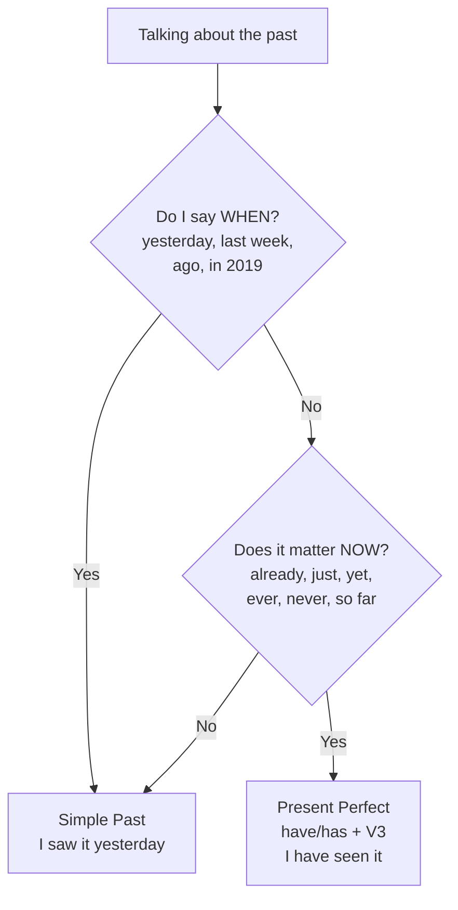

**Say it aloud, 3 times each (this is your daily drill):**

1. I have finished my homework.
2. He has lost his keys.
3. We have completed the training.
4. I have never seen a tiger.
5. Have you ever eaten sushi?

### Step 3: Verbs of the Day

| V1 (today) | V1 + s (he/she/it) | V2 (yesterday) | V3 (have/has/had) |
|---|---|---|---|
| **hear** | hears | heard | heard |
| **help** | helps | helped | helped |

Say these sentences aloud:

- **hear:**
  - I hear a sound. (She hears a sound.)
  - Yesterday, I heard a sound.
  - I have heard a sound.
- **help:**
  - I help my mother. (She helps her mother.)
  - Yesterday, I helped my mother.
  - I have helped my mother.

### Step 4: Fill in the Blanks

1. I ____ (finish) my work.
2. She ____ (lose) her phone.
3. They ____ (not, arrive) yet.
4. ____ you ever ____ (visit) Goa?
5. He ____ (already, eat) lunch.

### Step 5: Fix the Mistake

1. ❌ She have finished.   ➜   ✅ ______________________
2. ❌ I have went to Delhi.   ➜   ✅ ______________________

### Step 6: Speak Out Loud

1. Say 5 things you have already done today.
2. Say 3 things you have never done. (I have never flown in a plane.)
3. Ask 4 'Have you ever ...?' questions.

### Step 7: Check Answers

<details>
<summary>Click or scroll to see the answers (try first!)</summary>

**Fill in the blanks:**

1. **have finished**
2. **has lost**
3. **haven't arrived**
4. **Have ... visited**
5. **has already eaten**

**Fix the mistake:**

1. ✅ **She has finished.**
2. ✅ **I have gone to Delhi.**

</details>

**Tracker:** ☐ Remember  ☐ Learn  ☐ Verbs  ☐ Fill  ☐ Fix  ☐ Speak  ☐ Check   |  Score: ___ / 7


---


## Day 18: Present Perfect vs Simple Past

**Time: 30–40 minutes**

### Step 1: Remember (Spaced Review, 5 minutes)

Cover the sentences. Say them from memory. Then check.

**Day 17 — Present Perfect: Done, and It Matters Now** *(learned yesterday)*

- I have finished my homework.
- He has lost his keys.
- We have completed the training.
- I have never seen a tiger.
- Have you ever eaten sushi?

**Day 15 — Simple Future: What I Will Do** *(learned 3 days ago)*

- I will call you tomorrow.
- She will finish the work soon.
- We will visit my grandma next week.
- I won't forget.
- What will you do tomorrow?

**Day 11 — Simple Past: Irregular Verbs (The Rule Breakers)** *(learned 1 week ago)*

- I went to the market.
- We saw a tiger.
- She bought a red dress.
- They won the match.
- I found my keys.

**Day 4 — Simple Present: No and Question (Do / Does)** *(learned 2 weeks ago)*

- I don't like spicy food.
- She doesn't wake up late.
- Do you play chess?
- Does he live near here?
- Where does she study?

### Step 2: Learn

They both talk about the past. How are they different?

| Simple Past | Present Perfect |
|---|---|
| **Finished** time is said or clear | Time is **not said** (or time not finished) |
| I **saw** that film **yesterday**. | I **have seen** that film. |
| She **lost** her keys **last night**. | She **has lost** her keys. (she still doesn't have them) |
| We **finished** at 5. | We **have finished**. |

**Simple rule:**
- If you say **yesterday / last week / in 2019 / ago / when** ➜ use **Simple Past**.
- If you say **already / just / yet / ever / never / so far / since / for** or you care about **the result now** ➜ use **Present Perfect**.

**Many examples (pairs):**

1. I **went** to Goa last year. / I **have been** to Goa.
2. She **called** me at 5. / She **has called** me three times today.
3. We **ate** lunch an hour ago. / We **have eaten** lunch.
4. He **wrote** a letter yesterday. / He **has written** many letters.
5. They **won** the match on Sunday. / They **have won** five matches this year.
6. When **did** you **buy** that bag? / **Have** you **bought** a new bag?
7. I **lost** my pen yesterday. / I **have lost** my pen. (I need a new one)
8. He **was** here a minute ago. / He **has been** here since morning.

**🗺️ Flow Chart: Present Perfect or Simple Past?**


**Say it aloud, 3 times each (this is your daily drill):**

1. I went to Goa last year.
2. I have been to Goa.
3. She called me at five.
4. She has called me three times today.
5. They have won five matches this year.

### Step 3: Verbs of the Day

| V1 (today) | V1 + s (he/she/it) | V2 (yesterday) | V3 (have/has/had) |
|---|---|---|---|
| **hold** | holds | held | held |
| **include** | includes | included | included |

Say these sentences aloud:

- **hold:**
  - I hold my sister's hand. (She holds her sister's hand.)
  - Yesterday, I held my sister's hand.
  - I have held my sister's hand.
- **include:**
  - I include everyone in the game. (She includes everyone in the game.)
  - Yesterday, I included everyone in the game.
  - I have included everyone in the game.

### Step 4: Fill in the Blanks

1. I ____ (see) that film yesterday.
2. I ____ (see) that film. (no time)
3. She ____ (lose) her bag last week.
4. They ____ (already, leave).
5. When ____ you ____ (arrive)?

### Step 5: Fix the Mistake

1. ❌ I have seen him yesterday.   ➜   ✅ ______________________
2. ❌ Did you ever eat sushi? (talking about life so far)   ➜   ✅ ______________________

### Step 6: Speak Out Loud

1. Say 3 pairs: 'I ___ (past, with time). I have ___ (no time).'
2. Tell about your life so far: places you have been, food you have eaten (5 sentences).
3. Tell one story from last year (Simple Past), then say how it affects you now (Present Perfect).

### Step 7: Check Answers

<details>
<summary>Click or scroll to see the answers (try first!)</summary>

**Fill in the blanks:**

1. **saw**
2. **have seen**
3. **lost**
4. **have already left**
5. **did ... arrive**

**Fix the mistake:**

1. ✅ **I saw him yesterday.**
2. ✅ **Have you ever eaten sushi?**

</details>

**Tracker:** ☐ Remember  ☐ Learn  ☐ Verbs  ☐ Fill  ☐ Fix  ☐ Speak  ☐ Check   |  Score: ___ / 7


---


## Day 19: V3 Workout: Past Participle Power

**Time: 30–40 minutes**

### Step 1: Remember (Spaced Review, 5 minutes)

Cover the sentences. Say them from memory. Then check.

**Day 18 — Present Perfect vs Simple Past** *(learned yesterday)*

- I went to Goa last year.
- I have been to Goa.
- She called me at five.
- She has called me three times today.
- They have won five matches this year.

**Day 16 — Future Continuous: Will Be Doing** *(learned 3 days ago)*

- This time tomorrow I will be flying to Delhi.
- She will be studying all evening.
- We will be traveling next week.
- I won't be working tomorrow.
- Will you be coming to the meeting?

**Day 12 — Simple Past: No and Question (Did)** *(learned 1 week ago)*

- I didn't go to school yesterday.
- She didn't eat lunch.
- Did you sleep well?
- What did you eat for dinner?
- Were you hungry?

**Day 5 — One or Many? Subject and Verb Must Match** *(learned 2 weeks ago)*

- The manager is in a meeting.
- Sarah and Nancy lead the team.
- The dog barks. The dogs bark.
- My friend likes music.
- My friends like music.

### Step 2: Learn

Present Perfect, Past Perfect and Future Perfect all need **V3**. Today we make V3 easy.

**Group 1: V1 = V2 = V3 (easy, never changes!)**
cut, let, put, set, hit, shut, read (spelling same; sounds like "red")
- I **have cut** my finger. / I **have put** it down. / We **have let** him go.

**Group 2: V2 = V3 (same as past)**
bring ➜ brought ➜ brought; buy ➜ bought; build ➜ built; feel ➜ felt; find ➜ found; keep ➜ kept; hold ➜ held; hear ➜ heard; lead ➜ led; leave ➜ left; lose ➜ lost; make ➜ made; mean ➜ meant; meet ➜ met; pay ➜ paid; say ➜ said; sell ➜ sold; send ➜ sent; sit ➜ sat; spend ➜ spent; stand ➜ stood; tell ➜ told; think ➜ thought; understand ➜ understood; win ➜ won
- I **have bought** a bag. / She **has found** her keys.

**Group 3: all three different (the tough ones)**
be ➜ was/were ➜ **been**; begin ➜ began ➜ **begun**; do ➜ did ➜ **done**; fall ➜ fell ➜ **fallen**; give ➜ gave ➜ **given**; go ➜ went ➜ **gone**; grow ➜ grew ➜ **grown**; know ➜ knew ➜ **known**; see ➜ saw ➜ **seen**; show ➜ showed ➜ **shown**; speak ➜ spoke ➜ **spoken**; take ➜ took ➜ **taken**; write ➜ wrote ➜ **written**; eat ➜ ate ➜ **eaten**; drive ➜ drove ➜ **driven**; get ➜ got ➜ **got/gotten**; run ➜ ran ➜ **run**; come ➜ came ➜ **come**; become ➜ became ➜ **become**.

**Group 4: regular verbs (add ed, V2 = V3)**
add, ask, call, change, decide, help, learn (learnt/learned), open, play, start, talk, walk, watch, work...

**Examples:**

1. I **have eaten** dinner.
2. She **has written** a poem.
3. He **has taken** my pen.
4. We **have seen** the show.
5. They **have gone** home.
6. I **have known** him for years.
7. It **has begun** to rain.
8. You **have spoken** well.
9. The price **has grown**.
10. I **have been** here before.
11. He **has done** his work.
12. She **has given** me a gift.

**🗺️ Flow Chart: Finding V3 (the 'have' form)**

```mermaid
flowchart TD
    A["Need V3"] --> B{"Is it a regular verb?<br/>(V2 ends with ed)"}
    B -- Yes --> C["V3 = V2<br/>walked, walked"]
    B -- No --> D{"Do V1, V2, V3 look<br/>the SAME?<br/>cut, put, let, set, read"}
    D -- Yes --> E["No change!<br/>cut-cut-cut"]
    D -- No --> F{"Are V2 and V3 the same?<br/>buy, bring, find, make, tell"}
    F -- Yes --> G["V3 = V2<br/>bought, bought"]
    F -- No --> H["Learn all 3 forms:<br/>go-went-gone<br/>see-saw-seen<br/>write-wrote-written"]
```

**Say it aloud, 3 times each (this is your daily drill):**

1. I have eaten dinner.
2. She has written a poem.
3. They have gone home.
4. It has begun to rain.
5. He has done his work.

### Step 3: Verbs of the Day

| V1 (today) | V1 + s (he/she/it) | V2 (yesterday) | V3 (have/has/had) |
|---|---|---|---|
| **keep** | keeps | kept | kept |
| **kill** | kills | killed | killed |

Say these sentences aloud:

- **keep:**
  - I keep my room clean. (She keeps her room clean.)
  - Yesterday, I kept my room clean.
  - I have kept my room clean.
- **kill:**
  - Frost kills the plants.
  - Yesterday, Frost killed the plants.
  - Frost has killed the plants.

### Step 4: Fill in the Blanks

1. I have ____ (see) that movie.
2. She has ____ (take) my pen.
3. They have ____ (go) home.
4. We have ____ (write) the report.
5. He has ____ (speak) to the manager.
6. I have ____ (buy) a car.

### Step 5: Fix the Mistake

1. ❌ I have wrote a letter.   ➜   ✅ ______________________
2. ❌ She has went to the market.   ➜   ✅ ______________________

### Step 6: Speak Out Loud

1. Say each V1-V2-V3 from Groups 2 and 3 aloud, 2 times: 'go, went, gone'.
2. Make 6 sentences starting with 'I have ...' using Group 3 verbs.
3. Tell 5 things 'someone has done' for you today (My mother has made tea).

### Step 7: Check Answers

<details>
<summary>Click or scroll to see the answers (try first!)</summary>

**Fill in the blanks:**

1. **seen**
2. **taken**
3. **gone**
4. **written**
5. **spoken**
6. **bought**

**Fix the mistake:**

1. ✅ **I have written a letter.**
2. ✅ **She has gone to the market.**

</details>

**Tracker:** ☐ Remember  ☐ Learn  ☐ Verbs  ☐ Fill  ☐ Fix  ☐ Speak  ☐ Check   |  Score: ___ / 8


---


## Day 20: Past Perfect: The Earlier Past

**Time: 30–40 minutes**

### Step 1: Remember (Spaced Review, 5 minutes)

Cover the sentences. Say them from memory. Then check.

**Day 19 — V3 Workout: Past Participle Power** *(learned yesterday)*

- I have eaten dinner.
- She has written a poem.
- They have gone home.
- It has begun to rain.
- He has done his work.

**Day 17 — Present Perfect: Done, and It Matters Now** *(learned 3 days ago)*

- I have finished my homework.
- He has lost his keys.
- We have completed the training.
- I have never seen a tiger.
- Have you ever eaten sushi?

**Day 13 — Past Continuous: What Was Going On** *(learned 1 week ago)*

- I was sleeping at ten.
- They were watching a movie.
- I was walking when I saw an old friend.
- It was raining all day.
- What was he doing?

**Day 6 — AND, OR, NOR: Joining Two Subjects** *(learned 2 weeks ago)*

- Vishnu and Irfan attend the meetings.
- Neither the manager nor the team is available.
- Either the teacher or the students are coming.
- Mom and Dad are at home.
- Neither he nor I am ready.

### Step 2: Learn

**Past Perfect** = the **first** of two past things. It is **the past of the past**.

**Formula:** **had** + **V3** (same for everyone)

**Picture a timeline:**
Earlier ➜ **[had done]** ➜ Later past ➜ **[did]** ➜ Now

- When I **reached** the station (later), the train **had left** (earlier).
- She **had finished** her work **before** the meeting **started**.

**Magic words:** before, after, by the time, already, when (with two actions in past).

**Many examples:**

1. I **had finished** dinner before he called.
2. You **had left** when I arrived.
3. He **had lost** his bag before he reached the hotel.
4. She **had already eaten** when we came.
5. It **had stopped** raining by the time we went out.
6. We **had completed** the coding tasks before the software release.
7. They **had gained** valuable experience before taking on leadership roles.
8. Ajay **had already submitted** the report before the meeting started.
9. Sarah **had submitted** the proposal before the deadline.
10. I **hadn't seen** him before that day.
11. **Had** you **met** her before? Yes, I **had**. / No, I **hadn't**.
12. After I **had eaten**, I **went** to sleep.

**Small compare:**
- When I arrived, she **left**. (she left after I came)
- When I arrived, she **had left**. (she was already gone)

**🗺️ Flow Chart: Past Perfect: Which came first?**

```mermaid
flowchart LR
    A["1️⃣ FIRST (earlier)<br/>had + V3<br/>the train had left"] --> B["2️⃣ SECOND (later)<br/>V2<br/>I reached the station"]
    B --> C["⏰ NOW"]
```

**Say it aloud, 3 times each (this is your daily drill):**

1. I had finished dinner before he called.
2. The train had left when I reached.
3. She had already eaten.
4. I hadn't seen him before.
5. Had you met her before?

### Step 3: Verbs of the Day

| V1 (today) | V1 + s (he/she/it) | V2 (yesterday) | V3 (have/has/had) |
|---|---|---|---|
| **know** | knows | knew | known |
| **lead** | leads | led | led |

Say these sentences aloud:

- **know:**
  - I know the answer. (She knows the answer.)
  - Yesterday, I knew the answer.
  - I have known the answer.
- **lead:**
  - I lead the team. (She leads the team.)
  - Yesterday, I led the team.
  - I have led the team.

### Step 4: Fill in the Blanks

1. When I arrived, the film ____ (start) already.
2. She ____ (finish) her work before the meeting.
3. I ____ (not, eat) before you came.
4. ____ you ____ (meet) him before?
5. By the time we reached, they ____ (leave).

### Step 5: Fix the Mistake

1. ❌ The train has left when I reached.   ➜   ✅ ______________________
2. ❌ I had went home before it rained.   ➜   ✅ ______________________

### Step 6: Speak Out Loud

1. Say 5 sentences: 'When I woke up today, ... had already ...' (My mother had already made tea.)
2. Tell one event with 2 past actions: 'Before I ..., I had ...'
3. Say 3 sentences with 'by the time'.

### Step 7: Check Answers

<details>
<summary>Click or scroll to see the answers (try first!)</summary>

**Fill in the blanks:**

1. **had started**
2. **had finished**
3. **hadn't eaten**
4. **Had ... met**
5. **had left**

**Fix the mistake:**

1. ✅ **The train had left when I reached.**
2. ✅ **I had gone home before it rained.**

</details>

**Tracker:** ☐ Remember  ☐ Learn  ☐ Verbs  ☐ Fill  ☐ Fix  ☐ Speak  ☐ Check   |  Score: ___ / 7


---


## Day 21: Week 3 Check-Up Day (Review Day)

**Time: 30–40 minutes**

### Step 1: Remember (Spaced Review, 5 minutes)

Cover the sentences. Say them from memory. Then check.

**Day 20 — Past Perfect: The Earlier Past** *(learned yesterday)*

- I had finished dinner before he called.
- The train had left when I reached.
- She had already eaten.
- I hadn't seen him before.
- Had you met her before?

**Day 18 — Present Perfect vs Simple Past** *(learned 3 days ago)*

- I went to Goa last year.
- I have been to Goa.
- She called me at five.
- She has called me three times today.
- They have won five matches this year.

**Day 14 — Week 2 Check-Up Day (Review Day)** *(learned 1 week ago)*

- I am eating now.
- I went to the market yesterday.
- Did you go to school?
- I was cooking when you called.
- She didn't see the film.

**Day 7 — Week 1 Check-Up Day (Review Day)** *(learned 2 weeks ago)*

- I am happy.
- He goes to school.
- She doesn't like onions.
- Do you play chess?
- Neither he nor I am ready.

### Step 2: Learn

Week 3 was a big one: Future, Perfect tenses and V3.

**Week 3 Cheat Sheet**

| Tense | Formula | Example |
|---|---|---|
| Simple Future | will + V1 | I will call. |
| Future Continuous | will be + V-ing | I will be sleeping. |
| Present Perfect | have/has + V3 | I have eaten. |
| Past Perfect | had + V3 | I had eaten before... |

**Quick memory tricks:**
- **will** = later. **have/has** = connected to now. **had** = earlier past.
- After **will**, **do**, **does**, **did**, **to**, always plain verb.
- After **have/has/had**, always V3.

**🗺️ Picture: The Timeline of All Tenses**

```
 PAST  ◄──────────────────────── NOW ────────────────────────►  FUTURE
   │                               │                               │
   │ had + V3                      │ have/has + V3                 │ will have + V3
   │ (earlier past)                │ (done, matters now)           │ (done by then)
   │                               │                               │
   │ V2 / did                      │ V1 (+s/es)                    │ will + V1
   │ (finished)                    │ (habit, fact)                 │ (later)
   │                               │                               │
   │ was/were + ing                │ am/is/are + ing               │ will be + ing
   │ (in progress then)            │ (happening now)               │ (in progress then)
   │                               │                               │
   │ had been + ing                │ have/has been + ing           │ will have been + ing
   │ (long, before then)           │ (long, till now)              │ (long, by then)
```

**Say it aloud, 3 times each (this is your daily drill):**

1. I will call you tomorrow.
2. I will be sleeping at ten.
3. I have eaten lunch.
4. She had left before I came.
5. Have you ever visited Goa?

### Step 3: Verbs of the Day

| V1 (today) | V1 + s (he/she/it) | V2 (yesterday) | V3 (have/has/had) |
|---|---|---|---|
| **learn** | learns | learned/learnt | learned/learnt |
| **leave** | leaves | left | left |

Say these sentences aloud:

- **learn:**
  - I learn new words. (She learns new words.)
  - Yesterday, I learned new words.
  - I have learned new words.
- **leave:**
  - I leave home at eight. (She leaves home at eight.)
  - Yesterday, I left home at eight.
  - I have left home at eight.

### Step 4: Fill in the Blanks

1. Tomorrow he ____ (come).
2. This time next week, we ____ (fly).
3. I ____ (not, see) her yet.
4. She ____ (leave) before I arrived.
5. They have ____ (go) to Delhi.
6. Yesterday she ____ (write) a poem.
7. She has ____ (write) three poems.
8. ____ you ever ____ (be) to Paris?

### Step 5: Fix the Mistake

1. ❌ I will to go tomorrow.   ➜   ✅ ______________________
2. ❌ She has seen him yesterday.   ➜   ✅ ______________________
3. ❌ I have ate lunch.   ➜   ✅ ______________________

### Step 6: Speak Out Loud

1. Speak 1 minute: 'My plans for next week' (will, will be, going to).
2. Speak 1 minute: 'Things I have achieved' (Present Perfect).
3. Speak 1 minute: 'Yesterday morning' using Past Perfect once or twice.

### Step 7: Check Answers

<details>
<summary>Click or scroll to see the answers (try first!)</summary>

**Fill in the blanks:**

1. **will come**
2. **will be flying**
3. **haven't seen**
4. **had left**
5. **gone**
6. **wrote**
7. **written**
8. **Have ... been**

**Fix the mistake:**

1. ✅ **I will go tomorrow.**
2. ✅ **She saw him yesterday.**
3. ✅ **I have eaten lunch.**

</details>

**Tracker:** ☐ Remember  ☐ Learn  ☐ Verbs  ☐ Fill  ☐ Fix  ☐ Speak  ☐ Check   |  Score: ___ / 11


---


# Week 4 — Long Actions and Groups
*Perfect Continuous tenses, Future Perfect, everyone/team words*


## Day 22: Present Perfect Continuous: For and Since

**Time: 30–40 minutes**

### Step 1: Remember (Spaced Review, 5 minutes)

Cover the sentences. Say them from memory. Then check.

**Day 21 — Week 3 Check-Up Day (Review Day)** *(learned yesterday)*

- I will call you tomorrow.
- I will be sleeping at ten.
- I have eaten lunch.
- She had left before I came.
- Have you ever visited Goa?

**Day 19 — V3 Workout: Past Participle Power** *(learned 3 days ago)*

- I have eaten dinner.
- She has written a poem.
- They have gone home.
- It has begun to rain.
- He has done his work.

**Day 15 — Simple Future: What I Will Do** *(learned 1 week ago)*

- I will call you tomorrow.
- She will finish the work soon.
- We will visit my grandma next week.
- I won't forget.
- What will you do tomorrow?

**Day 8 — Present Continuous: Happening Right Now** *(learned 2 weeks ago)*

- I am reading a story.
- She is making tea.
- They are watching a movie.
- It is raining now.
- What are you doing?

### Step 2: Learn

**Present Perfect Continuous** = an action that **started in the past and is still going on** (or just stopped, and we see the result). We talk about **how long**.

**Formula:** **have / has been** + verb + **ing**

**For** = a **length** of time: for 5 years, for two hours, for a long time.
**Since** = a **starting point**: since 2019, since morning, since Monday, since I was a child.

**Many examples:**

1. I **have been working** at IBM **for** 5 years.
2. I **have been working** at IBM **since** 2019.
3. You **have been talking** **for** an hour.
4. He **has been sleeping** **since** 3 o'clock.
5. She **has been learning** English **for** six months.
6. It **has been raining** **since** morning.
7. We **have been waiting** **for** twenty minutes.
8. They **have been fostering** strategic partnerships.
9. Prakash **has been collaborating** with the design team **since** 2023.
10. Kaustubh **has been improving** supply chain efficiency.
11. I **haven't been sleeping** well **lately**.
12. How long **have** you **been learning** English? / **Has** she **been waiting** long?

**Present Perfect or Perfect Continuous?**
- I **have read** three chapters. (the **result / how many**)
- I **have been reading** all morning. (the **action / how long**)

**🗺️ Flow Chart: For or Since?**

```mermaid
flowchart TD
    A["How long...?"] --> B{"Can I say a LENGTH<br/>of time?<br/>5 years, 2 hours"}
    B -- Yes --> C["for<br/>I have lived here for 5 years"]
    B -- No --> D{"A starting POINT?<br/>2019, Monday, morning"}
    D -- Yes --> E["since<br/>I have lived here since 2019"]
```

**Say it aloud, 3 times each (this is your daily drill):**

1. I have been working here for five years.
2. It has been raining since morning.
3. She has been learning English for six months.
4. We have been waiting for twenty minutes.
5. How long have you been learning English?

### Step 3: Verbs of the Day

| V1 (today) | V1 + s (he/she/it) | V2 (yesterday) | V3 (have/has/had) |
|---|---|---|---|
| **let** | lets | let | let |
| **like** | likes | liked | liked |

Say these sentences aloud:

- **let:**
  - I let him play. (She lets him play.)
  - Yesterday, I let him play.
  - I have let him play.
- **like:**
  - I like ice cream. (She likes ice cream.)
  - Yesterday, I liked ice cream.
  - I have liked ice cream.

### Step 4: Fill in the Blanks

1. I ____ (work) here for 3 years.
2. She ____ (study) since morning.
3. It ____ (rain) for two hours.
4. They ____ (wait) since 5 o'clock.
5. How long ____ you ____ (live) here?

### Step 5: Fix the Mistake

1. ❌ I am working here since 2019.   ➜   ✅ ______________________
2. ❌ She has been working here from five years.   ➜   ✅ ______________________

### Step 6: Speak Out Loud

1. Say 5 sentences: 'I have been ... for ...' (about your work, learning, hobbies).
2. Say 5 sentences: 'I have been ... since ...'
3. Ask someone 'How long have you been ...?' 3 times. Answer yourself.

### Step 7: Check Answers

<details>
<summary>Click or scroll to see the answers (try first!)</summary>

**Fill in the blanks:**

1. **have been working**
2. **has been studying**
3. **has been raining**
4. **have been waiting**
5. **have ... been living**

**Fix the mistake:**

1. ✅ **I have been working here since 2019.**
2. ✅ **She has been working here for five years.**

</details>

**Tracker:** ☐ Remember  ☐ Learn  ☐ Verbs  ☐ Fill  ☐ Fix  ☐ Speak  ☐ Check   |  Score: ___ / 7


---


## Day 23: Past Perfect Continuous: How Long Before

**Time: 30–40 minutes**

### Step 1: Remember (Spaced Review, 5 minutes)

Cover the sentences. Say them from memory. Then check.

**Day 22 — Present Perfect Continuous: For and Since** *(learned yesterday)*

- I have been working here for five years.
- It has been raining since morning.
- She has been learning English for six months.
- We have been waiting for twenty minutes.
- How long have you been learning English?

**Day 20 — Past Perfect: The Earlier Past** *(learned 3 days ago)*

- I had finished dinner before he called.
- The train had left when I reached.
- She had already eaten.
- I hadn't seen him before.
- Had you met her before?

**Day 16 — Future Continuous: Will Be Doing** *(learned 1 week ago)*

- This time tomorrow I will be flying to Delhi.
- She will be studying all evening.
- We will be traveling next week.
- I won't be working tomorrow.
- Will you be coming to the meeting?

**Day 9 — Simple Present vs Present Continuous** *(learned 2 weeks ago)*

- He plays football on Sundays.
- Today he is playing chess.
- I speak Hindi. Now I am speaking English.
- She wants some water.
- I understand this lesson.

### Step 2: Learn

**Past Perfect Continuous** (less common, but useful!) = an action that had been going on **for some time before** another past moment.

**Formula:** **had been** + verb + **ing** (+ for / since)

**Many examples:**

1. Ajay **had been overseeing** the client relations department **for six months** before his promotion.
2. Prakash and Raghav **had been collaborating** with the design team **for several weeks** before the project ended.
3. I **had been waiting for** an hour when the bus finally came.
4. She **had been studying since** morning, so she was tired.
5. It **had been raining for** two days before the sun came out.
6. We **had been walking for** hours when we found the hotel.
7. They **had been playing** for ten minutes when the rain began.
8. He **had been working** there **since** 2010 before he quit.
9. **Had** you **been sleeping** when I called?
10. I **hadn't been feeling** well, so I stayed home.

**Simple trick:**
- Present Perfect Continuous: from the past **till NOW**. (have been)
- Past Perfect Continuous: from the past **till another past moment**. (had been)

**🗺️ Flow Chart: Past Perfect: Which came first?**

```mermaid
flowchart LR
    A["1️⃣ FIRST (earlier)<br/>had + V3<br/>the train had left"] --> B["2️⃣ SECOND (later)<br/>V2<br/>I reached the station"]
    B --> C["⏰ NOW"]
```

**Say it aloud, 3 times each (this is your daily drill):**

1. I had been waiting for an hour.
2. She had been studying since morning.
3. It had been raining for two days.
4. We had been walking for hours.
5. Had you been sleeping when I called?

### Step 3: Verbs of the Day

| V1 (today) | V1 + s (he/she/it) | V2 (yesterday) | V3 (have/has/had) |
|---|---|---|---|
| **live** | lives | lived | lived |
| **look** | looks | looked | looked |

Say these sentences aloud:

- **live:**
  - I live in Delhi. (She lives in Delhi.)
  - Yesterday, I lived in Delhi.
  - I have lived in Delhi.
- **look:**
  - I look at the sky. (She looks at the sky.)
  - Yesterday, I looked at the sky.
  - I have looked at the sky.

### Step 4: Fill in the Blanks

1. I ____ (wait) for an hour when the bus came.
2. She was tired because she ____ (work) all day.
3. It ____ (rain) for two days before it stopped.
4. They ____ (play) for 10 minutes when it rained.
5. ____ you ____ (sleep) when I called?

### Step 5: Fix the Mistake

1. ❌ I had been wait for an hour.   ➜   ✅ ______________________
2. ❌ She had been work since morning.   ➜   ✅ ______________________

### Step 6: Speak Out Loud

1. Say 3 sentences: 'When ... came, I had been ... for ...'
2. Explain why you were tired / happy / hungry using 'had been'. (3 sentences)
3. Say 2 sentences about someone's past job: 'He had been ... for ... before ...'

### Step 7: Check Answers

<details>
<summary>Click or scroll to see the answers (try first!)</summary>

**Fill in the blanks:**

1. **had been waiting**
2. **had been working**
3. **had been raining**
4. **had been playing**
5. **Had ... been sleeping**

**Fix the mistake:**

1. ✅ **I had been waiting for an hour.**
2. ✅ **She had been working since morning.**

</details>

**Tracker:** ☐ Remember  ☐ Learn  ☐ Verbs  ☐ Fill  ☐ Fix  ☐ Speak  ☐ Check   |  Score: ___ / 7


---


## Day 24: Future Perfect: Finished by Then

**Time: 30–40 minutes**

### Step 1: Remember (Spaced Review, 5 minutes)

Cover the sentences. Say them from memory. Then check.

**Day 23 — Past Perfect Continuous: How Long Before** *(learned yesterday)*

- I had been waiting for an hour.
- She had been studying since morning.
- It had been raining for two days.
- We had been walking for hours.
- Had you been sleeping when I called?

**Day 21 — Week 3 Check-Up Day (Review Day)** *(learned 3 days ago)*

- I will call you tomorrow.
- I will be sleeping at ten.
- I have eaten lunch.
- She had left before I came.
- Have you ever visited Goa?

**Day 17 — Present Perfect: Done, and It Matters Now** *(learned 1 week ago)*

- I have finished my homework.
- He has lost his keys.
- We have completed the training.
- I have never seen a tiger.
- Have you ever eaten sushi?

**Day 10 — Simple Past: Finished Things (Regular Verbs)** *(learned 2 weeks ago)*

- I walked to school yesterday.
- She called me last night.
- We played cricket on Sunday.
- He tried again.
- She stopped the car.

### Step 2: Learn

**Future Perfect** (less common) = something that **will be finished BEFORE a time in the future**.

**Formula:** **will have** + **V3**

**Magic words:** by tomorrow, by 5 pm, by the end of the month, by next year, before.

**Picture:** Stand in the future. Look back. The work is **already done**.

**Many examples:**

1. I **will have finished** my homework by 8 pm.
2. You **will have learned** many new words by next month.
3. He **will have reached** home by now.
4. She **will have left** before you arrive.
5. It **will have stopped** raining by evening.
6. We **will have eaten** by 9.
7. They **will have built** the bridge by next year.
8. Ajay **will have finalized** the annual report by the end of the month.
9. Sarah **will have presented** the marketing strategy before the product launch.
10. Rehman **will have successfully implemented** process improvements by the end of the fiscal year.
11. I **won't have finished** by Monday.
12. **Will** you **have finished** by then?

**🗺️ Picture: The Timeline of All Tenses**

```
 PAST  ◄──────────────────────── NOW ────────────────────────►  FUTURE
   │                               │                               │
   │ had + V3                      │ have/has + V3                 │ will have + V3
   │ (earlier past)                │ (done, matters now)           │ (done by then)
   │                               │                               │
   │ V2 / did                      │ V1 (+s/es)                    │ will + V1
   │ (finished)                    │ (habit, fact)                 │ (later)
   │                               │                               │
   │ was/were + ing                │ am/is/are + ing               │ will be + ing
   │ (in progress then)            │ (happening now)               │ (in progress then)
   │                               │                               │
   │ had been + ing                │ have/has been + ing           │ will have been + ing
   │ (long, before then)           │ (long, till now)              │ (long, by then)
```

**Say it aloud, 3 times each (this is your daily drill):**

1. I will have finished my homework by eight.
2. He will have reached home by now.
3. They will have built the bridge by next year.
4. Ajay will have finalized the report by month end.
5. Will you have finished by then?

### Step 3: Verbs of the Day

| V1 (today) | V1 + s (he/she/it) | V2 (yesterday) | V3 (have/has/had) |
|---|---|---|---|
| **lose** | loses | lost | lost |
| **love** | loves | loved | loved |

Say these sentences aloud:

- **lose:**
  - I lose my pen. (She loses her pen.)
  - Yesterday, I lost my pen.
  - I have lost my pen.
- **love:**
  - I love my family. (She loves her family.)
  - Yesterday, I loved my family.
  - I have loved my family.

### Step 4: Fill in the Blanks

1. By 9 pm I ____ (finish) my work.
2. She ____ (leave) before you arrive.
3. By next year they ____ (build) the school.
4. He ____ (not, complete) it by Monday.
5. ____ you ____ (eat) by 8?

### Step 5: Fix the Mistake

1. ❌ I will have finish by 5.   ➜   ✅ ______________________
2. ❌ She will has left by then.   ➜   ✅ ______________________

### Step 6: Speak Out Loud

1. Say 5 things you will have done by tonight.
2. Say 3 things you will have achieved by the end of this year.
3. Say 3 things that will have changed by next year in your city.

### Step 7: Check Answers

<details>
<summary>Click or scroll to see the answers (try first!)</summary>

**Fill in the blanks:**

1. **will have finished**
2. **will have left**
3. **will have built**
4. **won't have completed**
5. **Will ... have eaten**

**Fix the mistake:**

1. ✅ **I will have finished by 5.**
2. ✅ **She will have left by then.**

</details>

**Tracker:** ☐ Remember  ☐ Learn  ☐ Verbs  ☐ Fill  ☐ Fix  ☐ Speak  ☐ Check   |  Score: ___ / 7


---


## Day 25: Future Perfect Continuous: Will Have Been Doing

**Time: 30–40 minutes**

### Step 1: Remember (Spaced Review, 5 minutes)

Cover the sentences. Say them from memory. Then check.

**Day 24 — Future Perfect: Finished by Then** *(learned yesterday)*

- I will have finished my homework by eight.
- He will have reached home by now.
- They will have built the bridge by next year.
- Ajay will have finalized the report by month end.
- Will you have finished by then?

**Day 22 — Present Perfect Continuous: For and Since** *(learned 3 days ago)*

- I have been working here for five years.
- It has been raining since morning.
- She has been learning English for six months.
- We have been waiting for twenty minutes.
- How long have you been learning English?

**Day 18 — Present Perfect vs Simple Past** *(learned 1 week ago)*

- I went to Goa last year.
- I have been to Goa.
- She called me at five.
- She has called me three times today.
- They have won five matches this year.

**Day 11 — Simple Past: Irregular Verbs (The Rule Breakers)** *(learned 2 weeks ago)*

- I went to the market.
- We saw a tiger.
- She bought a red dress.
- They won the match.
- I found my keys.

### Step 2: Learn

**Future Perfect Continuous** (rare, but sounds smart!) = by a future time, an action **will have been going on for a certain length of time**.

**Formula:** **will have been** + verb + **ing** (+ for / since)

**Many examples:**

1. By June, I **will have been working** here **for** five years.
2. By evening, you **will have been studying for** six hours.
3. By next week, he **will have been living** here **for** a year.
4. Sarah **will have been working** on the market research **for a year** by the upcoming conference.
5. Nancy **will have been fostering** strategic partnerships with key clients **for two years** by the next review.
6. By 2030, we **will have been using** this app **for** ten years.
7. They **will have been playing** for two hours by then.
8. **How long will** you **have been working** here by next year?

**The Big Family of 12 Tenses (a map)**

| | Past | Present | Future |
|---|---|---|---|
| **Simple** | V2 / did | V1 (+s/es) / do, does | will + V1 |
| **Continuous** | was/were + ing | am/is/are + ing | will be + ing |
| **Perfect** | had + V3 | have/has + V3 | will have + V3 |
| **Perfect Continuous** | had been + ing | have/has been + ing | will have been + ing |

For daily speaking, you will mainly use: **Simple Present, Present Continuous, Present Perfect, Simple Past, Past Continuous, Simple Future**. The others are bonus.

**🗺️ Flow Chart: The Great Tense Chooser**

```mermaid
flowchart TD
    S["START: When did it happen?"] --> T{"Time?"}
    T -- "⬅️ Past" --> P{"What kind?"}
    T -- "⏺️ Present" --> N{"What kind?"}
    T -- "➡️ Future" --> F{"What kind?"}
    P -- "Fact / finished" --> P1["Simple Past<br/>V2 / did + V1"]
    P -- "Was in progress" --> P2["Past Continuous<br/>was/were + ing"]
    P -- "Earlier than another past" --> P3["Past Perfect<br/>had + V3"]
    P -- "Long action before a past time" --> P4["Past Perfect Cont.<br/>had been + ing"]
    N -- "Habit / fact" --> N1["Simple Present<br/>V1 (+s/es)"]
    N -- "Happening now" --> N2["Present Continuous<br/>am/is/are + ing"]
    N -- "Done, matters now" --> N3["Present Perfect<br/>have/has + V3"]
    N -- "Started and still going<br/>(for / since)" --> N4["Present Perfect Cont.<br/>have/has been + ing"]
    F -- "Will happen" --> F1["Simple Future<br/>will + V1"]
    F -- "Will be in progress" --> F2["Future Continuous<br/>will be + ing"]
    F -- "Finished by a future time" --> F3["Future Perfect<br/>will have + V3"]
    F -- "Long action by a future time" --> F4["Future Perfect Cont.<br/>will have been + ing"]
```

**Say it aloud, 3 times each (this is your daily drill):**

1. By June I will have been working here for five years.
2. By evening you will have been studying for six hours.
3. By next week he will have been living here for a year.
4. They will have been playing for two hours.
5. By 2030 we will have been using this app for ten years.

### Step 3: Verbs of the Day

| V1 (today) | V1 + s (he/she/it) | V2 (yesterday) | V3 (have/has/had) |
|---|---|---|---|
| **make** | makes | made | made |
| **mean** | means | meant | meant |

Say these sentences aloud:

- **make:**
  - I make a cake. (She makes a cake.)
  - Yesterday, I made a cake.
  - I have made a cake.
- **mean:**
  - I mean it. (She means it.)
  - Yesterday, I meant it.
  - I have meant it.

### Step 4: Fill in the Blanks

1. By June, I ____ (work) here for 5 years.
2. By evening, she ____ (study) for 6 hours.
3. By next month, we ____ (live) here for a year.
4. They ____ (play) for 2 hours by then.
5. By 5 pm he ____ (drive) for 3 hours.

### Step 5: Fix the Mistake

1. ❌ By June I will have been work here for 5 years.   ➜   ✅ ______________________
2. ❌ She will have been study for hours.   ➜   ✅ ______________________

### Step 6: Speak Out Loud

1. Say 3 'By next year, I will have been ... for ...' sentences about your job or learning.
2. Look at the 12-tense map. Say one sentence for each tense about the verb 'work'. (12 sentences)
3. Say the 12 tense names and their formulas without looking.

### Step 7: Check Answers

<details>
<summary>Click or scroll to see the answers (try first!)</summary>

**Fill in the blanks:**

1. **will have been working**
2. **will have been studying**
3. **will have been living**
4. **will have been playing**
5. **will have been driving**

**Fix the mistake:**

1. ✅ **By June I will have been working here for 5 years.**
2. ✅ **She will have been studying for hours.**

</details>

**Tracker:** ☐ Remember  ☐ Learn  ☐ Verbs  ☐ Fill  ☐ Fix  ☐ Speak  ☐ Check   |  Score: ___ / 7


---


## Day 26: Everyone, Someone, Each: Singular Words in Disguise

**Time: 30–40 minutes**

### Step 1: Remember (Spaced Review, 5 minutes)

Cover the sentences. Say them from memory. Then check.

**Day 25 — Future Perfect Continuous: Will Have Been Doing** *(learned yesterday)*

- By June I will have been working here for five years.
- By evening you will have been studying for six hours.
- By next week he will have been living here for a year.
- They will have been playing for two hours.
- By 2030 we will have been using this app for ten years.

**Day 23 — Past Perfect Continuous: How Long Before** *(learned 3 days ago)*

- I had been waiting for an hour.
- She had been studying since morning.
- It had been raining for two days.
- We had been walking for hours.
- Had you been sleeping when I called?

**Day 19 — V3 Workout: Past Participle Power** *(learned 1 week ago)*

- I have eaten dinner.
- She has written a poem.
- They have gone home.
- It has begun to rain.
- He has done his work.

**Day 12 — Simple Past: No and Question (Did)** *(learned 2 weeks ago)*

- I didn't go to school yesterday.
- She didn't eat lunch.
- Did you sleep well?
- What did you eat for dinner?
- Were you hungry?

### Step 2: Learn

Some words look like many, but they are **ONE** to grammar!

**Singular (use is / has / goes / needs ...):**
everyone, everybody, everything, someone, somebody, something, anyone, nobody, no one, nothing, each, every, either, neither, one

- **Everyone has** submitted the report.
- **Each student has** been asked to bring a letter.
- **Everybody is** happy.
- **Somebody is** knocking at the door.
- **Nobody knows** the answer.
- **Every child needs** love.
- **Nothing is** impossible.

**Plural (use are / have / go ...):**
both, few, many, several

- **Both** of them **are** my friends.
- **Many** of the employees **are** attending the training.
- **Few** people **know** this secret.
- **Several** boys **have** come.

**Their (a polite helper):** In daily English we say "Everyone has done **their** work." This is accepted.

**Many examples:**

1. **Everyone** in my class **likes** music.
2. **Someone** **is** calling you.
3. **Each** of the boys **has** a ball.
4. **Everything** **looks** good.
5. **Neither** of them **is** here.
6. **Either** of the two roads **leads** to the city.
7. **Both** the dogs **are** barking.
8. **Many** students **are** absent.
9. **Few** of my friends **live** nearby.
10. **Anybody** **can** learn English.

**🗺️ Flow Chart: Subject-Verb Agreement: The Master Flow**

```mermaid
flowchart TD
    A["Find the REAL subject<br/>(cross out guests like 'along with')"] --> B{"Joined by AND?"}
    B -- Yes --> C["Many ➜ plural verb<br/>Tom and Sam are"]
    B -- No --> D{"Joined by OR / NOR?"}
    D -- Yes --> E["Match the CLOSEST subject<br/>Neither Tom nor the boys are"]
    D -- No --> F{"everyone, each, nobody,<br/>someone, every?"}
    F -- Yes --> G["Singular<br/>Everyone is"]
    F -- No --> H{"both, few, many, several?"}
    H -- Yes --> I["Plural<br/>Many are"]
    H -- No --> J{"A group word?<br/>team, family, class"}
    J -- Yes --> K["Singular (usual)<br/>The team is"]
    J -- No --> L{"One person/thing<br/>or many?"}
    L -- One --> M["Singular verb"]
    L -- Many --> N["Plural verb"]
```

**Say it aloud, 3 times each (this is your daily drill):**

1. Everyone has submitted the report.
2. Each student has a book.
3. Nobody knows the answer.
4. Many of the employees are attending the training.
5. Both of them are my friends.

### Step 3: Verbs of the Day

| V1 (today) | V1 + s (he/she/it) | V2 (yesterday) | V3 (have/has/had) |
|---|---|---|---|
| **meet** | meets | met | met |
| **move** | moves | moved | moved |

Say these sentences aloud:

- **meet:**
  - I meet my teacher. (She meets her teacher.)
  - Yesterday, I met my teacher.
  - I have met my teacher.
- **move:**
  - I move the chair. (She moves the chair.)
  - Yesterday, I moved the chair.
  - I have moved the chair.

### Step 4: Fill in the Blanks

1. Everyone ____ (be) ready.
2. Each of the girls ____ (have) a pen.
3. Nobody ____ (know) the answer.
4. Many people ____ (like) music.
5. Both of my brothers ____ (play) cricket.

### Step 5: Fix the Mistake

1. ❌ Everyone have finished.   ➜   ✅ ______________________
2. ❌ Many of the students is absent.   ➜   ✅ ______________________

### Step 6: Speak Out Loud

1. Say 5 sentences starting with 'Everyone'.
2. Say 3 with 'each' and 3 with 'nobody'.
3. Say 3 with 'many', 'few', 'both'.

### Step 7: Check Answers

<details>
<summary>Click or scroll to see the answers (try first!)</summary>

**Fill in the blanks:**

1. **is**
2. **has**
3. **knows**
4. **like**
5. **play**

**Fix the mistake:**

1. ✅ **Everyone has finished.**
2. ✅ **Many of the students are absent.**

</details>

**Tracker:** ☐ Remember  ☐ Learn  ☐ Verbs  ☐ Fill  ☐ Fix  ☐ Speak  ☐ Check   |  Score: ___ / 7


---


## Day 27: Group Words: Team, Family, Class, Committee

**Time: 30–40 minutes**

### Step 1: Remember (Spaced Review, 5 minutes)

Cover the sentences. Say them from memory. Then check.

**Day 26 — Everyone, Someone, Each: Singular Words in Disguise** *(learned yesterday)*

- Everyone has submitted the report.
- Each student has a book.
- Nobody knows the answer.
- Many of the employees are attending the training.
- Both of them are my friends.

**Day 24 — Future Perfect: Finished by Then** *(learned 3 days ago)*

- I will have finished my homework by eight.
- He will have reached home by now.
- They will have built the bridge by next year.
- Ajay will have finalized the report by month end.
- Will you have finished by then?

**Day 20 — Past Perfect: The Earlier Past** *(learned 1 week ago)*

- I had finished dinner before he called.
- The train had left when I reached.
- She had already eaten.
- I hadn't seen him before.
- Had you met her before?

**Day 13 — Past Continuous: What Was Going On** *(learned 2 weeks ago)*

- I was sleeping at ten.
- They were watching a movie.
- I was walking when I saw an old friend.
- It was raining all day.
- What was he doing?

### Step 2: Learn

A **collective noun** is **one name for a group**: team, group, family, class, committee, board, jury, staff, audience, government, department.

**Normal rule: treat the group as ONE thing ➜ singular verb.**

- The **team is** in agreement.
- The **group meets** every week.
- The **committee agrees** on the quality.
- The **board of directors approves** the new budget.
- The **jury has** reached a verdict.
- The **Department of Finance is** conducting an audit.
- My **family is** very close.
- Our **class starts** at nine.

**Less common: if you stress the people inside the group, you can use plural.**

- The **team are** discussing different options. (everyone speaking separately)
- The **committee participate** in volunteer activities in their private lives.

**Tip:** In most daily and office English, **singular** is the safe choice.

**Many examples:**

1. The **audience is** clapping.
2. The **staff is** ready.
3. The **government has** announced a new rule.
4. My **family goes** on a trip every year.
5. The **class is** quiet today.
6. The **team has** won the cup.
7. A **group of children is** playing outside. (the group = one)
8. The **band plays** at 8 pm.
9. The **crowd was** huge.
10. The **committee has** decided.

**🗺️ Flow Chart: Subject-Verb Agreement: The Master Flow**

```mermaid
flowchart TD
    A["Find the REAL subject<br/>(cross out guests like 'along with')"] --> B{"Joined by AND?"}
    B -- Yes --> C["Many ➜ plural verb<br/>Tom and Sam are"]
    B -- No --> D{"Joined by OR / NOR?"}
    D -- Yes --> E["Match the CLOSEST subject<br/>Neither Tom nor the boys are"]
    D -- No --> F{"everyone, each, nobody,<br/>someone, every?"}
    F -- Yes --> G["Singular<br/>Everyone is"]
    F -- No --> H{"both, few, many, several?"}
    H -- Yes --> I["Plural<br/>Many are"]
    H -- No --> J{"A group word?<br/>team, family, class"}
    J -- Yes --> K["Singular (usual)<br/>The team is"]
    J -- No --> L{"One person/thing<br/>or many?"}
    L -- One --> M["Singular verb"]
    L -- Many --> N["Plural verb"]
```

**Say it aloud, 3 times each (this is your daily drill):**

1. The team is in agreement.
2. The jury has reached a verdict.
3. My family is very close.
4. The board approves the new budget.
5. The audience is clapping.

### Step 3: Verbs of the Day

| V1 (today) | V1 + s (he/she/it) | V2 (yesterday) | V3 (have/has/had) |
|---|---|---|---|
| **need** | needs | needed | needed |
| **offer** | offers | offered | offered |

Say these sentences aloud:

- **need:**
  - I need some water. (She needs some water.)
  - Yesterday, I needed some water.
  - I have needed some water.
- **offer:**
  - I offer help. (She offers help.)
  - Yesterday, I offered help.
  - I have offered help.

### Step 4: Fill in the Blanks

1. The team ____ (be) ready.
2. My family ____ (go) on a trip every year.
3. The committee ____ (have) decided.
4. The class ____ (start) at nine.
5. The audience ____ (clap) loudly.

### Step 5: Fix the Mistake

1. ❌ The team are winning the match. (normal English)   ➜   ✅ ______________________
2. ❌ My family are very close. (usual form)   ➜   ✅ ______________________

### Step 6: Speak Out Loud

1. Describe your team or family using 5 sentences with 'The team / My family ...'.
2. Say 3 sentences about a government, a school, or a company.
3. Say 2 sentences using the plural form 'The team are...' to feel the difference.

### Step 7: Check Answers

<details>
<summary>Click or scroll to see the answers (try first!)</summary>

**Fill in the blanks:**

1. **is**
2. **goes**
3. **has**
4. **starts**
5. **claps**

**Fix the mistake:**

1. ✅ **The team is winning the match.**
2. ✅ **My family is very close.**

</details>

**Tracker:** ☐ Remember  ☐ Learn  ☐ Verbs  ☐ Fill  ☐ Fix  ☐ Speak  ☐ Check   |  Score: ___ / 7


---


## Day 28: Week 4 Check-Up Day (Review Day)

**Time: 30–40 minutes**

### Step 1: Remember (Spaced Review, 5 minutes)

Cover the sentences. Say them from memory. Then check.

**Day 27 — Group Words: Team, Family, Class, Committee** *(learned yesterday)*

- The team is in agreement.
- The jury has reached a verdict.
- My family is very close.
- The board approves the new budget.
- The audience is clapping.

**Day 25 — Future Perfect Continuous: Will Have Been Doing** *(learned 3 days ago)*

- By June I will have been working here for five years.
- By evening you will have been studying for six hours.
- By next week he will have been living here for a year.
- They will have been playing for two hours.
- By 2030 we will have been using this app for ten years.

**Day 21 — Week 3 Check-Up Day (Review Day)** *(learned 1 week ago)*

- I will call you tomorrow.
- I will be sleeping at ten.
- I have eaten lunch.
- She had left before I came.
- Have you ever visited Goa?

**Day 14 — Week 2 Check-Up Day (Review Day)** *(learned 2 weeks ago)*

- I am eating now.
- I went to the market yesterday.
- Did you go to school?
- I was cooking when you called.
- She didn't see the film.

### Step 2: Learn

Great! 4 weeks done. Today: **big test**.

**Week 4 Cheat Sheet**

| Topic | Remember |
|---|---|
| Present Perfect Continuous | have/has been + ing + for/since |
| Past Perfect Continuous | had been + ing |
| Future Perfect | will have + V3 |
| Future Perfect Continuous | will have been + ing |
| Everyone / each / nobody | one (singular) |
| Both / few / many | many (plural) |
| Team / family / class | one group (singular) |

**Plan:** read, test, fix, say aloud 3 times.

**🗺️ Flow Chart: Subject-Verb Agreement: The Master Flow**

```mermaid
flowchart TD
    A["Find the REAL subject<br/>(cross out guests like 'along with')"] --> B{"Joined by AND?"}
    B -- Yes --> C["Many ➜ plural verb<br/>Tom and Sam are"]
    B -- No --> D{"Joined by OR / NOR?"}
    D -- Yes --> E["Match the CLOSEST subject<br/>Neither Tom nor the boys are"]
    D -- No --> F{"everyone, each, nobody,<br/>someone, every?"}
    F -- Yes --> G["Singular<br/>Everyone is"]
    F -- No --> H{"both, few, many, several?"}
    H -- Yes --> I["Plural<br/>Many are"]
    H -- No --> J{"A group word?<br/>team, family, class"}
    J -- Yes --> K["Singular (usual)<br/>The team is"]
    J -- No --> L{"One person/thing<br/>or many?"}
    L -- One --> M["Singular verb"]
    L -- Many --> N["Plural verb"]
```

**Say it aloud, 3 times each (this is your daily drill):**

1. I have been working here for five years.
2. She had been waiting for an hour.
3. Everyone has submitted the report.
4. The team is ready.
5. Many students are absent.

### Step 3: Verbs of the Day

| V1 (today) | V1 + s (he/she/it) | V2 (yesterday) | V3 (have/has/had) |
|---|---|---|---|
| **open** | opens | opened | opened |
| **pass** | passes | passed | passed |

Say these sentences aloud:

- **open:**
  - I open the door. (She opens the door.)
  - Yesterday, I opened the door.
  - I have opened the door.
- **pass:**
  - I pass the ball. (She passes the ball.)
  - Yesterday, I passed the ball.
  - I have passed the ball.

### Step 4: Fill in the Blanks

1. I ____ (live) here since 2015.
2. She ____ (study) for hours when I called.
3. By 5 pm, I ____ (finish).
4. Everyone ____ (be) here.
5. Both of them ____ (like) music.
6. The committee ____ (agree) with the plan.
7. Each student ____ (have) a book.
8. Few people ____ (know) this.

### Step 5: Fix the Mistake

1. ❌ Everyone are ready.   ➜   ✅ ______________________
2. ❌ The team are ready. (usual form)   ➜   ✅ ______________________
3. ❌ I am living here since 2015.   ➜   ✅ ______________________

### Step 6: Speak Out Loud

1. Speak 1 minute: 'My work / my studies and how long I have been doing it.'
2. Speak 1 minute: 'My team / my family' with group nouns.
3. Speak 1 minute: 'Everyone in my life' using everyone, nobody, each, both, many.

### Step 7: Check Answers

<details>
<summary>Click or scroll to see the answers (try first!)</summary>

**Fill in the blanks:**

1. **have been living**
2. **had been studying**
3. **will have finished**
4. **is**
5. **like**
6. **agrees**
7. **has**
8. **know**

**Fix the mistake:**

1. ✅ **Everyone is ready.**
2. ✅ **The team is ready.**
3. ✅ **I have been living here since 2015.**

</details>

**Tracker:** ☐ Remember  ☐ Learn  ☐ Verbs  ☐ Fill  ☐ Fix  ☐ Speak  ☐ Check   |  Score: ___ / 11


---


# Week 5 — Tricky Agreement and First Speaking
*Phrases in the middle, There is/are, money/time, were*


## Day 29: Ignore the Middle Part: Phrases Between Subject and Verb

**Time: 30–40 minutes**

### Step 1: Remember (Spaced Review, 5 minutes)

Cover the sentences. Say them from memory. Then check.

**Day 28 — Week 4 Check-Up Day (Review Day)** *(learned yesterday)*

- I have been working here for five years.
- She had been waiting for an hour.
- Everyone has submitted the report.
- The team is ready.
- Many students are absent.

**Day 26 — Everyone, Someone, Each: Singular Words in Disguise** *(learned 3 days ago)*

- Everyone has submitted the report.
- Each student has a book.
- Nobody knows the answer.
- Many of the employees are attending the training.
- Both of them are my friends.

**Day 22 — Present Perfect Continuous: For and Since** *(learned 1 week ago)*

- I have been working here for five years.
- It has been raining since morning.
- She has been learning English for six months.
- We have been waiting for twenty minutes.
- How long have you been learning English?

**Day 15 — Simple Future: What I Will Do** *(learned 2 weeks ago)*

- I will call you tomorrow.
- She will finish the work soon.
- We will visit my grandma next week.
- I won't forget.
- What will you do tomorrow?

### Step 2: Learn

Sometimes extra words stand **between the subject and the verb**. They are like **guests**. Do not let them confuse you!

**Words that bring guests:** along with, as well as, together with, in addition to, with, including, besides, of, like.

**Rule: The verb agrees with the MAIN subject, NOT the guest.**

Trick: **cross out** the guest part.

1. The list of tasks, ~~as well as the schedule,~~ **was** reviewed.
2. The new project proposal, ~~along with several supplementary documents,~~ **has** been submitted.
3. Irfan, ~~along with his team,~~ **is** presenting.
4. The teacher, ~~together with her students,~~ **is** going on a trip.
5. The box of chocolates **is** on the table. (not "are")
6. The boys in the red shirt **are** my friends.
7. The price of vegetables **has** gone up.
8. My brother, ~~with his two friends,~~ **plays** cricket.
9. The books on the shelf **are** old.
10. The manager, ~~as well as the employees,~~ **was** late.
11. A bunch of flowers **is** on the desk.
12. The quality of these shoes **is** good.

**Remember:** "and" makes it plural, but "along with / as well as / with" does NOT.
- Irfan **and** his team **are** presenting. (and = plural)
- Irfan **along with** his team **is** presenting. (guest = ignore)

**🗺️ Flow Chart: Ignore the Guest in the Middle**

```mermaid
flowchart LR
    A["The teacher"] --> G["along with her students<br/>👥 (guest: cross it out!)"] --> B["is going on a trip"]
    A -.-> B
```

**Say it aloud, 3 times each (this is your daily drill):**

1. The list of tasks, as well as the schedule, was reviewed.
2. Irfan, along with his team, is presenting.
3. The box of chocolates is on the table.
4. The price of vegetables has gone up.
5. The books on the shelf are old.

### Step 3: Verbs of the Day

| V1 (today) | V1 + s (he/she/it) | V2 (yesterday) | V3 (have/has/had) |
|---|---|---|---|
| **pay** | pays | paid | paid |
| **play** | plays | played | played |

Say these sentences aloud:

- **pay:**
  - I pay the bill. (She pays the bill.)
  - Yesterday, I paid the bill.
  - I have paid the bill.
- **play:**
  - I play cricket. (She plays cricket.)
  - Yesterday, I played cricket.
  - I have played cricket.

### Step 4: Fill in the Blanks

1. The teacher, along with her students, ____ (be) here.
2. The boys in the garden ____ (play) cricket.
3. The box of toys ____ (be) heavy.
4. My mother, as well as my aunts, ____ (cook) well.
5. The price of vegetables ____ (have) increased.

### Step 5: Fix the Mistake

1. ❌ The box of pens are on the table.   ➜   ✅ ______________________
2. ❌ Irfan, along with his team, are presenting.   ➜   ✅ ______________________

### Step 6: Speak Out Loud

1. Say 5 sentences with 'along with' or 'as well as'.
2. Say 5 sentences using 'The ___ of ___ is ...' (The cost of petrol is high.)
3. Say 3 sentences about your friend 'with' his family, and listen to the verb.

### Step 7: Check Answers

<details>
<summary>Click or scroll to see the answers (try first!)</summary>

**Fill in the blanks:**

1. **is**
2. **play**
3. **is**
4. **cooks**
5. **has**

**Fix the mistake:**

1. ✅ **The box of pens is on the table.**
2. ✅ **Irfan, along with his team, is presenting.**

</details>

**Tracker:** ☐ Remember  ☐ Learn  ☐ Verbs  ☐ Fill  ☐ Fix  ☐ Speak  ☐ Check   |  Score: ___ / 7


---


## Day 30: Tricky Cases 1: There Is / There Are, Here Is / Here Are

**Time: 30–40 minutes**

### Step 1: Remember (Spaced Review, 5 minutes)

Cover the sentences. Say them from memory. Then check.

**Day 29 — Ignore the Middle Part: Phrases Between Subject and Verb** *(learned yesterday)*

- The list of tasks, as well as the schedule, was reviewed.
- Irfan, along with his team, is presenting.
- The box of chocolates is on the table.
- The price of vegetables has gone up.
- The books on the shelf are old.

**Day 27 — Group Words: Team, Family, Class, Committee** *(learned 3 days ago)*

- The team is in agreement.
- The jury has reached a verdict.
- My family is very close.
- The board approves the new budget.
- The audience is clapping.

**Day 23 — Past Perfect Continuous: How Long Before** *(learned 1 week ago)*

- I had been waiting for an hour.
- She had been studying since morning.
- It had been raining for two days.
- We had been walking for hours.
- Had you been sleeping when I called?

**Day 16 — Future Continuous: Will Be Doing** *(learned 2 weeks ago)*

- This time tomorrow I will be flying to Delhi.
- She will be studying all evening.
- We will be traveling next week.
- I won't be working tomorrow.
- Will you be coming to the meeting?

### Step 2: Learn

After **There** and **Here**, the real subject comes **AFTER the verb**. Look at the noun *after* the verb and match it.

- **There is** one vacancy. (one)
- **There are** many opportunities for growth. (many)
- **Here are** the keys. (many)
- **Here is** your tea. (one)

**Trick:** Flip the sentence in your head.
- There are many opportunities ➜ Many opportunities **are** there.
- There is one vacancy ➜ One vacancy **is** there.

**Two things together? Use "are".**
- There **are** a pen and two books on the table. (a pen + books = many things; in speaking, many people say "is" for the first thing, but "are" is the safe choice)

**Many examples:**

1. **There is** a cat on the roof.
2. **There are** two cats on the roof.
3. **There is** some water in the bottle.
4. **There are** many students in the hall.
5. **There isn't** any milk.
6. **There aren't** any seats.
7. **Is there** a bank near here?
8. **Are there** any questions?
9. **Here is** my phone number.
10. **Here are** my notes.
11. **There was** a big crowd. **There were** many people.
12. **There will be** a meeting tomorrow.
13. **There has been** a mistake. **There have been** many mistakes.

**🗺️ Flow Chart: There is or There are?**

```mermaid
flowchart TD
    A["There ___ ?"] --> B["Look at the noun AFTER the verb"]
    B --> C{"One thing or many?"}
    C -- One --> D["There is a vacancy"]
    C -- Many --> E["There are many opportunities"]
```

**Say it aloud, 3 times each (this is your daily drill):**

1. There is only one vacancy.
2. There are many opportunities for growth.
3. Is there a bank near here?
4. Are there any questions?
5. There were many people.

### Step 3: Verbs of the Day

| V1 (today) | V1 + s (he/she/it) | V2 (yesterday) | V3 (have/has/had) |
|---|---|---|---|
| **provide** | provides | provided | provided |
| **pull** | pulls | pulled | pulled |

Say these sentences aloud:

- **provide:**
  - I provide food. (She provides food.)
  - Yesterday, I provided food.
  - I have provided food.
- **pull:**
  - I pull the rope. (She pulls the rope.)
  - Yesterday, I pulled the rope.
  - I have pulled the rope.

### Step 4: Fill in the Blanks

1. There ____ (be) a book on the table.
2. There ____ (be) three apples in the bag.
3. ____ there any milk?
4. Here ____ (be) your keys.
5. There ____ (be) a lot of traffic yesterday.

### Step 5: Fix the Mistake

1. ❌ There is many students here.   ➜   ✅ ______________________
2. ❌ There are a big problem.   ➜   ✅ ______________________

### Step 6: Speak Out Loud

1. Describe your room: 'There is... There are...' (6 sentences).
2. Describe your city or street using 'There is/are' (5 sentences).
3. Ask 4 questions with 'Is there...?' and 'Are there...?'

### Step 7: Check Answers

<details>
<summary>Click or scroll to see the answers (try first!)</summary>

**Fill in the blanks:**

1. **is**
2. **are**
3. **Is**
4. **are**
5. **was**

**Fix the mistake:**

1. ✅ **There are many students here.**
2. ✅ **There is a big problem.**

</details>

**Tracker:** ☐ Remember  ☐ Learn  ☐ Verbs  ☐ Fill  ☐ Fix  ☐ Speak  ☐ Check   |  Score: ___ / 7


---


## Day 31: Tricky Cases 2: Money, Distance, Time, Percent and 'A Lot Of'

**Time: 30–40 minutes**

### Step 1: Remember (Spaced Review, 5 minutes)

Cover the sentences. Say them from memory. Then check.

**Day 30 — Tricky Cases 1: There Is / There Are, Here Is / Here Are** *(learned yesterday)*

- There is only one vacancy.
- There are many opportunities for growth.
- Is there a bank near here?
- Are there any questions?
- There were many people.

**Day 28 — Week 4 Check-Up Day (Review Day)** *(learned 3 days ago)*

- I have been working here for five years.
- She had been waiting for an hour.
- Everyone has submitted the report.
- The team is ready.
- Many students are absent.

**Day 24 — Future Perfect: Finished by Then** *(learned 1 week ago)*

- I will have finished my homework by eight.
- He will have reached home by now.
- They will have built the bridge by next year.
- Ajay will have finalized the report by month end.
- Will you have finished by then?

**Day 17 — Present Perfect: Done, and It Matters Now** *(learned 2 weeks ago)*

- I have finished my homework.
- He has lost his keys.
- We have completed the training.
- I have never seen a tiger.
- Have you ever eaten sushi?

**Day 1 — The Two Boss Words: Who and Does-What** *(learned 1 month ago)*

- I drink water.
- She sings a song.
- We walk to school.
- The birds fly in the sky.
- My father drives a car.

### Step 2: Learn

**1. Money, distance, time and weight are ONE amount ➜ singular verb.**

- **1000 rupees is** a little too much for a portrait.
- **1267 kilometres is** too long to travel in half a day.
- **Ten years is** a long time.
- **Five minutes is** enough.
- **Two kilos of rice is** enough for us.

**2. Percent, part, fraction, some, all, a lot of: look at the thing AFTER "of".**

- **Ten percent of the budget is** for research. (budget = one)
- **Ten percent of the students are** absent. (students = many)
- **A lot of food is** left. (food = one lump, uncountable)
- **A lot of books are** on the shelf. (books = many)
- **Some of the books are** torn. (books = many)
- **Some of the milk is** spilled. (milk = one)
- **All my dresses have** become tight. (dresses = many)
- **All the water is** gone.
- **Half of the cake is** left. **Half of the cakes are** left.

**3. Words that look plural but are singular:** news, maths, physics, politics, mathematics.
- The **news is** good. **Maths is** my favourite subject.

**4. Pairs that are always plural:** jeans, trousers, scissors, glasses.
- My **jeans are** new. These **scissors are** sharp.

**Many examples:**

1. **Fifty rupees is** not much.
2. **Three hours is** a long time to wait.
3. **Two thirds of the work is** finished.
4. **Most of the people are** kind.
5. **None of the cookies are** left. / **None of the milk is** left.
6. **A lot of rain falls** here.
7. **A lot of people live** here.
8. **My glasses are** on the table.

**🗺️ Flow Chart: Of-Words: What comes AFTER 'of'?**

```mermaid
flowchart TD
    A["some of / a lot of / half of /<br/>ten percent of / all of ..."] --> B{"Noun after 'of' is..."}
    B -- "ONE lump<br/>(food, water, budget)" --> C["singular<br/>A lot of food is left"]
    B -- "MANY things<br/>(books, students)" --> D["plural<br/>Some of the books are torn"]
```

**Say it aloud, 3 times each (this is your daily drill):**

1. 1000 rupees is too much.
2. Ten percent of the budget is for research.
3. A lot of food is left.
4. Some of the books are torn.
5. All my dresses have become tight.

### Step 3: Verbs of the Day

| V1 (today) | V1 + s (he/she/it) | V2 (yesterday) | V3 (have/has/had) |
|---|---|---|---|
| **put** | puts | put | put |
| **raise** | raises | raised | raised |

Say these sentences aloud:

- **put:**
  - I put the book on the table. (She puts the book on the table.)
  - Yesterday, I put the book on the table.
  - I have put the book on the table.
- **raise:**
  - I raise my hand. (She raises her hand.)
  - Yesterday, I raised my hand.
  - I have raised my hand.

### Step 4: Fill in the Blanks

1. Five hundred rupees ____ (be) enough.
2. Ten kilometres ____ (be) far.
3. A lot of water ____ (be) wasted.
4. A lot of children ____ (be) here.
5. Half of the apples ____ (be) rotten.

### Step 5: Fix the Mistake

1. ❌ Two hours are a long time.   ➜   ✅ ______________________
2. ❌ The news are good.   ➜   ✅ ______________________

### Step 6: Speak Out Loud

1. Say 5 sentences about prices ('Fifty rupees is...').
2. Say 5 sentences with 'a lot of', some of, all of, half of.
3. Say 3 sentences about distance or time. ('Five kilometres is...')

### Step 7: Check Answers

<details>
<summary>Click or scroll to see the answers (try first!)</summary>

**Fill in the blanks:**

1. **is**
2. **is**
3. **is**
4. **are**
5. **are**

**Fix the mistake:**

1. ✅ **Two hours is a long time.**
2. ✅ **The news is good.**

</details>

**Tracker:** ☐ Remember  ☐ Learn  ☐ Verbs  ☐ Fill  ☐ Fix  ☐ Speak  ☐ Check   |  Score: ___ / 7


---


## Day 32: Tricky Cases 3: Wishes, 'Were', 'Every', Requests

**Time: 30–40 minutes**

### Step 1: Remember (Spaced Review, 5 minutes)

Cover the sentences. Say them from memory. Then check.

**Day 31 — Tricky Cases 2: Money, Distance, Time, Percent and 'A Lot Of'** *(learned yesterday)*

- 1000 rupees is too much.
- Ten percent of the budget is for research.
- A lot of food is left.
- Some of the books are torn.
- All my dresses have become tight.

**Day 29 — Ignore the Middle Part: Phrases Between Subject and Verb** *(learned 3 days ago)*

- The list of tasks, as well as the schedule, was reviewed.
- Irfan, along with his team, is presenting.
- The box of chocolates is on the table.
- The price of vegetables has gone up.
- The books on the shelf are old.

**Day 25 — Future Perfect Continuous: Will Have Been Doing** *(learned 1 week ago)*

- By June I will have been working here for five years.
- By evening you will have been studying for six hours.
- By next week he will have been living here for a year.
- They will have been playing for two hours.
- By 2030 we will have been using this app for ten years.

**Day 18 — Present Perfect vs Simple Past** *(learned 2 weeks ago)*

- I went to Goa last year.
- I have been to Goa.
- She called me at five.
- She has called me three times today.
- They have won five matches this year.

**Day 2 — Am, Is, Are: The Being Words** *(learned 1 month ago)*

- I am happy.
- She is at home.
- They are my friends.
- The mangoes are sweet.
- Is he ready?

### Step 2: Learn

**1. Wishes and imaginary things use "WERE" for everyone** (even I, he, she).

- I wish **I were** a bird.
- If **you were** here, I would not be sad.
- If **I were** you, I would study more.
- I wish **he were** here.
- If **she were** the manager, she would help.

(Because it is not real. In real life, I am not a bird.)

**2. "Every" + many nouns ➜ one verb (singular).**

- **Every teacher, parent and student is** expected to work together.
- **Every man, woman and child has** a right to learn.
- **Each** and **every** student **has** a seat.

**3. Requests / suggestions with "that": use plain verb (no s).**

- We request that **everyone make** their choices now.
- I suggest that **he go** home. (not "goes")
- It is important that **she be** on time.
- The teacher asks that **each student bring** a pen.

**Many examples:**

1. If I **were** rich, I would buy a big house.
2. I wish it **were** Sunday today.
3. If he **were** here, he would help.
4. If she **were** taller, she could reach the shelf.
5. **Every** dog **has** its day.
6. **Every** boy and girl **is** invited.
7. I **demand** that he **leave** now.
8. We **insist** that she **come**.
9. It is **essential** that everyone **be** present.
10. I wish I **were** on a beach right now.

**🗺️ Flow Chart: Was or Were?**

```mermaid
flowchart TD
    A["Past of 'be'"] --> B{"Is it a wish or<br/>an imaginary 'if'?"}
    B -- Yes --> C["were for EVERYONE<br/>If I were a bird<br/>I wish he were here"]
    B -- No --> D{"Subject?"}
    D -- "I, he, she, it, one" --> E["was"]
    D -- "you, we, they, many" --> F["were"]
```

**Say it aloud, 3 times each (this is your daily drill):**

1. I wish I were a bird.
2. If you were here, I would not be sad.
3. If I were you, I would study more.
4. Every teacher, parent and student is expected to help.
5. We request that everyone make their choices now.

### Step 3: Verbs of the Day

| V1 (today) | V1 + s (he/she/it) | V2 (yesterday) | V3 (have/has/had) |
|---|---|---|---|
| **reach** | reaches | reached | reached |
| **read** | reads | read | read |

Say these sentences aloud:

- **reach:**
  - I reach school on time. (She reaches school on time.)
  - Yesterday, I reached school on time.
  - I have reached school on time.
- **read:**
  - I read a story. (She reads a story.)
  - Yesterday, I read a story.
  - I have read a story.

### Step 4: Fill in the Blanks

1. If I ____ (be) rich, I would travel.
2. I wish she ____ (be) here.
3. Every student ____ (have) a book.
4. We suggest that he ____ (go) home.
5. If it ____ (be) Sunday, we would sleep.

### Step 5: Fix the Mistake

1. ❌ If I was you, I would go.   ➜   ✅ ______________________
2. ❌ Every child have a toy.   ➜   ✅ ______________________

### Step 6: Speak Out Loud

1. Make 5 wishes: 'I wish I were...' 
2. Give 3 advices: 'If I were you, I would ...'
3. Say 3 requests: 'We request that everyone ...'

### Step 7: Check Answers

<details>
<summary>Click or scroll to see the answers (try first!)</summary>

**Fill in the blanks:**

1. **were**
2. **were**
3. **has**
4. **go**
5. **were**

**Fix the mistake:**

1. ✅ **If I were you, I would go.**
2. ✅ **Every child has a toy.**

</details>

**Tracker:** ☐ Remember  ☐ Learn  ☐ Verbs  ☐ Fill  ☐ Fix  ☐ Speak  ☐ Check   |  Score: ___ / 7


---


## Day 33: Speaking Day: Talk About Yourself (Simple Present + Is/Am/Are)

**Time: 30–40 minutes**

### Step 1: Remember (Spaced Review, 5 minutes)

Cover the sentences. Say them from memory. Then check.

**Day 32 — Tricky Cases 3: Wishes, 'Were', 'Every', Requests** *(learned yesterday)*

- I wish I were a bird.
- If you were here, I would not be sad.
- If I were you, I would study more.
- Every teacher, parent and student is expected to help.
- We request that everyone make their choices now.

**Day 30 — Tricky Cases 1: There Is / There Are, Here Is / Here Are** *(learned 3 days ago)*

- There is only one vacancy.
- There are many opportunities for growth.
- Is there a bank near here?
- Are there any questions?
- There were many people.

**Day 26 — Everyone, Someone, Each: Singular Words in Disguise** *(learned 1 week ago)*

- Everyone has submitted the report.
- Each student has a book.
- Nobody knows the answer.
- Many of the employees are attending the training.
- Both of them are my friends.

**Day 19 — V3 Workout: Past Participle Power** *(learned 2 weeks ago)*

- I have eaten dinner.
- She has written a poem.
- They have gone home.
- It has begun to rain.
- He has done his work.

**Day 3 — Simple Present: Things I Do Again and Again** *(learned 1 month ago)*

- I wake up at six.
- She goes to school by bus.
- The sun rises in the east.
- My sister studies at night.
- They live in Mumbai.

### Step 2: Learn

Today we **speak**. You will build a **self-introduction** with everything you learned.

**Template (change the blue words to your own):**

> Hello! My name **is** ____. I **am** ____ years old. I **live** in ____. I **work** at / **study** at ____. My family **has** ____ people. My father **is** a ____. My mother **is** a ____. I **like** ____ and I **don't like** ____. Every day I **wake up** at ____. After that I ____. In my free time, I **play / watch / read** ____. My best friend **is** ____. He/She **lives** in ____. We **meet** on ____.

**Sample (copy the style, not the content):**

> Hello! My name **is** Ravi. I **am** 30 years old. I **live** in Noida. I **work** at Paytm. My family **has** four people. My father **is** a teacher. My mother **is** a homemaker. I **like** cricket and I **don't like** spicy food. Every day I **wake up** at 6. After that I **drink** tea and **read** the news. In my free time, I **watch** movies. My best friend **is** Amit. He **lives** in Delhi. We **talk** on weekends.

**Useful starters (variety!):**
- "Let me tell you about myself."
- "I come from ..."
- "One thing I love is ..."
- "In my spare time ..."
- "My dream is to ..."

**Say it aloud, 3 times each (this is your daily drill):**

1. My name is Ravi.
2. I live in Noida.
3. I don't like spicy food.
4. My father is a teacher.
5. In my free time, I watch movies.

### Step 3: Verbs of the Day

| V1 (today) | V1 + s (he/she/it) | V2 (yesterday) | V3 (have/has/had) |
|---|---|---|---|
| **remain** | remains | remained | remained |
| **remember** | remembers | remembered | remembered |

Say these sentences aloud:

- **remain:**
  - I remain calm. (She remains calm.)
  - Yesterday, I remained calm.
  - I have remained calm.
- **remember:**
  - I remember your name. (She remembers your name.)
  - Yesterday, I remembered your name.
  - I have remembered your name.

### Step 4: Fill in the Blanks

1. My name ____ Asha.
2. I ____ (live) in Pune.
3. My brother ____ (study) in Class 6.
4. We ____ (not, eat) meat.
5. She ____ (love) painting.

### Step 5: Fix the Mistake

1. ❌ My father are a doctor.   ➜   ✅ ______________________
2. ❌ She don't like tea.   ➜   ✅ ______________________

### Step 6: Speak Out Loud

1. Record yourself (phone) for 1 minute: your self-introduction. Listen. Count mistakes.
2. Repeat the introduction without notes. Try to add 3 new sentences.
3. Introduce a family member or friend in 8 sentences.

### Step 7: Check Answers

<details>
<summary>Click or scroll to see the answers (try first!)</summary>

**Fill in the blanks:**

1. **is**
2. **live**
3. **studies**
4. **don't eat**
5. **loves**

**Fix the mistake:**

1. ✅ **My father is a doctor.**
2. ✅ **She doesn't like tea.**

</details>

**Tracker:** ☐ Remember  ☐ Learn  ☐ Verbs  ☐ Fill  ☐ Fix  ☐ Speak  ☐ Check   |  Score: ___ / 7


---


## Day 34: Speaking Day: Tell About Your Day (Simple Past + Past Continuous)

**Time: 30–40 minutes**

### Step 1: Remember (Spaced Review, 5 minutes)

Cover the sentences. Say them from memory. Then check.

**Day 33 — Speaking Day: Talk About Yourself (Simple Present + Is/Am/Are)** *(learned yesterday)*

- My name is Ravi.
- I live in Noida.
- I don't like spicy food.
- My father is a teacher.
- In my free time, I watch movies.

**Day 31 — Tricky Cases 2: Money, Distance, Time, Percent and 'A Lot Of'** *(learned 3 days ago)*

- 1000 rupees is too much.
- Ten percent of the budget is for research.
- A lot of food is left.
- Some of the books are torn.
- All my dresses have become tight.

**Day 27 — Group Words: Team, Family, Class, Committee** *(learned 1 week ago)*

- The team is in agreement.
- The jury has reached a verdict.
- My family is very close.
- The board approves the new budget.
- The audience is clapping.

**Day 20 — Past Perfect: The Earlier Past** *(learned 2 weeks ago)*

- I had finished dinner before he called.
- The train had left when I reached.
- She had already eaten.
- I hadn't seen him before.
- Had you met her before?

**Day 4 — Simple Present: No and Question (Do / Does)** *(learned 1 month ago)*

- I don't like spicy food.
- She doesn't wake up late.
- Do you play chess?
- Does he live near here?
- Where does she study?

### Step 2: Learn

Today you tell **a past story**: Yesterday, or last weekend.

**Story recipe:**

1. **When / where:** Yesterday morning, I ...
2. **What happened (Simple Past):** I woke up, I ate, I went ...
3. **What was going on (Past Continuous):** While I was walking, ...
4. **What happened suddenly (Simple Past):** ... I saw / heard / met ...
5. **How it ended / how you felt:** In the end ... I felt ...

**Sample:**

> Yesterday I **woke up** at 7. I **drank** tea and **read** the newspaper. Then I **went** to the office. While I **was waiting** for the bus, I **met** an old friend. We **talked** for ten minutes. When I **reached** the office, my boss **was waiting** for me. I **gave** my report and he **said** "Well done!" I **felt** very happy. After work, I **went** home and **watched** a movie.

**Connecting words (to sound smooth):** first, then, after that, later, suddenly, while, when, in the end, finally.

**🗺️ Flow Chart: Story Machine**

```mermaid
flowchart LR
    A["🎬 Start<br/>One day... (V2)"] --> B["🌄 Background<br/>It was... (was/were)"]
    B --> C["⚡ Events<br/>Then... Suddenly... (V2)"]
    C --> D["⏪ Go back<br/>I had forgotten... (had + V3)"]
    D --> E["🏁 End<br/>In the end... Since then..."]
```

**Say it aloud, 3 times each (this is your daily drill):**

1. I woke up at seven.
2. While I was waiting for the bus, I met a friend.
3. We talked for ten minutes.
4. My boss was waiting for me.
5. In the end, I felt happy.

### Step 3: Verbs of the Day

| V1 (today) | V1 + s (he/she/it) | V2 (yesterday) | V3 (have/has/had) |
|---|---|---|---|
| **report** | reports | reported | reported |
| **require** | requires | required | required |

Say these sentences aloud:

- **report:**
  - I report the news. (She reports the news.)
  - Yesterday, I reported the news.
  - I have reported the news.
- **require:**
  - This game requires a ticket.
  - Yesterday, this game required a ticket.
  - This game has required a ticket.

### Step 4: Fill in the Blanks

1. Yesterday I ____ (go) to the market.
2. While I ____ (walk), I saw a dog.
3. She ____ (not, come) to school.
4. They ____ (play) when it started to rain.
5. What ____ you ____ (do) last night?

### Step 5: Fix the Mistake

1. ❌ Yesterday I go to the market and buy a shirt.   ➜   ✅ ______________________
2. ❌ While I walked, I was meeting a friend.   ➜   ✅ ______________________

### Step 6: Speak Out Loud

1. Record 1 minute: 'Yesterday' with at least 3 connecting words.
2. Tell the story of your last birthday or festival (8 sentences).
3. Tell a funny or scary story that really happened to you.

### Step 7: Check Answers

<details>
<summary>Click or scroll to see the answers (try first!)</summary>

**Fill in the blanks:**

1. **went**
2. **was walking**
3. **didn't come**
4. **were playing**
5. **did ... do**

**Fix the mistake:**

1. ✅ **Yesterday I went to the market and bought a shirt.**
2. ✅ **While I was walking, I met a friend.**

</details>

**Tracker:** ☐ Remember  ☐ Learn  ☐ Verbs  ☐ Fill  ☐ Fix  ☐ Speak  ☐ Check   |  Score: ___ / 7


---


## Day 35: Week 5 Check-Up Day (Review Day)

**Time: 30–40 minutes**

### Step 1: Remember (Spaced Review, 5 minutes)

Cover the sentences. Say them from memory. Then check.

**Day 34 — Speaking Day: Tell About Your Day (Simple Past + Past Continuous)** *(learned yesterday)*

- I woke up at seven.
- While I was waiting for the bus, I met a friend.
- We talked for ten minutes.
- My boss was waiting for me.
- In the end, I felt happy.

**Day 32 — Tricky Cases 3: Wishes, 'Were', 'Every', Requests** *(learned 3 days ago)*

- I wish I were a bird.
- If you were here, I would not be sad.
- If I were you, I would study more.
- Every teacher, parent and student is expected to help.
- We request that everyone make their choices now.

**Day 28 — Week 4 Check-Up Day (Review Day)** *(learned 1 week ago)*

- I have been working here for five years.
- She had been waiting for an hour.
- Everyone has submitted the report.
- The team is ready.
- Many students are absent.

**Day 21 — Week 3 Check-Up Day (Review Day)** *(learned 2 weeks ago)*

- I will call you tomorrow.
- I will be sleeping at ten.
- I have eaten lunch.
- She had left before I came.
- Have you ever visited Goa?

**Day 5 — One or Many? Subject and Verb Must Match** *(learned 1 month ago)*

- The manager is in a meeting.
- Sarah and Nancy lead the team.
- The dog barks. The dogs bark.
- My friend likes music.
- My friends like music.

### Step 2: Learn

Week 5: tricky agreement and speaking. Today, mix everything.

**Week 5 Cheat Sheet**

| Topic | Remember |
|---|---|
| along with / as well as | ignore the guest |
| There is / are | match the noun AFTER the verb |
| Money, time, distance | one amount = singular |
| a lot of / some of / percent of | look after "of" |
| wish / if ... | **were** for everyone |
| every ... | singular |
| request that ... | plain verb |

**Say it aloud, 3 times each (this is your daily drill):**

1. Irfan, along with his team, is presenting.
2. There are many opportunities.
3. 1000 rupees is too much.
4. If I were you, I would go.
5. Every student has a pen.

### Step 3: Verbs of the Day

| V1 (today) | V1 + s (he/she/it) | V2 (yesterday) | V3 (have/has/had) |
|---|---|---|---|
| **run** | runs | ran | run |
| **say** | says | said | said |

Say these sentences aloud:

- **run:**
  - I run in the park. (She runs in the park.)
  - Yesterday, I ran in the park.
  - I have run in the park.
- **say:**
  - I say hello. (She says hello.)
  - Yesterday, I said hello.
  - I have said hello.

### Step 4: Fill in the Blanks

1. The manager, along with his team, ____ (be) late.
2. There ____ (be) two cats in the garden.
3. Two hours ____ (be) too long.
4. If I ____ (be) a bird, I would fly.
5. Every boy and girl ____ (have) a seat.
6. A lot of money ____ (be) lost.
7. Some of the apples ____ (be) red.
8. We suggest that she ____ (take) a break.

### Step 5: Fix the Mistake

1. ❌ Ten rupees are enough.   ➜   ✅ ______________________
2. ❌ If I was a king, I would help the poor.   ➜   ✅ ______________________
3. ❌ There is two problems.   ➜   ✅ ______________________

### Step 6: Speak Out Loud

1. Speak 1 minute: 'My room / my office' with There is / There are.
2. Speak 1 minute: 'If I were the boss of my company ...'
3. Tell about your last holiday (Simple Past) for 1 minute.

### Step 7: Check Answers

<details>
<summary>Click or scroll to see the answers (try first!)</summary>

**Fill in the blanks:**

1. **is**
2. **are**
3. **is**
4. **were**
5. **has**
6. **is**
7. **are**
8. **take**

**Fix the mistake:**

1. ✅ **Ten rupees is enough.**
2. ✅ **If I were a king, I would help the poor.**
3. ✅ **There are two problems.**

</details>

**Tracker:** ☐ Remember  ☐ Learn  ☐ Verbs  ☐ Fill  ☐ Fix  ☐ Speak  ☐ Check   |  Score: ___ / 11


---


# Week 6 — Real-Life Speaking
*Plans, work updates, meetings, negatives, questions, stories*


## Day 36: Speaking Day: My Plans (Future, Going To, Will Be Doing)

**Time: 30–40 minutes**

### Step 1: Remember (Spaced Review, 5 minutes)

Cover the sentences. Say them from memory. Then check.

**Day 35 — Week 5 Check-Up Day (Review Day)** *(learned yesterday)*

- Irfan, along with his team, is presenting.
- There are many opportunities.
- 1000 rupees is too much.
- If I were you, I would go.
- Every student has a pen.

**Day 33 — Speaking Day: Talk About Yourself (Simple Present + Is/Am/Are)** *(learned 3 days ago)*

- My name is Ravi.
- I live in Noida.
- I don't like spicy food.
- My father is a teacher.
- In my free time, I watch movies.

**Day 29 — Ignore the Middle Part: Phrases Between Subject and Verb** *(learned 1 week ago)*

- The list of tasks, as well as the schedule, was reviewed.
- Irfan, along with his team, is presenting.
- The box of chocolates is on the table.
- The price of vegetables has gone up.
- The books on the shelf are old.

**Day 22 — Present Perfect Continuous: For and Since** *(learned 2 weeks ago)*

- I have been working here for five years.
- It has been raining since morning.
- She has been learning English for six months.
- We have been waiting for twenty minutes.
- How long have you been learning English?

**Day 6 — AND, OR, NOR: Joining Two Subjects** *(learned 1 month ago)*

- Vishnu and Irfan attend the meetings.
- Neither the manager nor the team is available.
- Either the teacher or the students are coming.
- Mom and Dad are at home.
- Neither he nor I am ready.

### Step 2: Learn

Today you speak about **the future**: your plans, dreams and promises.

**Which future form to use?**

| Situation | Use | Example |
|---|---|---|
| Quick decision / promise | **will** | I'll carry that bag for you. |
| Plan you already made | **am/is/are going to** | I **am going to** buy a laptop. |
| Fixed arrangement | **Present Continuous** | I **am meeting** my manager at 4. |
| Action in progress at a future time | **will be + ing** | At 9 pm I **will be having** dinner. |
| Done before a future time | **will have + V3** | By Friday I **will have finished**. |

**Sample plan talk:**

> Tomorrow I **will wake up** early. I **am going to** exercise for 30 minutes. At 10 I **am meeting** my team. At noon I **will be working** on my report. By 5 pm I **will have finished** it. In the evening, I **will call** my parents. Next year, I **am going to** speak English very fluently!

**Useful phrases:** "I plan to ...", "I hope to ...", "I'm planning to ...", "I intend to ...", "My goal is to ...".

**🗺️ Flow Chart: Which Future? Pick by the situation**

```mermaid
flowchart TD
    A["Talking about the future"] --> B{"What kind?"}
    B -- "Quick decision<br/>or promise" --> C["will + V1<br/>I'll help you"]
    B -- "A plan I made" --> D["am/is/are going to + V1<br/>I am going to buy a bike"]
    B -- "Fixed appointment" --> E["Present Continuous<br/>I am meeting him at 5"]
    B -- "In progress at a future time" --> F["will be + ing<br/>At 9 I will be eating"]
    B -- "Finished before a future time" --> G["will have + V3<br/>By 9 I will have eaten"]
```

**Say it aloud, 3 times each (this is your daily drill):**

1. I am going to buy a laptop.
2. I am meeting my manager at four.
3. At nine I will be having dinner.
4. By Friday I will have finished.
5. I'll carry that bag for you.

### Step 3: Verbs of the Day

| V1 (today) | V1 + s (he/she/it) | V2 (yesterday) | V3 (have/has/had) |
|---|---|---|---|
| **see** | sees | saw | seen |
| **seem** | seems | seemed | seemed |

Say these sentences aloud:

- **see:**
  - I see a rainbow. (She sees a rainbow.)
  - Yesterday, I saw a rainbow.
  - I have seen a rainbow.
- **seem:**
  - I seem happy. (She seems happy.)
  - Yesterday, I seemed happy.
  - I have seemed happy.

### Step 4: Fill in the Blanks

1. I ____ (go) to buy a bike. (plan)
2. Wait! I ____ (help) you. (quick decision)
3. At 8 pm, we ____ (eat) dinner.
4. By Sunday, I ____ (finish) the book.
5. She ____ (meet) her friend at 5. (fixed plan)

### Step 5: Fix the Mistake

1. ❌ I will going to the market.   ➜   ✅ ______________________
2. ❌ Tomorrow I am go to school.   ➜   ✅ ______________________

### Step 6: Speak Out Loud

1. Record 1 minute: 'My plans for tomorrow' using 4 different future forms.
2. Say your 3 dreams for the next 5 years ('I am going to ...').
3. Make 5 promises to a friend or family member.

### Step 7: Check Answers

<details>
<summary>Click or scroll to see the answers (try first!)</summary>

**Fill in the blanks:**

1. **am going to buy**
2. **will help**
3. **will be eating**
4. **will have finished**
5. **is meeting**

**Fix the mistake:**

1. ✅ **I am going to the market. / I will go to the market.**
2. ✅ **Tomorrow I am going to school. / Tomorrow I will go to school.**

</details>

**Tracker:** ☐ Remember  ☐ Learn  ☐ Verbs  ☐ Fill  ☐ Fix  ☐ Speak  ☐ Check   |  Score: ___ / 7


---


## Day 37: Speaking Day: Work Updates (Present Perfect + Present Continuous)

**Time: 30–40 minutes**

### Step 1: Remember (Spaced Review, 5 minutes)

Cover the sentences. Say them from memory. Then check.

**Day 36 — Speaking Day: My Plans (Future, Going To, Will Be Doing)** *(learned yesterday)*

- I am going to buy a laptop.
- I am meeting my manager at four.
- At nine I will be having dinner.
- By Friday I will have finished.
- I'll carry that bag for you.

**Day 34 — Speaking Day: Tell About Your Day (Simple Past + Past Continuous)** *(learned 3 days ago)*

- I woke up at seven.
- While I was waiting for the bus, I met a friend.
- We talked for ten minutes.
- My boss was waiting for me.
- In the end, I felt happy.

**Day 30 — Tricky Cases 1: There Is / There Are, Here Is / Here Are** *(learned 1 week ago)*

- There is only one vacancy.
- There are many opportunities for growth.
- Is there a bank near here?
- Are there any questions?
- There were many people.

**Day 23 — Past Perfect Continuous: How Long Before** *(learned 2 weeks ago)*

- I had been waiting for an hour.
- She had been studying since morning.
- It had been raining for two days.
- We had been walking for hours.
- Had you been sleeping when I called?

**Day 7 — Week 1 Check-Up Day (Review Day)** *(learned 1 month ago)*

- I am happy.
- He goes to school.
- She doesn't like onions.
- Do you play chess?
- Neither he nor I am ready.

### Step 2: Learn

In an office, people ask: *"What have you done? What are you doing? What will you do?"*

**The 3-part update:**

1. **Done (Present Perfect):** I **have completed** the report. I **have sent** the mail.
2. **In progress (Present Continuous / Present Perfect Continuous):** I **am working on** the slides. I **have been testing** it since morning.
3. **Next (Future):** I **will share** it by 5 pm. I **will be discussing** it tomorrow.

**Blockers:** I **haven't received** the data yet. I **am waiting** for feedback.

**Sample update (like a stand-up meeting):**

> Good morning, everyone. Yesterday, I **finished** the budget sheet. I **have also sent** it to Sarah. Today I **am working** on the client presentation. I **have been preparing** it since 9 am. I **haven't received** the final numbers yet, so I **am waiting** for Rehman's reply. By evening I **will have completed** the draft, and tomorrow I **will present** it to the team.

**Handy office phrases:**
- "I have wrapped up ..."
- "I am currently working on ..."
- "We are on track."
- "We are running a little late."
- "I need your support on ..."
- "I will keep you posted."

**🗺️ Flow Chart: Work Update in 3 Steps**

```mermaid
flowchart LR
    A["✅ DONE<br/>I have finished..."] --> B["🔄 DOING<br/>I am working on..."]
    B --> C["⏭️ NEXT<br/>I will share it by 5 pm"]
    B -.-> D["🚧 Stuck?<br/>I haven't received... yet"]
```

**Say it aloud, 3 times each (this is your daily drill):**

1. I have completed the report.
2. I am working on the slides.
3. I haven't received the data yet.
4. I will keep you posted.
5. We are on track.

### Step 3: Verbs of the Day

| V1 (today) | V1 + s (he/she/it) | V2 (yesterday) | V3 (have/has/had) |
|---|---|---|---|
| **sell** | sells | sold | sold |
| **send** | sends | sent | sent |

Say these sentences aloud:

- **sell:**
  - I sell toys. (She sells toys.)
  - Yesterday, I sold toys.
  - I have sold toys.
- **send:**
  - I send a message. (She sends a message.)
  - Yesterday, I sent a message.
  - I have sent a message.

### Step 4: Fill in the Blanks

1. I ____ (send) the email already.
2. She ____ (work) on the report since morning.
3. We ____ (not, get) the approval yet.
4. Right now, they ____ (test) the app.
5. I ____ (share) the file by 5 pm.

### Step 5: Fix the Mistake

1. ❌ I am completing the report yesterday.   ➜   ✅ ______________________
2. ❌ I have send the mail.   ➜   ✅ ______________________

### Step 6: Speak Out Loud

1. Record a 1-minute work/study update (done, doing, next).
2. Give a 3-sentence update to your 'manager' (the mirror) about a problem.
3. Practice the 6 office phrases aloud, each in a new sentence.

### Step 7: Check Answers

<details>
<summary>Click or scroll to see the answers (try first!)</summary>

**Fill in the blanks:**

1. **have sent**
2. **has been working**
3. **haven't got / haven't received**
4. **are testing**
5. **will share**

**Fix the mistake:**

1. ✅ **I completed the report yesterday.**
2. ✅ **I have sent the mail.**

</details>

**Tracker:** ☐ Remember  ☐ Learn  ☐ Verbs  ☐ Fill  ☐ Fix  ☐ Speak  ☐ Check   |  Score: ___ / 7


---


## Day 38: Speaking Day: Meetings (Mix All Tenses)

**Time: 30–40 minutes**

### Step 1: Remember (Spaced Review, 5 minutes)

Cover the sentences. Say them from memory. Then check.

**Day 37 — Speaking Day: Work Updates (Present Perfect + Present Continuous)** *(learned yesterday)*

- I have completed the report.
- I am working on the slides.
- I haven't received the data yet.
- I will keep you posted.
- We are on track.

**Day 35 — Week 5 Check-Up Day (Review Day)** *(learned 3 days ago)*

- Irfan, along with his team, is presenting.
- There are many opportunities.
- 1000 rupees is too much.
- If I were you, I would go.
- Every student has a pen.

**Day 31 — Tricky Cases 2: Money, Distance, Time, Percent and 'A Lot Of'** *(learned 1 week ago)*

- 1000 rupees is too much.
- Ten percent of the budget is for research.
- A lot of food is left.
- Some of the books are torn.
- All my dresses have become tight.

**Day 24 — Future Perfect: Finished by Then** *(learned 2 weeks ago)*

- I will have finished my homework by eight.
- He will have reached home by now.
- They will have built the bridge by next year.
- Ajay will have finalized the report by month end.
- Will you have finished by then?

**Day 8 — Present Continuous: Happening Right Now** *(learned 1 month ago)*

- I am reading a story.
- She is making tea.
- They are watching a movie.
- It is raining now.
- What are you doing?

### Step 2: Learn

In a meeting you must **switch tenses smoothly**. Use this ladder:

| Meaning | Tense | Starter phrase |
|---|---|---|
| Habit / fact | Simple Present | "Normally we ..." |
| Now | Present Continuous | "Right now we are ..." |
| Past result | Present Perfect | "So far we have ..." |
| Finished past | Simple Past | "Last month we ..." |
| Plan | Future | "Next quarter we will ..." |

**Sample mini-presentation:**

> **Normally** our team **handles** 50 customer requests a day. **Right now** we **are testing** a new tool. **So far** we **have reduced** waiting time by 20 percent. **Last month** we **trained** ten new members. **Next quarter** we **will launch** the tool for all customers. **By December** we **will have doubled** our speed.

**Polite meeting phrases:**
- "Let me add something here."
- "Could you please explain ...?"
- "I agree with ..."
- "I see your point, but ..."
- "Let's summarise."
- "Does everyone agree?" (not "Do everyone agree")
- "Is everyone okay with this?"

**Say it aloud, 3 times each (this is your daily drill):**

1. Normally we handle fifty requests a day.
2. So far we have reduced waiting time.
3. Last month we trained ten people.
4. Next quarter we will launch the tool.
5. Does everyone agree?

### Step 3: Verbs of the Day

| V1 (today) | V1 + s (he/she/it) | V2 (yesterday) | V3 (have/has/had) |
|---|---|---|---|
| **serve** | serves | served | served |
| **set** | sets | set | set |

Say these sentences aloud:

- **serve:**
  - I serve tea. (She serves tea.)
  - Yesterday, I served tea.
  - I have served tea.
- **set:**
  - I set the table. (She sets the table.)
  - Yesterday, I set the table.
  - I have set the table.

### Step 4: Fill in the Blanks

1. Normally our team ____ (handle) 50 requests.
2. So far we ____ (finish) 70 percent.
3. Last week we ____ (hold) a workshop.
4. Next month we ____ (start) a new project.
5. ____ everyone ____ (agree)?

### Step 5: Fix the Mistake

1. ❌ Do everyone agree?   ➜   ✅ ______________________
2. ❌ Last month we have trained ten people.   ➜   ✅ ______________________

### Step 6: Speak Out Loud

1. Record a 1-minute mini-presentation with the 5-step ladder.
2. Practice the 7 polite phrases in sentences of your own.
3. Pretend to run a meeting: open, discuss, summarise, close (2 minutes).

### Step 7: Check Answers

<details>
<summary>Click or scroll to see the answers (try first!)</summary>

**Fill in the blanks:**

1. **handles**
2. **have finished**
3. **held**
4. **will start**
5. **Does ... agree**

**Fix the mistake:**

1. ✅ **Does everyone agree?**
2. ✅ **Last month we trained ten people.**

</details>

**Tracker:** ☐ Remember  ☐ Learn  ☐ Verbs  ☐ Fill  ☐ Fix  ☐ Speak  ☐ Check   |  Score: ___ / 7


---


## Day 39: Saying NO in Every Tense

**Time: 30–40 minutes**

### Step 1: Remember (Spaced Review, 5 minutes)

Cover the sentences. Say them from memory. Then check.

**Day 38 — Speaking Day: Meetings (Mix All Tenses)** *(learned yesterday)*

- Normally we handle fifty requests a day.
- So far we have reduced waiting time.
- Last month we trained ten people.
- Next quarter we will launch the tool.
- Does everyone agree?

**Day 36 — Speaking Day: My Plans (Future, Going To, Will Be Doing)** *(learned 3 days ago)*

- I am going to buy a laptop.
- I am meeting my manager at four.
- At nine I will be having dinner.
- By Friday I will have finished.
- I'll carry that bag for you.

**Day 32 — Tricky Cases 3: Wishes, 'Were', 'Every', Requests** *(learned 1 week ago)*

- I wish I were a bird.
- If you were here, I would not be sad.
- If I were you, I would study more.
- Every teacher, parent and student is expected to help.
- We request that everyone make their choices now.

**Day 25 — Future Perfect Continuous: Will Have Been Doing** *(learned 2 weeks ago)*

- By June I will have been working here for five years.
- By evening you will have been studying for six hours.
- By next week he will have been living here for a year.
- They will have been playing for two hours.
- By 2030 we will have been using this app for ten years.

**Day 9 — Simple Present vs Present Continuous** *(learned 1 month ago)*

- He plays football on Sundays.
- Today he is playing chess.
- I speak Hindi. Now I am speaking English.
- She wants some water.
- I understand this lesson.

### Step 2: Learn

Negative (NO) sentences. Here is the full map:

| Tense | Negative formula | Example |
|---|---|---|
| Simple Present | do/does + **not** + V1 | I **don't** like tea. He **doesn't** like tea. |
| Present Continuous | am/is/are + **not** + V-ing | She **isn't** sleeping. |
| Present Perfect | have/has + **not** + V3 | We **haven't** finished. |
| Present Perf. Cont. | have/has + **not been** + V-ing | I **haven't been** sleeping well. |
| Simple Past | did + **not** + V1 | They **didn't** come. |
| Past Continuous | was/were + **not** + V-ing | I **wasn't** listening. |
| Past Perfect | had + **not** + V3 | She **hadn't** eaten. |
| Simple Future | will + **not** + V1 | He **won't** come. |
| Future Continuous | will + **not be** + V-ing | I **won't be** working. |
| Future Perfect | will + **not have** + V3 | We **won't have** finished. |

**Short forms:** don't, doesn't, didn't, isn't, aren't, wasn't, weren't, haven't, hasn't, hadn't, won't.

**Many examples:**

1. I **don't** drink coffee.
2. She **doesn't** work on Sundays.
3. They **aren't** watching TV.
4. He **hasn't** called me yet.
5. We **haven't been** sleeping well.
6. I **didn't** see the message.
7. She **wasn't** feeling well.
8. They **hadn't** left when I arrived.
9. I **won't** be late.
10. She **won't be** coming today.
11. By Monday, we **won't have** finished.
12. I **never** eat junk food. (never = built-in no! Don't say "I never don't")

**🗺️ Flow Chart: Making any sentence NEGATIVE**

```mermaid
flowchart LR
    A["Find the first helper verb<br/>do, does, did, am, is, are, was, were,<br/>have, has, had, will"] --> B["Put NOT after it<br/>don't, doesn't, isn't, haven't, won't"]
    B --> C["No helper in the sentence?<br/>Add do / does / did (Simple tenses only)"]
```

**Say it aloud, 3 times each (this is your daily drill):**

1. I don't drink coffee.
2. She isn't sleeping.
3. We haven't finished.
4. They didn't come.
5. I won't be late.

### Step 3: Verbs of the Day

| V1 (today) | V1 + s (he/she/it) | V2 (yesterday) | V3 (have/has/had) |
|---|---|---|---|
| **show** | shows | showed | shown |
| **sit** | sits | sat | sat |

Say these sentences aloud:

- **show:**
  - I show my drawing. (She shows her drawing.)
  - Yesterday, I showed my drawing.
  - I have shown my drawing.
- **sit:**
  - I sit on the bench. (She sits on the bench.)
  - Yesterday, I sat on the bench.
  - I have sat on the bench.

### Step 4: Fill in the Blanks

1. He ____ (not, like) fish.
2. They ____ (not, play) now.
3. I ____ (not, see) him yet.
4. She ____ (not, call) yesterday.
5. We ____ (not, be) late.

### Step 5: Fix the Mistake

1. ❌ I don't never go there.   ➜   ✅ ______________________
2. ❌ She hasn't went yet.   ➜   ✅ ______________________

### Step 6: Speak Out Loud

1. Say one NO sentence for each of 8 tenses about yourself.
2. Turn 5 positive sentences about your day into NO sentences.
3. Say 5 things you never do (use 'never').

### Step 7: Check Answers

<details>
<summary>Click or scroll to see the answers (try first!)</summary>

**Fill in the blanks:**

1. **doesn't like**
2. **aren't playing**
3. **haven't seen**
4. **didn't call**
5. **won't be**

**Fix the mistake:**

1. ✅ **I never go there. / I don't ever go there.**
2. ✅ **She hasn't gone yet.**

</details>

**Tracker:** ☐ Remember  ☐ Learn  ☐ Verbs  ☐ Fill  ☐ Fix  ☐ Speak  ☐ Check   |  Score: ___ / 7


---


## Day 40: Asking Questions in Every Tense

**Time: 30–40 minutes**

### Step 1: Remember (Spaced Review, 5 minutes)

Cover the sentences. Say them from memory. Then check.

**Day 39 — Saying NO in Every Tense** *(learned yesterday)*

- I don't drink coffee.
- She isn't sleeping.
- We haven't finished.
- They didn't come.
- I won't be late.

**Day 37 — Speaking Day: Work Updates (Present Perfect + Present Continuous)** *(learned 3 days ago)*

- I have completed the report.
- I am working on the slides.
- I haven't received the data yet.
- I will keep you posted.
- We are on track.

**Day 33 — Speaking Day: Talk About Yourself (Simple Present + Is/Am/Are)** *(learned 1 week ago)*

- My name is Ravi.
- I live in Noida.
- I don't like spicy food.
- My father is a teacher.
- In my free time, I watch movies.

**Day 26 — Everyone, Someone, Each: Singular Words in Disguise** *(learned 2 weeks ago)*

- Everyone has submitted the report.
- Each student has a book.
- Nobody knows the answer.
- Many of the employees are attending the training.
- Both of them are my friends.

**Day 10 — Simple Past: Finished Things (Regular Verbs)** *(learned 1 month ago)*

- I walked to school yesterday.
- She called me last night.
- We played cricket on Sunday.
- He tried again.
- She stopped the car.

### Step 2: Learn

**Recipe: Helper first, then subject, then verb.**

| Tense | Question formula | Example |
|---|---|---|
| Simple Present | Do/Does + S + V1 | **Do** you **like** tea? |
| Present Continuous | Am/Is/Are + S + V-ing | **Is** she **sleeping**? |
| Present Perfect | Have/Has + S + V3 | **Have** you **eaten**? |
| Present Perf. Cont. | Have/Has + S + been + V-ing | **Have** you **been waiting**? |
| Simple Past | Did + S + V1 | **Did** he **come**? |
| Past Continuous | Was/Were + S + V-ing | **Were** they **playing**? |
| Past Perfect | Had + S + V3 | **Had** she **left**? |
| Simple Future | Will + S + V1 | **Will** you **help**? |
| Future Continuous | Will + S + be + V-ing | **Will** you **be coming**? |
| Future Perfect | Will + S + have + V3 | **Will** you **have finished**? |

**Add a question word in the front:** What, Where, When, Why, Who, How, How long, How many, How much, Which, Whose.

- **What** do you do? **Where** does he live? **Why** is she crying? **How long** have you been waiting? **When** did they leave? **Who** called you? **How many** books do you have? **How much** does it cost?

**Special:** When the question word IS the subject, no helper needed.
- **Who** called you? (not "Who did call you?")
- **What** happened? (not "What did happen?")

**Many examples:**

1. **Do** you speak English?
2. **Does** she work here?
3. **Are** they coming?
4. **Has** he finished?
5. **Have** you been to Goa?
6. **Did** you enjoy the trip?
7. **Was** it raining?
8. **Will** it rain tomorrow?
9. **Where** have you been?
10. **How long** has she been waiting?

**🗺️ Flow Chart: Making any sentence a QUESTION**

```mermaid
flowchart LR
    A["She is eating."] --> B["Move the first helper<br/>to the FRONT"] --> C["Is she eating?"]
    C --> D["Add a question word<br/>at the very start"] --> E["What is she eating?"]
```

**Say it aloud, 3 times each (this is your daily drill):**

1. Do you speak English?
2. Where does he live?
3. Have you eaten?
4. Did you enjoy the trip?
5. How long have you been waiting?

### Step 3: Verbs of the Day

| V1 (today) | V1 + s (he/she/it) | V2 (yesterday) | V3 (have/has/had) |
|---|---|---|---|
| **stop** | stops | stopped | stopped |
| **speak** | speaks | spoke | spoken |

Say these sentences aloud:

- **stop:**
  - I stop the car. (She stops the car.)
  - Yesterday, I stopped the car.
  - I have stopped the car.
- **speak:**
  - I speak English. (She speaks English.)
  - Yesterday, I spoke English.
  - I have spoken English.

### Step 4: Fill in the Blanks

1. ____ she ____ (live) here?
2. ____ they ____ (play) now?
3. ____ you ____ (finish) the work?
4. ____ you ____ (meet) him yesterday?
5. How long ____ you ____ (wait)?

### Step 5: Fix the Mistake

1. ❌ Where you live?   ➜   ✅ ______________________
2. ❌ What did happen?   ➜   ✅ ______________________

### Step 6: Speak Out Loud

1. Ask 10 different questions about someone's day (use all kinds of question words).
2. Interview a friend or family member for 2 minutes: 8 questions.
3. Make 1 question for each of the 10 tenses in the table.

### Step 7: Check Answers

<details>
<summary>Click or scroll to see the answers (try first!)</summary>

**Fill in the blanks:**

1. **Does ... live**
2. **Are ... playing**
3. **Have ... finished**
4. **Did ... meet**
5. **have ... been waiting**

**Fix the mistake:**

1. ✅ **Where do you live?**
2. ✅ **What happened?**

</details>

**Tracker:** ☐ Remember  ☐ Learn  ☐ Verbs  ☐ Fill  ☐ Fix  ☐ Speak  ☐ Check   |  Score: ___ / 7


---


## Day 41: Speaking Day: Telling a Story (Past + Past Perfect)

**Time: 30–40 minutes**

### Step 1: Remember (Spaced Review, 5 minutes)

Cover the sentences. Say them from memory. Then check.

**Day 40 — Asking Questions in Every Tense** *(learned yesterday)*

- Do you speak English?
- Where does he live?
- Have you eaten?
- Did you enjoy the trip?
- How long have you been waiting?

**Day 38 — Speaking Day: Meetings (Mix All Tenses)** *(learned 3 days ago)*

- Normally we handle fifty requests a day.
- So far we have reduced waiting time.
- Last month we trained ten people.
- Next quarter we will launch the tool.
- Does everyone agree?

**Day 34 — Speaking Day: Tell About Your Day (Simple Past + Past Continuous)** *(learned 1 week ago)*

- I woke up at seven.
- While I was waiting for the bus, I met a friend.
- We talked for ten minutes.
- My boss was waiting for me.
- In the end, I felt happy.

**Day 27 — Group Words: Team, Family, Class, Committee** *(learned 2 weeks ago)*

- The team is in agreement.
- The jury has reached a verdict.
- My family is very close.
- The board approves the new budget.
- The audience is clapping.

**Day 11 — Simple Past: Irregular Verbs (The Rule Breakers)** *(learned 1 month ago)*

- I went to the market.
- We saw a tiger.
- She bought a red dress.
- They won the match.
- I found my keys.

### Step 2: Learn

A good story has **order**. Sometimes you need to go **back** to explain something that happened **earlier**. That is when **Past Perfect (had + V3)** helps.

**Story recipe:**

1. **Start:** One day ... / Last year ... (Simple Past)
2. **Background:** It was ... / I was ... (was/were, Past Continuous)
3. **Main events:** Then ... Suddenly ... (Simple Past)
4. **Go back (Past Perfect):** I realised I **had forgotten** my wallet.
5. **Ending:** In the end ... Since then ...

**Sample story:**

> Last winter, I **was traveling** to Jaipur by train. It **was** very cold. When I **reached** the station, the train **had already left**! I **felt** sad because I **had bought** an expensive ticket. Then a kind man **told** me, "The next train **comes** in one hour." I **waited**, and finally I **reached** Jaipur at night. Since then, I **always reach** the station early.

**Link words:** one day, suddenly, then, at that time, by the time, after that, finally, since then.

**🗺️ Flow Chart: Story Machine**

```mermaid
flowchart LR
    A["🎬 Start<br/>One day... (V2)"] --> B["🌄 Background<br/>It was... (was/were)"]
    B --> C["⚡ Events<br/>Then... Suddenly... (V2)"]
    C --> D["⏪ Go back<br/>I had forgotten... (had + V3)"]
    D --> E["🏁 End<br/>In the end... Since then..."]
```

**Say it aloud, 3 times each (this is your daily drill):**

1. The train had already left.
2. I had forgotten my wallet.
3. By the time I reached, he had gone.
4. It was very cold.
5. Since then, I always reach early.

### Step 3: Verbs of the Day

| V1 (today) | V1 + s (he/she/it) | V2 (yesterday) | V3 (have/has/had) |
|---|---|---|---|
| **spend** | spends | spent | spent |
| **stand** | stands | stood | stood |

Say these sentences aloud:

- **spend:**
  - I spend money wisely. (She spends money wisely.)
  - Yesterday, I spent money wisely.
  - I have spent money wisely.
- **stand:**
  - I stand in line. (She stands in line.)
  - Yesterday, I stood in line.
  - I have stood in line.

### Step 4: Fill in the Blanks

1. When I reached, the film ____ (start).
2. I ____ (forget) my keys, so I couldn't enter.
3. She was happy because she ____ (win) the prize.
4. By the time we arrived, they ____ (eat).
5. Suddenly it ____ (start) to rain.

### Step 5: Fix the Mistake

1. ❌ When I reached, the train has left.   ➜   ✅ ______________________
2. ❌ I had forgot my bag.   ➜   ✅ ______________________

### Step 6: Speak Out Loud

1. Tell a 1-minute story using the recipe. Record it.
2. Tell a story about a mistake you made and what you learned.
3. Tell a story about the best surprise you ever got.

### Step 7: Check Answers

<details>
<summary>Click or scroll to see the answers (try first!)</summary>

**Fill in the blanks:**

1. **had started**
2. **had forgotten**
3. **had won**
4. **had eaten**
5. **started**

**Fix the mistake:**

1. ✅ **When I reached, the train had left.**
2. ✅ **I had forgotten my bag.**

</details>

**Tracker:** ☐ Remember  ☐ Learn  ☐ Verbs  ☐ Fill  ☐ Fix  ☐ Speak  ☐ Check   |  Score: ___ / 7


---


## Day 42: Week 6 Check-Up Day (Review Day)

**Time: 30–40 minutes**

### Step 1: Remember (Spaced Review, 5 minutes)

Cover the sentences. Say them from memory. Then check.

**Day 41 — Speaking Day: Telling a Story (Past + Past Perfect)** *(learned yesterday)*

- The train had already left.
- I had forgotten my wallet.
- By the time I reached, he had gone.
- It was very cold.
- Since then, I always reach early.

**Day 39 — Saying NO in Every Tense** *(learned 3 days ago)*

- I don't drink coffee.
- She isn't sleeping.
- We haven't finished.
- They didn't come.
- I won't be late.

**Day 35 — Week 5 Check-Up Day (Review Day)** *(learned 1 week ago)*

- Irfan, along with his team, is presenting.
- There are many opportunities.
- 1000 rupees is too much.
- If I were you, I would go.
- Every student has a pen.

**Day 28 — Week 4 Check-Up Day (Review Day)** *(learned 2 weeks ago)*

- I have been working here for five years.
- She had been waiting for an hour.
- Everyone has submitted the report.
- The team is ready.
- Many students are absent.

**Day 12 — Simple Past: No and Question (Did)** *(learned 1 month ago)*

- I didn't go to school yesterday.
- She didn't eat lunch.
- Did you sleep well?
- What did you eat for dinner?
- Were you hungry?

### Step 2: Learn

Week 6 was all about **speaking**. Today we test and refresh.

**Week 6 Cheat Sheet**

| Skill | Key idea |
|---|---|
| Self-intro | Simple Present + am/is/are |
| Past story | Simple Past + Past Continuous + Past Perfect for "earlier" |
| Plans | will / going to / will be / will have |
| Work update | Present Perfect (done), Present Continuous (doing), Future (next) |
| Negatives | helper + not |
| Questions | helper first |

**Say it aloud, 3 times each (this is your daily drill):**

1. My name is Ravi.
2. Yesterday I went to the market.
3. I am going to buy a laptop.
4. I have completed the report.
5. Where have you been?

### Step 3: Verbs of the Day

| V1 (today) | V1 + s (he/she/it) | V2 (yesterday) | V3 (have/has/had) |
|---|---|---|---|
| **start** | starts | started | started |
| **stay** | stays | stayed | stayed |

Say these sentences aloud:

- **start:**
  - I start the work. (She starts the work.)
  - Yesterday, I started the work.
  - I have started the work.
- **stay:**
  - I stay at home. (She stays at home.)
  - Yesterday, I stayed at home.
  - I have stayed at home.

### Step 4: Fill in the Blanks

1. I ____ (not, know) the answer.
2. ____ she ____ (call) you yesterday?
3. We ____ (finish) the work by 5.
4. What ____ you ____ (do) now?
5. When I arrived, the guests ____ (leave).
6. He ____ (work) here since 2018.
7. Who ____ (call) you? (past)
8. She ____ (not, eat) breakfast today.

### Step 5: Fix the Mistake

1. ❌ Where you have been?   ➜   ✅ ______________________
2. ❌ She don't have time.   ➜   ✅ ______________________
3. ❌ When I reached, he has gone.   ➜   ✅ ______________________

### Step 6: Speak Out Loud

1. Speak 2 minutes: self-introduction + your day yesterday + your plan for tomorrow.
2. Give a 1-minute work update (done, doing, next).
3. Tell a 1-minute story with the Past Perfect.

### Step 7: Check Answers

<details>
<summary>Click or scroll to see the answers (try first!)</summary>

**Fill in the blanks:**

1. **don't know**
2. **Did ... call**
3. **will have finished**
4. **are ... doing**
5. **had left**
6. **has been working**
7. **called**
8. **hasn't eaten**

**Fix the mistake:**

1. ✅ **Where have you been?**
2. ✅ **She doesn't have time.**
3. ✅ **When I reached, he had gone.**

</details>

**Tracker:** ☐ Remember  ☐ Learn  ☐ Verbs  ☐ Fill  ☐ Fix  ☐ Speak  ☐ Check   |  Score: ___ / 11


---


# Week 7 — Polish and Shine
*For/since, opinions, tense detective, speeches, mistakes, final test*


## Day 43: Talking About Progress: For, Since, Ago, Already, Yet, Just

**Time: 30–40 minutes**

### Step 1: Remember (Spaced Review, 5 minutes)

Cover the sentences. Say them from memory. Then check.

**Day 42 — Week 6 Check-Up Day (Review Day)** *(learned yesterday)*

- My name is Ravi.
- Yesterday I went to the market.
- I am going to buy a laptop.
- I have completed the report.
- Where have you been?

**Day 40 — Asking Questions in Every Tense** *(learned 3 days ago)*

- Do you speak English?
- Where does he live?
- Have you eaten?
- Did you enjoy the trip?
- How long have you been waiting?

**Day 36 — Speaking Day: My Plans (Future, Going To, Will Be Doing)** *(learned 1 week ago)*

- I am going to buy a laptop.
- I am meeting my manager at four.
- At nine I will be having dinner.
- By Friday I will have finished.
- I'll carry that bag for you.

**Day 29 — Ignore the Middle Part: Phrases Between Subject and Verb** *(learned 2 weeks ago)*

- The list of tasks, as well as the schedule, was reviewed.
- Irfan, along with his team, is presenting.
- The box of chocolates is on the table.
- The price of vegetables has gone up.
- The books on the shelf are old.

**Day 13 — Past Continuous: What Was Going On** *(learned 1 month ago)*

- I was sleeping at ten.
- They were watching a movie.
- I was walking when I saw an old friend.
- It was raining all day.
- What was he doing?

### Step 2: Learn

These small time words help you choose the right tense.

| Word | Meaning | Tense | Example |
|---|---|---|---|
| **for** | length of time | Present Perfect (Continuous) | I have lived here **for** 5 years. |
| **since** | starting point | Present Perfect (Continuous) | I have lived here **since** 2020. |
| **ago** | time back from now | Simple Past | I came here 5 years **ago**. |
| **already** | sooner than expected | Present Perfect | I have **already** eaten. |
| **yet** | until now (questions/no) | Present Perfect | Have you eaten **yet**? I haven't eaten **yet**. |
| **just** | a moment ago | Present Perfect | I have **just** arrived. |
| **still** | continuing | Present Simple | I **still** live here. |
| **ever / never** | in your life | Present Perfect | I have **never** seen a lion. |
| **last / yesterday** | finished time | Simple Past | I went **last** week. |

**Memory trick:** *For = Fifteen minutes. Since = Starting day.*

**Many examples:**

1. I have known him **for** ten years.
2. I have known him **since** school.
3. I met him ten years **ago**.
4. She has **already** left.
5. Have they arrived **yet**?
6. He has **just** called.
7. It is **still** raining.
8. We have **never** been late.
9. They have been married **for** 12 years.
10. They got married 12 years **ago**.

**🗺️ Flow Chart: For or Since?**

```mermaid
flowchart TD
    A["How long...?"] --> B{"Can I say a LENGTH<br/>of time?<br/>5 years, 2 hours"}
    B -- Yes --> C["for<br/>I have lived here for 5 years"]
    B -- No --> D{"A starting POINT?<br/>2019, Monday, morning"}
    D -- Yes --> E["since<br/>I have lived here since 2019"]
```

**Say it aloud, 3 times each (this is your daily drill):**

1. I have known him for ten years.
2. I have known him since school.
3. I met him ten years ago.
4. She has already left.
5. Have they arrived yet?

### Step 3: Verbs of the Day

| V1 (today) | V1 + s (he/she/it) | V2 (yesterday) | V3 (have/has/had) |
|---|---|---|---|
| **suggest** | suggests | suggested | suggested |
| **take** | takes | took | taken |

Say these sentences aloud:

- **suggest:**
  - I suggest a new game. (She suggests a new game.)
  - Yesterday, I suggested a new game.
  - I have suggested a new game.
- **take:**
  - I take a bus. (She takes a bus.)
  - Yesterday, I took a bus.
  - I have taken a bus.

### Step 4: Fill in the Blanks

1. I have lived here ____ 2015. (for/since)
2. I have lived here ____ five years. (for/since)
3. I came here five years ____. (ago/for)
4. Have you eaten ____? (yet/already)
5. She has ____ arrived. (just/ago)

### Step 5: Fix the Mistake

1. ❌ I am here since morning.   ➜   ✅ ______________________
2. ❌ I have seen him two days ago.   ➜   ✅ ______________________

### Step 6: Speak Out Loud

1. Say 5 sentences with 'for' and 5 with 'since' about your life.
2. Say 5 sentences with 'ago'.
3. Ask 5 questions with 'yet' and 'ever'.

### Step 7: Check Answers

<details>
<summary>Click or scroll to see the answers (try first!)</summary>

**Fill in the blanks:**

1. **since**
2. **for**
3. **ago**
4. **yet**
5. **just**

**Fix the mistake:**

1. ✅ **I have been here since morning.**
2. ✅ **I saw him two days ago.**

</details>

**Tracker:** ☐ Remember  ☐ Learn  ☐ Verbs  ☐ Fill  ☐ Fix  ☐ Speak  ☐ Check   |  Score: ___ / 7


---


## Day 44: Giving Opinions, Advice and Polite Requests

**Time: 30–40 minutes**

### Step 1: Remember (Spaced Review, 5 minutes)

Cover the sentences. Say them from memory. Then check.

**Day 43 — Talking About Progress: For, Since, Ago, Already, Yet, Just** *(learned yesterday)*

- I have known him for ten years.
- I have known him since school.
- I met him ten years ago.
- She has already left.
- Have they arrived yet?

**Day 41 — Speaking Day: Telling a Story (Past + Past Perfect)** *(learned 3 days ago)*

- The train had already left.
- I had forgotten my wallet.
- By the time I reached, he had gone.
- It was very cold.
- Since then, I always reach early.

**Day 37 — Speaking Day: Work Updates (Present Perfect + Present Continuous)** *(learned 1 week ago)*

- I have completed the report.
- I am working on the slides.
- I haven't received the data yet.
- I will keep you posted.
- We are on track.

**Day 30 — Tricky Cases 1: There Is / There Are, Here Is / Here Are** *(learned 2 weeks ago)*

- There is only one vacancy.
- There are many opportunities for growth.
- Is there a bank near here?
- Are there any questions?
- There were many people.

**Day 14 — Week 2 Check-Up Day (Review Day)** *(learned 1 month ago)*

- I am eating now.
- I went to the market yesterday.
- Did you go to school?
- I was cooking when you called.
- She didn't see the film.

### Step 2: Learn

Speaking English is not just grammar. It is also **being polite** and **sharing ideas**.

**Opinions:**
- **I think** it is a good idea.
- **In my opinion**, we should wait.
- **I feel** that this is important.
- **I agree.** / **I don't agree.** / **I'm not sure.**

**Advice:**
- **You should** drink more water.
- **You shouldn't** stay up late.
- **Why don't you** talk to him?
- **If I were you**, I would apologise.

**Polite requests (use "could" or "would"):**
- **Could you** please help me?
- **Would you mind** closing the door? (mind + V-ing)
- **May I** come in?
- **Can I** borrow your pen?
- **Would you like** some tea? (offer)

**Reply politely:**
- "Sure, no problem." "Of course." "Sorry, I can't right now." "Thank you so much."

**Many examples:**

1. **I think** he is right.
2. **In my opinion**, English is easy to learn if we practice daily.
3. **You should** sleep early.
4. **You shouldn't** eat too much sugar.
5. **If I were you**, I would start today.
6. **Could you** repeat that, please?
7. **Would you mind** speaking slowly?
8. **May I** ask a question?
9. **Would you like** some water?
10. **Thank you** for your help. **You're welcome.**

**Say it aloud, 3 times each (this is your daily drill):**

1. I think it is a good idea.
2. You should drink more water.
3. If I were you, I would start today.
4. Could you repeat that, please?
5. Would you mind speaking slowly?

### Step 3: Verbs of the Day

| V1 (today) | V1 + s (he/she/it) | V2 (yesterday) | V3 (have/has/had) |
|---|---|---|---|
| **talk** | talks | talked | talked |
| **tell** | tells | told | told |

Say these sentences aloud:

- **talk:**
  - I talk to my friend. (She talks to her friend.)
  - Yesterday, I talked to my friend.
  - I have talked to my friend.
- **tell:**
  - I tell a story. (She tells a story.)
  - Yesterday, I told a story.
  - I have told a story.

### Step 4: Fill in the Blanks

1. You ____ (should / shouldn't) eat too much sugar. (advice: not good)
2. ____ you please help me? (polite)
3. Would you mind ____ (open) the window?
4. If I ____ (be) you, I would call him.
5. ____ I come in? (asking permission)

### Step 5: Fix the Mistake

1. ❌ Would you mind to close the door?   ➜   ✅ ______________________
2. ❌ You should to sleep early.   ➜   ✅ ______________________

### Step 6: Speak Out Loud

1. Give advice to 5 different people (a tired friend, a new student, a shy colleague...).
2. Make 5 polite requests for different situations.
3. Share your opinion on 3 topics (English, mobile phones, exercise) in 3 sentences each.

### Step 7: Check Answers

<details>
<summary>Click or scroll to see the answers (try first!)</summary>

**Fill in the blanks:**

1. **shouldn't**
2. **Could**
3. **opening**
4. **were**
5. **May**

**Fix the mistake:**

1. ✅ **Would you mind closing the door?**
2. ✅ **You should sleep early.**

</details>

**Tracker:** ☐ Remember  ☐ Learn  ☐ Verbs  ☐ Fill  ☐ Fix  ☐ Speak  ☐ Check   |  Score: ___ / 7


---


## Day 45: Which Tense Should I Use? (Mixed Decision Game)

**Time: 30–40 minutes**

### Step 1: Remember (Spaced Review, 5 minutes)

Cover the sentences. Say them from memory. Then check.

**Day 44 — Giving Opinions, Advice and Polite Requests** *(learned yesterday)*

- I think it is a good idea.
- You should drink more water.
- If I were you, I would start today.
- Could you repeat that, please?
- Would you mind speaking slowly?

**Day 42 — Week 6 Check-Up Day (Review Day)** *(learned 3 days ago)*

- My name is Ravi.
- Yesterday I went to the market.
- I am going to buy a laptop.
- I have completed the report.
- Where have you been?

**Day 38 — Speaking Day: Meetings (Mix All Tenses)** *(learned 1 week ago)*

- Normally we handle fifty requests a day.
- So far we have reduced waiting time.
- Last month we trained ten people.
- Next quarter we will launch the tool.
- Does everyone agree?

**Day 31 — Tricky Cases 2: Money, Distance, Time, Percent and 'A Lot Of'** *(learned 2 weeks ago)*

- 1000 rupees is too much.
- Ten percent of the budget is for research.
- A lot of food is left.
- Some of the books are torn.
- All my dresses have become tight.

**Day 15 — Simple Future: What I Will Do** *(learned 1 month ago)*

- I will call you tomorrow.
- She will finish the work soon.
- We will visit my grandma next week.
- I won't forget.
- What will you do tomorrow?

### Step 2: Learn

Today you become a **tense detective**. Look at the clue words and pick the tense.

**Clue table:**

| Clue | Tense |
|---|---|
| every day, always, usually, often, never, facts | Simple Present |
| now, right now, at the moment, look!, these days | Present Continuous |
| already, just, yet, ever, so far, recently | Present Perfect |
| for / since + "still going on" | Present Perfect Continuous |
| yesterday, last ..., ago, in 2019 | Simple Past |
| at 5 pm yesterday, while, when (long action) | Past Continuous |
| before / by the time (earlier past) | Past Perfect |
| tomorrow, next ..., soon, promise | Simple Future |
| this time tomorrow, throughout next week | Future Continuous |
| by tomorrow / by the end of ... | Future Perfect |

**Steps:**
1. Underline the **time clue**.
2. Ask: past, present or future?
3. Ask: simple (fact), continuous (in progress), perfect (finished/connected)?
4. Write the formula.

**Example:** "By the time I reached, she (leave)." Clue: *by the time* + two past things ➜ the first is earlier ➜ **had left**.

**🗺️ Flow Chart: The Great Tense Chooser**

```mermaid
flowchart TD
    S["START: When did it happen?"] --> T{"Time?"}
    T -- "⬅️ Past" --> P{"What kind?"}
    T -- "⏺️ Present" --> N{"What kind?"}
    T -- "➡️ Future" --> F{"What kind?"}
    P -- "Fact / finished" --> P1["Simple Past<br/>V2 / did + V1"]
    P -- "Was in progress" --> P2["Past Continuous<br/>was/were + ing"]
    P -- "Earlier than another past" --> P3["Past Perfect<br/>had + V3"]
    P -- "Long action before a past time" --> P4["Past Perfect Cont.<br/>had been + ing"]
    N -- "Habit / fact" --> N1["Simple Present<br/>V1 (+s/es)"]
    N -- "Happening now" --> N2["Present Continuous<br/>am/is/are + ing"]
    N -- "Done, matters now" --> N3["Present Perfect<br/>have/has + V3"]
    N -- "Started and still going<br/>(for / since)" --> N4["Present Perfect Cont.<br/>have/has been + ing"]
    F -- "Will happen" --> F1["Simple Future<br/>will + V1"]
    F -- "Will be in progress" --> F2["Future Continuous<br/>will be + ing"]
    F -- "Finished by a future time" --> F3["Future Perfect<br/>will have + V3"]
    F -- "Long action by a future time" --> F4["Future Perfect Cont.<br/>will have been + ing"]
```

**Say it aloud, 3 times each (this is your daily drill):**

1. She goes to school every day.
2. She is going to school now.
3. She has gone to school.
4. She went to school yesterday.
5. She will go to school tomorrow.

### Step 3: Verbs of the Day

| V1 (today) | V1 + s (he/she/it) | V2 (yesterday) | V3 (have/has/had) |
|---|---|---|---|
| **think** | thinks | thought | thought |
| **try** | tries | tried | tried |

Say these sentences aloud:

- **think:**
  - I think about it. (She thinks about it.)
  - Yesterday, I thought about it.
  - I have thought about it.
- **try:**
  - I try again. (She tries again.)
  - Yesterday, I tried again.
  - I have tried again.

### Step 4: Fill in the Blanks

1. Look! The baby ____ (walk).
2. She ____ (be) here since morning.
3. I ____ (visit) Goa in 2019.
4. By the time he came, we ____ (eat).
5. By 2030, I ____ (work) here for ten years.
6. The sun ____ (rise) in the east.
7. This time tomorrow, I ____ (fly).
8. I ____ (just, finish) my work.

### Step 5: Fix the Mistake

1. ❌ I am living here from 2015.   ➜   ✅ ______________________
2. ❌ Yesterday I have gone to the market.   ➜   ✅ ______________________
3. ❌ The sun is rising in the east every day.   ➜   ✅ ______________________

### Step 6: Speak Out Loud

1. Say the same fact about yourself in 5 tenses (e.g., 'I work... I am working... I have worked... I worked... I will work').
2. Pick any 10 tenses and speak one sentence each about your day.
3. Teach the clue table to someone (even your toy or mirror) in your own words.

### Step 7: Check Answers

<details>
<summary>Click or scroll to see the answers (try first!)</summary>

**Fill in the blanks:**

1. **is walking**
2. **has been**
3. **visited**
4. **had eaten**
5. **will have been working**
6. **rises**
7. **will be flying**
8. **have just finished**

**Fix the mistake:**

1. ✅ **I have been living here since 2015.**
2. ✅ **Yesterday I went to the market.**
3. ✅ **The sun rises in the east every day.**

</details>

**Tracker:** ☐ Remember  ☐ Learn  ☐ Verbs  ☐ Fill  ☐ Fix  ☐ Speak  ☐ Check   |  Score: ___ / 11


---


## Day 46: Mini Speech 1: 'My Best Day' (1 Minute)

**Time: 30–40 minutes**

### Step 1: Remember (Spaced Review, 5 minutes)

Cover the sentences. Say them from memory. Then check.

**Day 45 — Which Tense Should I Use? (Mixed Decision Game)** *(learned yesterday)*

- She goes to school every day.
- She is going to school now.
- She has gone to school.
- She went to school yesterday.
- She will go to school tomorrow.

**Day 43 — Talking About Progress: For, Since, Ago, Already, Yet, Just** *(learned 3 days ago)*

- I have known him for ten years.
- I have known him since school.
- I met him ten years ago.
- She has already left.
- Have they arrived yet?

**Day 39 — Saying NO in Every Tense** *(learned 1 week ago)*

- I don't drink coffee.
- She isn't sleeping.
- We haven't finished.
- They didn't come.
- I won't be late.

**Day 32 — Tricky Cases 3: Wishes, 'Were', 'Every', Requests** *(learned 2 weeks ago)*

- I wish I were a bird.
- If you were here, I would not be sad.
- If I were you, I would study more.
- Every teacher, parent and student is expected to help.
- We request that everyone make their choices now.

**Day 16 — Future Continuous: Will Be Doing** *(learned 1 month ago)*

- This time tomorrow I will be flying to Delhi.
- She will be studying all evening.
- We will be traveling next week.
- I won't be working tomorrow.
- Will you be coming to the meeting?

### Step 2: Learn

Prepare and deliver a **1-minute speech**: **My Best Day Ever**.

**Structure (4 parts):**

1. **Open:** "Today I want to tell you about the best day of my life."
2. **Middle 1 (past):** What happened? Where? With whom? (Simple Past, Past Continuous)
3. **Middle 2 (feeling):** How did you feel? Why was it special? (was/were, felt, Simple Past)
4. **Close (present + future):** "Even now, I remember it. I hope to have another day like that." (Simple Present, Present Perfect, Future)

**Useful sentence starters:**
- "It was a ... day."
- "I will never forget when ..."
- "What made it special was ..."
- "I had never felt so ..."
- "That day taught me ..."

**Sample (shorter):**

> Today I want to tell you about the best day of my life. It **was** my tenth birthday. I **woke up** early, and my parents **were waiting** with a big cake. My friends **came**, and we **played** all day. I **had never felt** so happy. I **still remember** the taste of that cake. I **hope** to celebrate many more such days.

**Say it aloud, 3 times each (this is your daily drill):**

1. It was a sunny day.
2. I will never forget that moment.
3. I had never felt so happy.
4. What made it special was my family.
5. I still remember it.

### Step 3: Verbs of the Day

| V1 (today) | V1 + s (he/she/it) | V2 (yesterday) | V3 (have/has/had) |
|---|---|---|---|
| **turn** | turns | turned | turned |
| **understand** | understands | understood | understood |

Say these sentences aloud:

- **turn:**
  - I turn left. (She turns left.)
  - Yesterday, I turned left.
  - I have turned left.
- **understand:**
  - I understand the lesson. (She understands the lesson.)
  - Yesterday, I understood the lesson.
  - I have understood the lesson.

### Step 4: Fill in the Blanks

1. It ____ (be) my birthday.
2. My friends ____ (come) at five.
3. I ____ (never, feel) so happy before.
4. I still ____ (remember) that day.
5. I ____ (hope) to see you again.

### Step 5: Fix the Mistake

1. ❌ It were my birthday.   ➜   ✅ ______________________
2. ❌ I never felt so happy before that day. (use earlier past)   ➜   ✅ ______________________

### Step 6: Speak Out Loud

1. Write 8 lines for your speech. Read them aloud twice.
2. Deliver the speech WITHOUT reading. Record it. Time it (target 1 minute).
3. Listen to the recording. Write down 3 mistakes. Fix them. Record again.

### Step 7: Check Answers

<details>
<summary>Click or scroll to see the answers (try first!)</summary>

**Fill in the blanks:**

1. **was**
2. **came**
3. **had never felt**
4. **remember**
5. **hope**

**Fix the mistake:**

1. ✅ **It was my birthday.**
2. ✅ **I had never felt so happy before that day.**

</details>

**Tracker:** ☐ Remember  ☐ Learn  ☐ Verbs  ☐ Fill  ☐ Fix  ☐ Speak  ☐ Check   |  Score: ___ / 7


---


## Day 47: Mini Speech 2: 'My Work / My Dream' (1 Minute)

**Time: 30–40 minutes**

### Step 1: Remember (Spaced Review, 5 minutes)

Cover the sentences. Say them from memory. Then check.

**Day 46 — Mini Speech 1: 'My Best Day' (1 Minute)** *(learned yesterday)*

- It was a sunny day.
- I will never forget that moment.
- I had never felt so happy.
- What made it special was my family.
- I still remember it.

**Day 44 — Giving Opinions, Advice and Polite Requests** *(learned 3 days ago)*

- I think it is a good idea.
- You should drink more water.
- If I were you, I would start today.
- Could you repeat that, please?
- Would you mind speaking slowly?

**Day 40 — Asking Questions in Every Tense** *(learned 1 week ago)*

- Do you speak English?
- Where does he live?
- Have you eaten?
- Did you enjoy the trip?
- How long have you been waiting?

**Day 33 — Speaking Day: Talk About Yourself (Simple Present + Is/Am/Are)** *(learned 2 weeks ago)*

- My name is Ravi.
- I live in Noida.
- I don't like spicy food.
- My father is a teacher.
- In my free time, I watch movies.

**Day 17 — Present Perfect: Done, and It Matters Now** *(learned 1 month ago)*

- I have finished my homework.
- He has lost his keys.
- We have completed the training.
- I have never seen a tiger.
- Have you ever eaten sushi?

### Step 2: Learn

Prepare and deliver a **1-minute speech** about **your job (or studies) and your dream**.

**Structure:**

1. **Now:** "I work/study at ... I am responsible for ..." (Simple Present)
2. **Progress:** "I have been doing this for ... I have learned ..." (Present Perfect, Perfect Continuous)
3. **Past:** "Before this, I worked at ... / I used to ..." (Simple Past)
4. **Future:** "In the next 5 years I am going to ... By then I will have ..." (Future)

**Sample:**

> I **work** as a project manager at a large company. I **am responsible** for a team of eight people. I **have been working** here for six years and I **have learned** how to lead. Before this, I **worked** in a small startup. In the next five years, I **am going to** grow into a director. By then, I **will have helped** many people grow, and I **will have been** a leader for over ten years.

**Power phrases:**
- "My biggest strength is ..."
- "I am passionate about ..."
- "One thing I am proud of is ..."
- "My goal is to ..."

**Say it aloud, 3 times each (this is your daily drill):**

1. I am responsible for a team of eight people.
2. I have been working here for six years.
3. Before this, I worked in a startup.
4. I am going to grow into a leader.
5. By then, I will have helped many people.

### Step 3: Verbs of the Day

| V1 (today) | V1 + s (he/she/it) | V2 (yesterday) | V3 (have/has/had) |
|---|---|---|---|
| **use** | uses | used | used |
| **wait** | waits | waited | waited |

Say these sentences aloud:

- **use:**
  - I use a pencil. (She uses a pencil.)
  - Yesterday, I used a pencil.
  - I have used a pencil.
- **wait:**
  - I wait for the bus. (She waits for the bus.)
  - Yesterday, I waited for the bus.
  - I have waited for the bus.

### Step 4: Fill in the Blanks

1. I ____ (work) in a bank. (now)
2. I ____ (learn) a lot since I joined.
3. Before this I ____ (study) in Pune.
4. Next year I ____ (go) to start my own business.
5. By 2030 I ____ (finish) my MBA.

### Step 5: Fix the Mistake

1. ❌ I am working here since six years.   ➜   ✅ ______________________
2. ❌ I will have been finished by 2030.   ➜   ✅ ______________________

### Step 6: Speak Out Loud

1. Write 8 lines. Read aloud twice.
2. Deliver without notes. Record. Time it.
3. Listen, find 3 mistakes, fix and record again.

### Step 7: Check Answers

<details>
<summary>Click or scroll to see the answers (try first!)</summary>

**Fill in the blanks:**

1. **work**
2. **have learned**
3. **studied**
4. **am going to start**
5. **will have finished**

**Fix the mistake:**

1. ✅ **I have been working here for six years.**
2. ✅ **I will have finished by 2030.**

</details>

**Tracker:** ☐ Remember  ☐ Learn  ☐ Verbs  ☐ Fill  ☐ Fix  ☐ Speak  ☐ Check   |  Score: ___ / 7


---


## Day 48: Mistake Hunter Day

**Time: 30–40 minutes**

### Step 1: Remember (Spaced Review, 5 minutes)

Cover the sentences. Say them from memory. Then check.

**Day 47 — Mini Speech 2: 'My Work / My Dream' (1 Minute)** *(learned yesterday)*

- I am responsible for a team of eight people.
- I have been working here for six years.
- Before this, I worked in a startup.
- I am going to grow into a leader.
- By then, I will have helped many people.

**Day 45 — Which Tense Should I Use? (Mixed Decision Game)** *(learned 3 days ago)*

- She goes to school every day.
- She is going to school now.
- She has gone to school.
- She went to school yesterday.
- She will go to school tomorrow.

**Day 41 — Speaking Day: Telling a Story (Past + Past Perfect)** *(learned 1 week ago)*

- The train had already left.
- I had forgotten my wallet.
- By the time I reached, he had gone.
- It was very cold.
- Since then, I always reach early.

**Day 34 — Speaking Day: Tell About Your Day (Simple Past + Past Continuous)** *(learned 2 weeks ago)*

- I woke up at seven.
- While I was waiting for the bus, I met a friend.
- We talked for ten minutes.
- My boss was waiting for me.
- In the end, I felt happy.

**Day 18 — Present Perfect vs Simple Past** *(learned 1 month ago)*

- I went to Goa last year.
- I have been to Goa.
- She called me at five.
- She has called me three times today.
- They have won five matches this year.

### Step 2: Learn

Today you **hunt mistakes**. This is the best way to protect yourself from them.

**The 10 most common spoken mistakes (and the fix):**

| Wrong | Right | Why |
|---|---|---|
| He don't know. | He **doesn't** know. | he/she/it = doesn't |
| She go to school. | She **goes** to school. | he/she/it + s/es |
| I didn't went. | I didn't **go**. | did + V1 |
| He doesn't likes it. | He doesn't **like** it. | does + V1 |
| I have went. | I have **gone**. | have + V3 |
| I am knowing. | I **know**. | no -ing for feelings/thinking |
| Everyone are here. | Everyone **is** here. | everyone = singular |
| Neither of them are here. | Neither of them **is** here. | neither = singular |
| I am here since morning. | I **have been** here since morning. | since + perfect |
| If I was you... | If I **were** you... | wish/imagine = were |

**How to hunt:** Read the sentence. Find subject. Find verb. Ask: does it match? Which tense? Is the form right (V1, V2, V3, ing)?

**🗺️ Flow Chart: Mistake Hunter: Check 4 things**

```mermaid
flowchart TD
    A["Read your sentence"] --> B{"1. Does the verb<br/>MATCH the subject?"}
    B -- No --> B1["Fix: s/es, is/are, has/have"]
    B -- Yes --> C{"2. Is the TIME clue<br/>matching the tense?"}
    C -- No --> C1["Fix: pick right tense"]
    C -- Yes --> D{"3. After do/does/did/will/to<br/>is the verb PLAIN?"}
    D -- No --> D1["Fix: use V1"]
    D -- Yes --> E{"4. After have/has/had<br/>is it V3?"}
    E -- No --> E1["Fix: use V3"]
    E -- Yes --> F["🎉 Sentence is perfect!"]
```

**Say it aloud, 3 times each (this is your daily drill):**

1. He doesn't know.
2. She goes to school.
3. I didn't go.
4. I have gone.
5. Everyone is here.

### Step 3: Verbs of the Day

| V1 (today) | V1 + s (he/she/it) | V2 (yesterday) | V3 (have/has/had) |
|---|---|---|---|
| **walk** | walks | walked | walked |
| **want** | wants | wanted | wanted |

Say these sentences aloud:

- **walk:**
  - I walk to school. (She walks to school.)
  - Yesterday, I walked to school.
  - I have walked to school.
- **want:**
  - I want some water. (She wants some water.)
  - Yesterday, I wanted some water.
  - I have wanted some water.

### Step 4: Fill in the Blanks

1. He ____ know the answer. (doesn't/don't)
2. She ____ to school daily. (go/goes)
3. I have ____ there. (went/gone)
4. Everyone ____ here. (is/are)
5. If I ____ you, I'd go. (was/were)

### Step 5: Fix the Mistake

1. ❌ She don't likes mangoes.   ➜   ✅ ______________________
2. ❌ Neither of the boys are here.   ➜   ✅ ______________________
3. ❌ I am living here since 2015.   ➜   ✅ ______________________
4. ❌ They was playing when it was raining.   ➜   ✅ ______________________
5. ❌ Did he went to office yesterday?   ➜   ✅ ______________________
6. ❌ The news are good and everyone are happy.   ➜   ✅ ______________________

### Step 6: Speak Out Loud

1. Say each corrected sentence in the table 3 times, loudly.
2. Make 2 new correct sentences for each mistake row (20 sentences).
3. Write your own 'My top 5 personal mistakes' list and fix each.

### Step 7: Check Answers

<details>
<summary>Click or scroll to see the answers (try first!)</summary>

**Fill in the blanks:**

1. **doesn't**
2. **goes**
3. **gone**
4. **is**
5. **were**

**Fix the mistake:**

1. ✅ **She doesn't like mangoes.**
2. ✅ **Neither of the boys is here.**
3. ✅ **I have been living here since 2015.**
4. ✅ **They were playing when it was raining.**
5. ✅ **Did he go to the office yesterday?**
6. ✅ **The news is good and everyone is happy.**

</details>

**Tracker:** ☐ Remember  ☐ Learn  ☐ Verbs  ☐ Fill  ☐ Fix  ☐ Speak  ☐ Check   |  Score: ___ / 11


---


## Day 49: Final Grand Test (Review Day)

**Time: 30–40 minutes**

### Step 1: Remember (Spaced Review, 5 minutes)

Cover the sentences. Say them from memory. Then check.

**Day 48 — Mistake Hunter Day** *(learned yesterday)*

- He doesn't know.
- She goes to school.
- I didn't go.
- I have gone.
- Everyone is here.

**Day 46 — Mini Speech 1: 'My Best Day' (1 Minute)** *(learned 3 days ago)*

- It was a sunny day.
- I will never forget that moment.
- I had never felt so happy.
- What made it special was my family.
- I still remember it.

**Day 42 — Week 6 Check-Up Day (Review Day)** *(learned 1 week ago)*

- My name is Ravi.
- Yesterday I went to the market.
- I am going to buy a laptop.
- I have completed the report.
- Where have you been?

**Day 35 — Week 5 Check-Up Day (Review Day)** *(learned 2 weeks ago)*

- Irfan, along with his team, is presenting.
- There are many opportunities.
- 1000 rupees is too much.
- If I were you, I would go.
- Every student has a pen.

**Day 19 — V3 Workout: Past Participle Power** *(learned 1 month ago)*

- I have eaten dinner.
- She has written a poem.
- They have gone home.
- It has begun to rain.
- He has done his work.

### Step 2: Learn

Today you take the **Final Test**. Take your time. Do not look back. Then check.

**Remember the big maps:**

| | Past | Present | Future |
|---|---|---|---|
| Simple | V2 / did | V1(s/es) / do, does | will + V1 |
| Continuous | was/were + ing | am/is/are + ing | will be + ing |
| Perfect | had + V3 | have/has + V3 | will have + V3 |
| Perf. Cont. | had been + ing | have/has been + ing | will have been + ing |

**Agreement map:** one = singular, many = plural; and = plural; or/nor = closest; everyone/each = singular; both/few/many = plural; group = singular; ignore "along with"; There + noun after; money/time/distance = singular; wish = were.

**🗺️ Flow Chart: The Great Tense Chooser**

```mermaid
flowchart TD
    S["START: When did it happen?"] --> T{"Time?"}
    T -- "⬅️ Past" --> P{"What kind?"}
    T -- "⏺️ Present" --> N{"What kind?"}
    T -- "➡️ Future" --> F{"What kind?"}
    P -- "Fact / finished" --> P1["Simple Past<br/>V2 / did + V1"]
    P -- "Was in progress" --> P2["Past Continuous<br/>was/were + ing"]
    P -- "Earlier than another past" --> P3["Past Perfect<br/>had + V3"]
    P -- "Long action before a past time" --> P4["Past Perfect Cont.<br/>had been + ing"]
    N -- "Habit / fact" --> N1["Simple Present<br/>V1 (+s/es)"]
    N -- "Happening now" --> N2["Present Continuous<br/>am/is/are + ing"]
    N -- "Done, matters now" --> N3["Present Perfect<br/>have/has + V3"]
    N -- "Started and still going<br/>(for / since)" --> N4["Present Perfect Cont.<br/>have/has been + ing"]
    F -- "Will happen" --> F1["Simple Future<br/>will + V1"]
    F -- "Will be in progress" --> F2["Future Continuous<br/>will be + ing"]
    F -- "Finished by a future time" --> F3["Future Perfect<br/>will have + V3"]
    F -- "Long action by a future time" --> F4["Future Perfect Cont.<br/>will have been + ing"]
```

**🗺️ Flow Chart: Mistake Hunter: Check 4 things**

```mermaid
flowchart TD
    A["Read your sentence"] --> B{"1. Does the verb<br/>MATCH the subject?"}
    B -- No --> B1["Fix: s/es, is/are, has/have"]
    B -- Yes --> C{"2. Is the TIME clue<br/>matching the tense?"}
    C -- No --> C1["Fix: pick right tense"]
    C -- Yes --> D{"3. After do/does/did/will/to<br/>is the verb PLAIN?"}
    D -- No --> D1["Fix: use V1"]
    D -- Yes --> E{"4. After have/has/had<br/>is it V3?"}
    E -- No --> E1["Fix: use V3"]
    E -- Yes --> F["🎉 Sentence is perfect!"]
```

**Say it aloud, 3 times each (this is your daily drill):**

1. I have been working here for five years.
2. By the time I reached, the train had left.
3. Everyone is ready.
4. If I were you, I would go.
5. There are many opportunities.

### Step 3: Verbs of the Day

| V1 (today) | V1 + s (he/she/it) | V2 (yesterday) | V3 (have/has/had) |
|---|---|---|---|
| **watch** | watches | watched | watched |
| **win** | wins | won | won |

Say these sentences aloud:

- **watch:**
  - I watch a movie. (She watches a movie.)
  - Yesterday, I watched a movie.
  - I have watched a movie.
- **win:**
  - I win the race. (She wins the race.)
  - Yesterday, I won the race.
  - I have won the race.

### Step 4: Fill in the Blanks

1. She ____ (go) to school every day.
2. They ____ (play) now.
3. I ____ (see) that film last week.
4. I ____ (finish) my work already.
5. When I arrived, she ____ (leave).
6. This time tomorrow, I ____ (fly).
7. By next year, he ____ (graduate).
8. Neither the boys nor the girl ____ (be) late.
9. Ten percent of the budget ____ (be) for research.
10. Irfan, along with his team, ____ (be) here.
11. There ____ (be) two options.
12. If I ____ (be) taller, I would play basketball.
13. Everyone ____ (have) finished.
14. ____ she ____ (come) yesterday?
15. How long ____ you ____ (learn) English?

### Step 5: Fix the Mistake

1. ❌ He don't likes onions.   ➜   ✅ ______________________
2. ❌ I have seen him yesterday.   ➜   ✅ ______________________
3. ❌ Both of them is ready.   ➜   ✅ ______________________
4. ❌ The team are ready.   ➜   ✅ ______________________
5. ❌ I am working here since 2018.   ➜   ✅ ______________________

### Step 6: Speak Out Loud

1. Speak 3 minutes: introduce yourself, tell yesterday, share plans for tomorrow, and a dream for next year.
2. Answer out loud: 'Why do you want to speak English well?' (5 sentences)
3. Teach one rule from this book to someone else.

### Step 7: Check Answers

<details>
<summary>Click or scroll to see the answers (try first!)</summary>

**Fill in the blanks:**

1. **goes**
2. **are playing**
3. **saw**
4. **have already finished**
5. **had left**
6. **will be flying**
7. **will have graduated**
8. **is**
9. **is**
10. **is**
11. **are**
12. **were**
13. **has**
14. **Did ... come**
15. **have ... been learning**

**Fix the mistake:**

1. ✅ **He doesn't like onions.**
2. ✅ **I saw him yesterday.**
3. ✅ **Both of them are ready.**
4. ✅ **The team is ready.**
5. ✅ **I have been working here since 2018.**

</details>

**Tracker:** ☐ Remember  ☐ Learn  ☐ Verbs  ☐ Fill  ☐ Fix  ☐ Speak  ☐ Check   |  Score: ___ / 20


---


## Day 50: Celebration Day: Your Final Speech and What Next

**Time: 30–40 minutes**

### Step 1: Remember (Spaced Review, 5 minutes)

Cover the sentences. Say them from memory. Then check.

**Day 49 — Final Grand Test (Review Day)** *(learned yesterday)*

- I have been working here for five years.
- By the time I reached, the train had left.
- Everyone is ready.
- If I were you, I would go.
- There are many opportunities.

**Day 47 — Mini Speech 2: 'My Work / My Dream' (1 Minute)** *(learned 3 days ago)*

- I am responsible for a team of eight people.
- I have been working here for six years.
- Before this, I worked in a startup.
- I am going to grow into a leader.
- By then, I will have helped many people.

**Day 43 — Talking About Progress: For, Since, Ago, Already, Yet, Just** *(learned 1 week ago)*

- I have known him for ten years.
- I have known him since school.
- I met him ten years ago.
- She has already left.
- Have they arrived yet?

**Day 36 — Speaking Day: My Plans (Future, Going To, Will Be Doing)** *(learned 2 weeks ago)*

- I am going to buy a laptop.
- I am meeting my manager at four.
- At nine I will be having dinner.
- By Friday I will have finished.
- I'll carry that bag for you.

**Day 20 — Past Perfect: The Earlier Past** *(learned 1 month ago)*

- I had finished dinner before he called.
- The train had left when I reached.
- She had already eaten.
- I hadn't seen him before.
- Had you met her before?

### Step 2: Learn

You did it! 50 days! 🎉

**Today:**

1. Give a **2-minute final speech** called **"My English Journey"**.
2. Review your **score card** (at the end of this book).
3. Plan your **next 30 days**.

**Final Speech Recipe:**

- **Past:** "Fifty days ago, I ... My English was ..." (Simple Past)
- **Process:** "Every day I have been practicing ... I have learned ..." (Present Perfect, Perfect Continuous)
- **Now:** "Now I can ... I am able to ... I feel ..." (Simple Present)
- **Future:** "From now on I will ... By next year I will have ..." (Future)

**Sample:**

> Fifty days ago, I **was** shy and I **made** many mistakes. Every day, I **practiced** for thirty minutes. I **have learned** all the tenses. I **have been speaking** English every day, and I **have gained** confidence. Now I **can** introduce myself, tell stories and give updates. From now on, I **will keep** practicing. By next year, I **will have become** a confident speaker.

**What next (after Day 50):**

- **Keep the review habit:** every week, redo one old day's exercise.
- **Add 5 new words** every day.
- **Speak with someone** every day (even 5 minutes).
- **Watch / listen** to English: news, podcasts, talks. Repeat what you hear (this is called **shadowing**).
- **Record yourself** once a week. Compare with Day 46 and 47.
- **Repeat this book** again from Day 1 at double speed. You will be surprised how easy it is!

**Say it aloud, 3 times each (this is your daily drill):**

1. Fifty days ago, I was shy.
2. I have learned all the tenses.
3. Now I can tell stories in English.
4. From now on, I will keep practicing.
5. By next year, I will have become a confident speaker.

### Step 3: Verbs of the Day

| V1 (today) | V1 + s (he/she/it) | V2 (yesterday) | V3 (have/has/had) |
|---|---|---|---|
| **work** | works | worked | worked |
| **write** | writes | wrote | written |

Say these sentences aloud:

- **work:**
  - I work hard. (She works hard.)
  - Yesterday, I worked hard.
  - I have worked hard.
- **write:**
  - I write a letter. (She writes a letter.)
  - Yesterday, I wrote a letter.
  - I have written a letter.

### Step 4: Fill in the Blanks

1. Fifty days ago, I ____ (be) shy.
2. I ____ (learn) many things.
3. Now I ____ (speak) with confidence.
4. I ____ (keep) practicing every day.
5. By next year, I ____ (become) fluent.

### Step 5: Fix the Mistake

1. ❌ I have learned English fifty days ago.   ➜   ✅ ______________________
2. ❌ I will had become fluent.   ➜   ✅ ______________________

### Step 6: Speak Out Loud

1. Record your 2-minute final speech. Listen to it. Smile!
2. Compare it with your Day 33 introduction. What improved?
3. Write your next 30-day goals and say them out loud.

### Step 7: Check Answers

<details>
<summary>Click or scroll to see the answers (try first!)</summary>

**Fill in the blanks:**

1. **was**
2. **have learned**
3. **speak**
4. **will keep**
5. **will have become**

**Fix the mistake:**

1. ✅ **I started learning English fifty days ago. / I have been learning English for fifty days.**
2. ✅ **I will have become fluent.**

</details>

**Tracker:** ☐ Remember  ☐ Learn  ☐ Verbs  ☐ Fill  ☐ Fix  ☐ Speak  ☐ Check   |  Score: ___ / 7


---


# Appendix A: The 100 Common Verbs (From Your PDF)

Two verbs are taught each day (see Step 3). Use this table as your master list. Tick each one when you can say all three forms and a sentence without looking.

| # | V1 | he/she/it | V2 | V3 | Day | ✔ |
|---|---|---|---|---|---|---|
| 1 | add | adds | added | added | 1 | ☐ |
| 2 | allow | allows | allowed | allowed | 1 | ☐ |
| 3 | appear | appears | appeared | appeared | 2 | ☐ |
| 4 | ask | asks | asked | asked | 2 | ☐ |
| 5 | be | is | was/were | been | 3 | ☐ |
| 6 | become | becomes | became | become | 3 | ☐ |
| 7 | begin | begins | began | begun | 4 | ☐ |
| 8 | believe | believes | believed | believed | 4 | ☐ |
| 9 | bring | brings | brought | brought | 5 | ☐ |
| 10 | build | builds | built | built | 5 | ☐ |
| 11 | buy | buys | bought | bought | 6 | ☐ |
| 12 | call | calls | called | called | 6 | ☐ |
| 13 | change | changes | changed | changed | 7 | ☐ |
| 14 | come | comes | came | come | 7 | ☐ |
| 15 | consider | considers | considered | considered | 8 | ☐ |
| 16 | continue | continues | continued | continued | 8 | ☐ |
| 17 | create | creates | created | created | 9 | ☐ |
| 18 | cut | cuts | cut | cut | 9 | ☐ |
| 19 | decide | decides | decided | decided | 10 | ☐ |
| 20 | die | dies | died | died | 10 | ☐ |
| 21 | do | does | did | done | 11 | ☐ |
| 22 | expect | expects | expected | expected | 11 | ☐ |
| 23 | fall | falls | fell | fallen | 12 | ☐ |
| 24 | feel | feels | felt | felt | 12 | ☐ |
| 25 | find | finds | found | found | 13 | ☐ |
| 26 | follow | follows | followed | followed | 13 | ☐ |
| 27 | get | gets | got | got/gotten | 14 | ☐ |
| 28 | give | gives | gave | given | 14 | ☐ |
| 29 | go | goes | went | gone | 15 | ☐ |
| 30 | grow | grows | grew | grown | 15 | ☐ |
| 31 | happen | happens | happened | happened | 16 | ☐ |
| 32 | have | has | had | had | 16 | ☐ |
| 33 | hear | hears | heard | heard | 17 | ☐ |
| 34 | help | helps | helped | helped | 17 | ☐ |
| 35 | hold | holds | held | held | 18 | ☐ |
| 36 | include | includes | included | included | 18 | ☐ |
| 37 | keep | keeps | kept | kept | 19 | ☐ |
| 38 | kill | kills | killed | killed | 19 | ☐ |
| 39 | know | knows | knew | known | 20 | ☐ |
| 40 | lead | leads | led | led | 20 | ☐ |
| 41 | learn | learns | learned/learnt | learned/learnt | 21 | ☐ |
| 42 | leave | leaves | left | left | 21 | ☐ |
| 43 | let | lets | let | let | 22 | ☐ |
| 44 | like | likes | liked | liked | 22 | ☐ |
| 45 | live | lives | lived | lived | 23 | ☐ |
| 46 | look | looks | looked | looked | 23 | ☐ |
| 47 | lose | loses | lost | lost | 24 | ☐ |
| 48 | love | loves | loved | loved | 24 | ☐ |
| 49 | make | makes | made | made | 25 | ☐ |
| 50 | mean | means | meant | meant | 25 | ☐ |
| 51 | meet | meets | met | met | 26 | ☐ |
| 52 | move | moves | moved | moved | 26 | ☐ |
| 53 | need | needs | needed | needed | 27 | ☐ |
| 54 | offer | offers | offered | offered | 27 | ☐ |
| 55 | open | opens | opened | opened | 28 | ☐ |
| 56 | pass | passes | passed | passed | 28 | ☐ |
| 57 | pay | pays | paid | paid | 29 | ☐ |
| 58 | play | plays | played | played | 29 | ☐ |
| 59 | provide | provides | provided | provided | 30 | ☐ |
| 60 | pull | pulls | pulled | pulled | 30 | ☐ |
| 61 | put | puts | put | put | 31 | ☐ |
| 62 | raise | raises | raised | raised | 31 | ☐ |
| 63 | reach | reaches | reached | reached | 32 | ☐ |
| 64 | read | reads | read | read | 32 | ☐ |
| 65 | remain | remains | remained | remained | 33 | ☐ |
| 66 | remember | remembers | remembered | remembered | 33 | ☐ |
| 67 | report | reports | reported | reported | 34 | ☐ |
| 68 | require | requires | required | required | 34 | ☐ |
| 69 | run | runs | ran | run | 35 | ☐ |
| 70 | say | says | said | said | 35 | ☐ |
| 71 | see | sees | saw | seen | 36 | ☐ |
| 72 | seem | seems | seemed | seemed | 36 | ☐ |
| 73 | sell | sells | sold | sold | 37 | ☐ |
| 74 | send | sends | sent | sent | 37 | ☐ |
| 75 | serve | serves | served | served | 38 | ☐ |
| 76 | set | sets | set | set | 38 | ☐ |
| 77 | show | shows | showed | shown | 39 | ☐ |
| 78 | sit | sits | sat | sat | 39 | ☐ |
| 79 | stop | stops | stopped | stopped | 40 | ☐ |
| 80 | speak | speaks | spoke | spoken | 40 | ☐ |
| 81 | spend | spends | spent | spent | 41 | ☐ |
| 82 | stand | stands | stood | stood | 41 | ☐ |
| 83 | start | starts | started | started | 42 | ☐ |
| 84 | stay | stays | stayed | stayed | 42 | ☐ |
| 85 | suggest | suggests | suggested | suggested | 43 | ☐ |
| 86 | take | takes | took | taken | 43 | ☐ |
| 87 | talk | talks | talked | talked | 44 | ☐ |
| 88 | tell | tells | told | told | 44 | ☐ |
| 89 | think | thinks | thought | thought | 45 | ☐ |
| 90 | try | tries | tried | tried | 45 | ☐ |
| 91 | turn | turns | turned | turned | 46 | ☐ |
| 92 | understand | understands | understood | understood | 46 | ☐ |
| 93 | use | uses | used | used | 47 | ☐ |
| 94 | wait | waits | waited | waited | 47 | ☐ |
| 95 | walk | walks | walked | walked | 48 | ☐ |
| 96 | want | wants | wanted | wanted | 48 | ☐ |
| 97 | watch | watches | watched | watched | 49 | ☐ |
| 98 | win | wins | won | won | 49 | ☐ |
| 99 | work | works | worked | worked | 50 | ☐ |
| 100 | write | writes | wrote | written | 50 | ☐ |

*Notes:* **be** is special: am/is/are (now), was/were (past), been. **read** is spelled the same in all 3 forms, but V2/V3 sounds like "red". **learn** can be learned or learnt. **get** is got (UK) or gotten (US).


# Appendix B: Spaced-Repetition Master Calendar

If you ever lose track, use this table. On each day, review the days listed.

| Day | Review these days |
|---|---|
| 1 | (none) |
| 2 | 1 |
| 3 | 2 |
| 4 | 3, 1 |
| 5 | 4, 2 |
| 6 | 5, 3 |
| 7 | 6, 4 |
| 8 | 7, 5, 1 |
| 9 | 8, 6, 2 |
| 10 | 9, 7, 3 |
| 11 | 10, 8, 4 |
| 12 | 11, 9, 5 |
| 13 | 12, 10, 6 |
| 14 | 13, 11, 7 |
| 15 | 14, 12, 8, 1 |
| 16 | 15, 13, 9, 2 |
| 17 | 16, 14, 10, 3 |
| 18 | 17, 15, 11, 4 |
| 19 | 18, 16, 12, 5 |
| 20 | 19, 17, 13, 6 |
| 21 | 20, 18, 14, 7 |
| 22 | 21, 19, 15, 8 |
| 23 | 22, 20, 16, 9 |
| 24 | 23, 21, 17, 10 |
| 25 | 24, 22, 18, 11 |
| 26 | 25, 23, 19, 12 |
| 27 | 26, 24, 20, 13 |
| 28 | 27, 25, 21, 14 |
| 29 | 28, 26, 22, 15 |
| 30 | 29, 27, 23, 16 |
| 31 | 30, 28, 24, 17, 1 |
| 32 | 31, 29, 25, 18, 2 |
| 33 | 32, 30, 26, 19, 3 |
| 34 | 33, 31, 27, 20, 4 |
| 35 | 34, 32, 28, 21, 5 |
| 36 | 35, 33, 29, 22, 6 |
| 37 | 36, 34, 30, 23, 7 |
| 38 | 37, 35, 31, 24, 8 |
| 39 | 38, 36, 32, 25, 9 |
| 40 | 39, 37, 33, 26, 10 |
| 41 | 40, 38, 34, 27, 11 |
| 42 | 41, 39, 35, 28, 12 |
| 43 | 42, 40, 36, 29, 13 |
| 44 | 43, 41, 37, 30, 14 |
| 45 | 44, 42, 38, 31, 15 |
| 46 | 45, 43, 39, 32, 16 |
| 47 | 46, 44, 40, 33, 17 |
| 48 | 47, 45, 41, 34, 18 |
| 49 | 48, 46, 42, 35, 19 |
| 50 | 49, 47, 43, 36, 20 |

# Appendix C: Your Score Card

After every check-up day (7, 14, 21, 28, 35, 42, 49), write your score.

| Check-up | Score | What I will improve |
|---|---|---|
| Day 7 | ___ / 11 | |
| Day 14 | ___ / 11 | |
| Day 21 | ___ / 11 | |
| Day 28 | ___ / 11 | |
| Day 35 | ___ / 11 | |
| Day 42 | ___ / 11 | |
| Day 49 | ___ / 20 | |

**Reading your score:** 90%+ = Excellent! 70–89% = Good, review the starred days. Below 70% = repeat that week's lessons for 2 days before moving on. There is no hurry.

# Appendix D: Quick Reference Pages

### D1. Agreement in one table

| Situation | Rule | Example |
|---|---|---|
| One subject | singular verb | The manager **is** here. |
| Many subjects | plural verb | The managers **are** here. |
| A **and** B | plural | Tom **and** Sam **are** here. |
| A **or / nor** B | match the closest | Neither Tom **nor the boys are** here. |
| everyone, each, nobody, someone, every | singular | Everyone **has** a pen. |
| both, few, many, several | plural | Many **are** absent. |
| team, family, class, committee | singular (usual) | The team **is** ready. |
| along with, as well as, together with | ignore the guest | Irfan, along with his team, **is** here. |
| There / Here | verb matches the noun AFTER it | There **are** two options. |
| Money, time, distance | singular | Ten rupees **is** enough. |
| a lot of / some of / percent of | match the noun after "of" | A lot of food **is** left. |
| wishes, imaginary | **were** for all | I wish I **were** a bird. |

### D2. Tense formulas (all 12)

| Tense | Positive | Negative | Question |
|---|---|---|---|
| Simple Present | V1 / V1+s | don't / doesn't + V1 | Do / Does + S + V1? |
| Present Continuous | am/is/are + ing | am/is/are not + ing | Am/Is/Are + S + ing? |
| Present Perfect | have/has + V3 | haven't / hasn't + V3 | Have/Has + S + V3? |
| Present Perfect Cont. | have/has been + ing | haven't / hasn't been + ing | Have/Has + S + been + ing? |
| Simple Past | V2 | didn't + V1 | Did + S + V1? |
| Past Continuous | was/were + ing | wasn't / weren't + ing | Was/Were + S + ing? |
| Past Perfect | had + V3 | hadn't + V3 | Had + S + V3? |
| Past Perfect Cont. | had been + ing | hadn't been + ing | Had + S + been + ing? |
| Simple Future | will + V1 | won't + V1 | Will + S + V1? |
| Future Continuous | will be + ing | won't be + ing | Will + S + be + ing? |
| Future Perfect | will have + V3 | won't have + V3 | Will + S + have + V3? |
| Future Perfect Cont. | will have been + ing | won't have been + ing | Will + S + have been + ing? |

### D3. Time words and their tenses

| Time words | Tense |
|---|---|
| every day, always, usually, never | Simple Present |
| now, at the moment, these days | Present Continuous |
| already, just, yet, ever, so far | Present Perfect |
| for, since (still going on) | Present Perfect Continuous |
| yesterday, last week, ago | Simple Past |
| while, when, at 5 pm yesterday | Past Continuous |
| before, by the time | Past Perfect |
| tomorrow, next week, soon | Simple Future |
| this time tomorrow | Future Continuous |
| by next year, by the end of ... | Future Perfect |

# Appendix E: After Day 50: The 30-Day "Keep It Alive" Plan

You do not stop. You use **maintenance spaced repetition**.

| When | Do this (10–20 minutes) |
|---|---|
| **Every day** | Speak for 5 minutes (to a friend, family, or the mirror). Use 5 new sentences. |
| **Monday** | Redo Day 3–5 drills (Simple Present, agreement) |
| **Tuesday** | Redo Day 10–13 drills (Past) |
| **Wednesday** | Redo Day 15–20 drills (Future and Perfect) |
| **Thursday** | Redo Day 26–32 drills (Tricky agreement) |
| **Friday** | Speaking: record yourself telling a story (Day 34 or 41 style) |
| **Saturday** | Redo Day 33, 36 or 37 speaking tasks |
| **Sunday** | Rest + watch one English video and repeat 10 sentences you hear |
| **Day 30 of this plan** | Do the Final Test (Day 49) again. Compare scores. |

**Closing words:** English is not learned in one day. It is learned in **many small days**. You have done 50. Keep going. You can do it! 🌟
